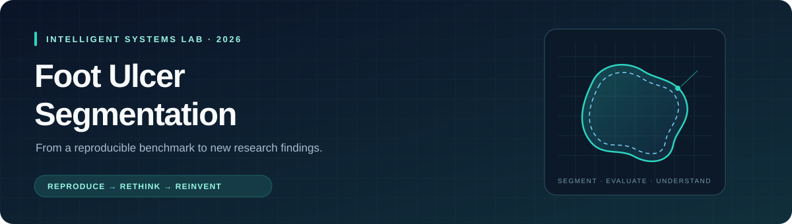

<div align="center">



<br />

**Reproducing FUSegNet. Understanding its limits. Exploring what comes next.**


[Overview](#overview) · [CP1 results](notebooks/01_cp1_analysis.ipynb) · [Research plan](#research-plan) · [Benchmark](#benchmark) · [Repository](#repository) · [Getting started](#getting-started)

</div>

## Overview

This project investigates **foot ulcer segmentation** through reproduction of FUSegNet and controlled experiments extending the baseline. It is developed for the **Intelligent Systems Lab FILKOM 2026** internship program.

The research follows three steps: **reproduce** the reference method, **rethink** its behavior through analysis and ablations, and **reinvent** through a testable extension. FUSegNet is our benchmark; the project's scope includes both reproduction and further development.

> [!NOTE]
> **Current status: baseline training, test evaluation, and initial analysis completed.** The public-source-data run achieves **92.29% data-based test Dice** and **86.42% image-based test Dice** with offline evaluator semantics. Training stopped at epoch 82; the source policy selected epoch 52. Dataset counts / original split and evaluator uncertainties limit direct equivalence to the paper. See the [results and limitations](reports/cp1-baseline-01.md) and [notebook instructions](notebooks/README.md).

**[Open the fully executed CP1 notebook →](notebooks/01_cp1_analysis.ipynb)**<br />
24 executed code cells · 6 analysis figures · 5 prediction galleries / 15 examples<br />
Learning curves, paper comparison, **PFOM boundary evaluation**, error analysis, and source image / ground truth / prediction / overlay panels are embedded and ready to view on GitHub. Test mean PFOM is **0.7782** with the documented empty-edge policy; the sentinel-2 proxy is reported separately in the [PFOM report](reports/cp1-pfom-01.md).

**CP1 attention ablations completed:** full P-scSE achieves **86.42% image Dice / 0.7782 PFOM**, versus additive-only **84.81% / 0.7554** and maxout-only **84.65% / 0.7613**. These are one-seed test comparisons with the same split and evaluator. [Open the executed comparison notebook](notebooks/02_cp1_attention_ablation.ipynb) · [Read the report](reports/cp1-attention-ablation-01.md) · [Protocol](docs/attention-ablations.md).

<!-- XFUSEGNET_STATUS -->
**x-FUSegNet reproduction completed:** five-fold training on FUSeg 512×512, **88.03% internal OOF image Dice**, and 200 verified test ensemble predictions. Official challenge test metrics remain unavailable because test masks are private. [Open the executed notebook](notebooks/03_cp1_xfusegnet.ipynb) · [Read the report](reports/cp1-xfusegnet-01.md).
<!-- /XFUSEGNET_STATUS -->

**[Open the executed CP1 train-data EDA →](notebooks/04_cp1_eda.ipynb)** · [Report](reports/cp1-eda-01.md) · [Slide figures, PNG/SVG](reports/figures/cp1-eda-01/).
The saved baseline manifest identifies **707 actual training pairs**: wound pixels occupy **2.70%** of the full mask canvas, with **43 empty GT masks**. The notebook connects these observations to the paper's rationale for Focal Loss and augmentation, and demonstrates the original paired preprocessing pipeline. These descriptive findings do not establish method superiority. Full-canvas padding, retained duplicates, and unverified patient independence remain limitations. The [manifest copy](reports/tables/cp1-eda-split-manifest.json), per-image table, replay configuration, and verification record are included; raw datasets, checkpoints, and tensors stay local.

## Research plan

| Phase | Focus | Evidence to produce |
| :--- | :--- | :--- |
| **01 · Reproduce** | Audit data, inspect the reference implementation, and reproduce FUSegNet | Documented protocol, trained baseline, metrics, and prediction examples |
| **02 · Rethink** | Examine failure cases and run controlled ablations | Analysis by wound size, boundary quality, and false positives / negatives |
| **03 · Reinvent** | Select and evaluate an extension | Fair comparisons, ablation evidence, and discussion of gains and tradeoffs |

- [ ] **Checkpoint 1 · Tentative late October 2026:** reproduction, a working deep learning model, and initial analysis / ablations.
- [ ] **Checkpoint 2 · Tentative mid-November 2026:** extension experiments, new findings, and final research artifacts.

The extension is **not selected yet**. Candidate research questions and decision criteria live in the [roadmap](docs/roadmap.md).

## Benchmark

**FUSegNet: A Deep Convolutional Neural Network for Foot Ulcer Segmentation**<br />
Mrinal Kanti Dhar, Taiyu Zhang, Yash Patel, Sandeep Gopalakrishnan, and Zeyun Yu · 2023<br />
[Read the reference paper ↗](https://arxiv.org/abs/2305.02961v2)

FUSegNet combines a pretrained **EfficientNet-B7 encoder** with a decoder using **parallel spatial and channel squeeze-and-excitation (P-scSE)** attention. The attention module combines additive and max-out scSE branches, with a shorted variant in the final decoder stage. **x-FUSegNet** averages predictions from five models trained using 5-fold cross-validation.

| Dataset / evaluation | Model | Paper Dice | Our Dice |
| :--- | :--- | ---: | ---: |
| Chronic Wound · data-based | FUSegNet | **92.70%** | **92.29%** |
| Chronic Wound · image-based | FUSegNet | **86.05%** | **86.42%** |
| FUSeg Challenge 2021 · data-based | x-FUSegNet | **89.23%** | — |

The table above lists paper reference protocols. Our completed source-data run uses 278 test images rather than the paper's stated 200, so its **92.29% / 86.42%** Dice scores are reported separately in the [run report](reports/cp1-baseline-01.md).

**Evaluation details matter.** Data-based Dice aggregates pixel counts across the dataset; image-based Dice averages per-image scores. The Chronic Wound images overlap with the FUSeg dataset, and the paper describes the FUSeg test masks as private. These results need separate, clearly identified evaluation protocols.

See the [benchmark protocol](docs/benchmark.md) and [paper reference configuration](configs/paper_reference.yaml) for reported settings and details still to verify.

## Repository

```text
foot-ulcer-segmentation/
├── assets/                 # README visuals
├── configs/                # Reference settings and future run configs
├── data/                   # Local datasets; contents excluded from Git
├── docs/
│   ├── benchmark.md        # Data, architecture, training, and evaluation protocol
│   ├── datasets.md         # Download provenance, inventory, and data audit
│   ├── experiment-log.md   # Run records and results index
│   ├── references.bib      # Reference paper citation
│   ├── reference-audit.md  # Source behavior, CPU probes, and paper discrepancies
│   └── roadmap.md          # Checkpoints, deliverables, and research questions
├── notebooks/              # Executed CP1 analysis and prediction visualization
├── outputs/                # Local checkpoints and predictions; excluded from Git
├── reports/                # Shareable research findings and figures
├── scripts/                # Reproducible dataset preparation and audit
├── source/                 # Local reference documents; excluded from Git
├── src/                    # Reference-code training and evaluation package
└── tests/                  # Metric parity, checkpoint resume, and data integrity
```

## Getting started

```bash
git clone https://github.com/maulnite/foot-ulcer-segmentation.git
cd foot-ulcer-segmentation
```

1. Read the [roadmap](docs/roadmap.md) and [benchmark protocol](docs/benchmark.md).
2. Read the [dataset audit](docs/datasets.md). Both datasets are prepared locally; use `python scripts/prepare_datasets.py` to download or re-audit them on another checkout. Review the count mismatch, split overlap, mask policy, and licensing before training.
3. Read the [reference implementation audit](docs/reference-audit.md) and [code settings](configs/code_reference.json); carry unresolved discrepancies into the reproduction record.
4. Follow the [training guide](docs/training.md) to create the isolated environment, prepare persisted splits, and run the smoke test.

The runnable baseline is [`configs/baseline.json`](configs/baseline.json). [`requirements-training.lock.txt`](requirements-training.lock.txt) records the validated training/test environment. The paper YAML and code-reference JSON remain separate evidence records. Full training and final test evaluation are separate commands; smoke metrics are diagnostic only.

## Experiment discipline

- Keep validation and test evaluation separate. Select models and tune thresholds using validation data.
- Track seeds, split manifests, environment versions, configuration, metrics, and artifact paths for every substantial run.
- Distinguish **paper results**, **local validation**, and **official challenge evaluation**.
- Change one factor at a time for ablations and compare extensions under the same protocol.
- Keep bulk raw datasets, model weights, environments, and personal documents out of Git. The executed CP1 notebook publishes selected dataset images, ground-truth masks, predictions, and error overlays as analysis examples, with source attribution. Full datasets and standalone prediction caches remain local.

Use the [experiment log](docs/experiment-log.md) to record runs. Weekly updates should cover completed work, decisions, next steps, and blockers.

## Planned deliverables

Public research code and documentation · reproducible experiment records · project report · presentation slides for both checkpoints · best model artifact

Model artifacts can be distributed separately once dataset and model licensing have been checked. No model artifacts are available yet.

<details>
<summary><strong>Reference citation</strong></summary>

```bibtex
@misc{dhar2023fusegnet,
  title         = {FUSegNet: A Deep Convolutional Neural Network for Foot Ulcer Segmentation},
  author        = {Dhar, Mrinal Kanti and Zhang, Taiyu and Patel, Yash and
                   Gopalakrishnan, Sandeep and Yu, Zeyun},
  year          = {2023},
  eprint        = {2305.02961},
  archivePrefix = {arXiv},
  primaryClass  = {cs.CV},
  url           = {https://arxiv.org/abs/2305.02961v2}
}
```

</details>
