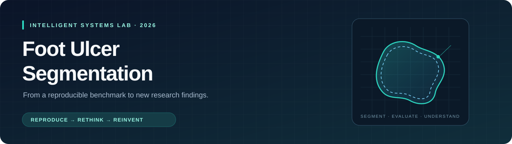
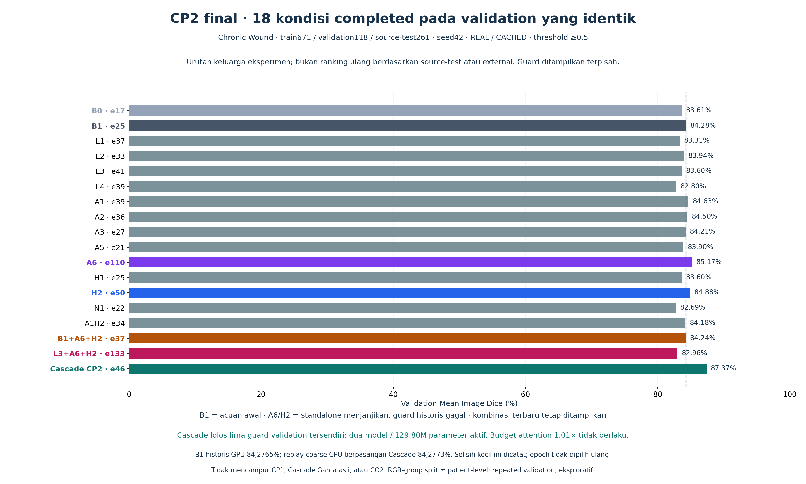

<div align="center">



<br />

**Reproducing FUSegNet. Understanding its limits. Exploring what comes next.**


[Overview](#overview) · [CP2 results](#cp2-results) · [Model weights](https://huggingface.co/maulnite/foot-ulcer-segmentation-weights) · [Presentation figures](reports/cp2-presentation-final-visual-index.md) · [Releases](https://github.com/maulnite/foot-ulcer-segmentation/releases) · [Getting started](#getting-started)

</div>

## Overview

This project investigates **foot ulcer segmentation** through reproduction of FUSegNet and controlled experiments extending the baseline. It is developed for the **Intelligent Systems Lab FILKOM 2026** internship program.

The research follows three steps: **reproduce** the reference method, **rethink** its behavior through analysis and ablations, and **reinvent** through a testable extension. FUSegNet is our benchmark; the project's scope includes both reproduction and further development.

> [!NOTE]
> **CP2 research and publication completed · 21 November 2026.** Controlled baseline/loss/attention/auxiliary/presence experiments, seed confirmation, combinations, the final Cascade, external analysis, and presentation evidence are available. Cascade was selected using its source-validation guards; source-test and external findings remain descriptive. This is research evidence, not clinical validation.

| Start here | Link |
| :--- | :--- |
| Final findings | [Cascade CP2 report](reports/cp2-cascade-clean.md) · [All phase reports](reports/README.md) |
| Presentation evidence | [Visual index, slides 13–16](reports/cp2-presentation-final-visual-index.md) · [Earlier visual index](reports/cp2-presentation-visual-index.md) |
| Orie + Ganta weights | [Hugging Face archive](https://huggingface.co/maulnite/foot-ulcer-segmentation-weights) · [Complete catalog](https://huggingface.co/maulnite/foot-ulcer-segmentation-weights/blob/main/CATALOG.md) |
| Downloadable package | [CP2 final release](https://github.com/maulnite/foot-ulcer-segmentation/releases/tag/cp2-final-2026-11-21) · [Release guide](docs/releases.md) |
| Partner implementations | [Ganta scripts and overview](https://github.com/maulnite/foot-ulcer-segmentation/tree/ganta/notebook) · [Ganta weights](https://huggingface.co/maulnite/foot-ulcer-segmentation-weights/tree/main/ganta) |

## CP2 results

The main controlled cohort contains **671 train / 118 validation / 261 source-test images**. Exact decoded-RGB groups are separated and annotation conflicts quarantined. **Patient identities are unavailable**, so this is not a patient-level split. Models retain their original phase-specific guards and final probability threshold **≥0.5**.

The final Cascade uses **frozen B1 coarse segmentation + a separately trained refiner**, selected at **epoch 46**. Inference proposals come exclusively from coarse predictions. Training crops may use training GT; validation/test crops do not use GT.

| Evaluation | n | B1 Image Dice | Cascade Image Dice | B1 Data Dice | Cascade Data Dice | GT-positive misses, B1 → Cascade |
| :--- | ---: | ---: | ---: | ---: | ---: | ---: |
| Source validation | 118 | 84.28% | 87.37% | 91.51% | 92.88% | 0 → 0 |
| Source-test · descriptive | 261 | 83.29% | 85.86% | 90.77% | 92.78% | 4 → 3 |
| CO2Wounds · external, descriptive | 558 | 39.33% | 42.27% | 54.69% | 58.99% | 143 → 153 |

**Interpretation:** source-validation small-wound Dice and boundary IoU also improve, without additional validation total misses or GT-empty FP images. **External aggregate scores improve while entirely missed positive images increase from 143 to 153.** All 558 eligible external masks are positive, and external evaluation uses a native-resolution grid. Neither source-test nor external scores were used to select the final candidate.

Image Dice averages image scores; Data Dice pools pixel counts. Misses count GT-positive images with no true-positive overlap, which need not have an empty predicted mask. The paired values above use the same CPU inference pipeline; small differences from historical GPU caches are documented in the [canonical report](reports/cp2-cascade-clean.md). Cascade has two models and additional proposal forwards: the original **1.01× single-model attention budget does not apply**. One exploratory Cascade seed and previously examined cohorts limit generalization claims.



The scoreboard retains each phase's original guards rather than imposing a retrospective selection rule. See the [figure interpretation and provenance](reports/cp2-presentation-final-visual-index.md).

| Research stage | Evidence |
| :--- | :--- |
| P · Protocol and baseline | [Pair/duplicate audit, B0 source loss and B1 corrected focal input](reports/cp2-phase-p.md) |
| L · Loss screening | [Alternative losses under the controlled protocol](reports/cp2-phase-l.md) |
| A · Attention screening | [Local attention/fusion, capacity control, CBAM, and validation decision](reports/cp2-phase-a-review.md) |
| H · Auxiliary supervision | [Deep supervision and boundary auxiliary experiments](reports/cp2-phase-h.md) |
| N · Presence supervision | [Presence-head experiment and false-positive guards](reports/cp2-phase-n.md) |
| C · Combinations | [A1+H2](reports/cp2-phase-c.md) · [B1+A6+H2 and L3+A6+H2](reports/cp2-phase-c-combinations.md) |
| Cascade · Crop-refine | [Final controlled experiment and external trade-offs](reports/cp2-cascade-clean.md) |
| Sensitivity and replication | [Three-seed confirmation](reports/cp2-confirmation.md) · [CP1-recipe study](reports/cp2-cp1-recipe.md) · [Matched CP1 study](reports/cp1-matched.md) |
| External and partner analysis | [Frozen-checkpoint CO2Wounds evaluation](reports/cp2-external-evaluation.md) · [Original Ganta Cascade replay](reports/ganta-cascade-replay.md) |

Completed screening does not imply every roadmap proposal was run. H3 and confirmatory multiseed/clinical Cascade evaluation remain future research. Single-model A/H/N/C guards did not yield a consistently accepted replacement for B1; the final two-model Cascade is a separate experiment with its stated cost and validation guards.

## Model weights

**171 original checkpoint paths** are published: **134 Orie + 37 Ganta**, with SHA256 verification and a browsable [catalog](https://huggingface.co/maulnite/foot-ulcer-segmentation-weights/blob/main/CATALOG.md). The archive separates selected checkpoints, final/resume states, initializers, and engineering-smoke outputs; these are not 171 distinct architectures. Eight old Ganta directories without weights are listed transparently.

[Download/loading guide](docs/model-checkpoints.md) · [Archive and reproducible publication](docs/huggingface-weights.md) · [Verified publication report](reports/huggingface-weights-publication.md).

## CP1 historical results

The following results retain their original CP1 cohorts, checkpoint policy, and evaluator. They are not pooled with controlled CP2 or used as a cross-protocol ranking.

**[Open the fully executed CP1 notebook →](notebooks/01_cp1_analysis.ipynb)**<br />
24 executed code cells · 6 analysis figures · 5 prediction galleries / 15 examples<br />
Learning curves, paper comparison, **PFOM boundary evaluation**, error analysis, and source image / ground truth / prediction / overlay panels are embedded and ready to view on GitHub. Test mean PFOM is **0.7782** with the documented empty-edge policy; the sentinel-2 proxy is reported separately in the [PFOM report](reports/cp1-pfom-01.md).

**CP1 attention ablations completed:** full P-scSE achieves **86.42% image Dice / 0.7782 PFOM**, versus additive-only **84.81% / 0.7554** and maxout-only **84.65% / 0.7613**. These are one-seed test comparisons with the same split and evaluator. [Open the executed comparison notebook](notebooks/02_cp1_attention_ablation.ipynb) · [Read the report](reports/cp1-attention-ablation-01.md) · [Protocol](docs/attention-ablations.md).

<!-- XFUSEGNET_STATUS -->
**x-FUSegNet reproduction completed:** five-fold training on FUSeg 512×512, **88.03% internal OOF image Dice**, and 200 verified test ensemble predictions. Official challenge test metrics remain unavailable because test masks are private. [Open the executed notebook](notebooks/03_cp1_xfusegnet.ipynb) · [Read the report](reports/cp1-xfusegnet-01.md).
<!-- /XFUSEGNET_STATUS -->

**[Open the executed CP1 train-data EDA →](notebooks/04_cp1_eda.ipynb)** · [Report](reports/cp1-eda-01.md) · [Slide figures, PNG/SVG](reports/figures/cp1-eda-01/).
The saved baseline manifest identifies **707 actual training pairs**: wound pixels occupy **2.70%** of the full mask canvas, with **43 empty GT masks**. The notebook connects these observations to the paper's rationale for Focal Loss and augmentation, and demonstrates the original paired preprocessing pipeline. These descriptive findings do not establish method superiority. Full-canvas padding, retained duplicates, and unverified patient independence remain limitations. The [manifest copy](reports/tables/cp1-eda-split-manifest.json), per-image table, replay configuration, and verification record are included; raw datasets and tensors remain local; available checkpoints are mirrored in the verified model archive above.

## Research plan

| Phase | Focus | Evidence to produce |
| :--- | :--- | :--- |
| **01 · Reproduce** | Audit data, inspect the reference implementation, and reproduce FUSegNet | Documented protocol, trained baseline, metrics, and prediction examples |
| **02 · Rethink** | Examine failure cases and run controlled ablations | Analysis by wound size, boundary quality, and false positives / negatives |
| **03 · Reinvent** | Select and evaluate an extension | Fair comparisons, ablation evidence, and discussion of gains and tradeoffs |

- [x] **Checkpoint 1 research artifacts:** reproduction, a trained model, initial analysis, and attention ablations.
- [x] **Checkpoint 2 implemented artifacts:** controlled experiments, final Cascade evaluation, figures, model archive, and reproducibility records.

Cascade is the final candidate under its stated source-validation guards. Deferred research and methodological limitations remain explicit in the [roadmap](docs/roadmap.md); publication does not assert clinical or confirmatory superiority.

## Benchmark

The comparison below is the historical CP1 reproduction context. CP2 uses a separately audited cohort and is summarized above.

**FUSegNet: A Deep Convolutional Neural Network for Foot Ulcer Segmentation**<br />
Mrinal Kanti Dhar, Taiyu Zhang, Yash Patel, Sandeep Gopalakrishnan, and Zeyun Yu · 2023<br />
[Read the reference paper ↗](https://arxiv.org/abs/2305.02961v2)

FUSegNet combines a pretrained **EfficientNet-B7 encoder** with a decoder using **parallel spatial and channel squeeze-and-excitation (P-scSE)** attention. The attention module combines additive and max-out scSE branches, with a shorted variant in the final decoder stage. **x-FUSegNet** averages predictions from five models trained using 5-fold cross-validation.

| Dataset / evaluation | Model | Paper Dice | Our Dice |
| :--- | :--- | ---: | ---: |
| Chronic Wound · data-based | FUSegNet | **92.70%** | **92.29%** |
| Chronic Wound · image-based | FUSegNet | **86.05%** | **86.42%** |
| FUSeg Challenge 2021 · data-based | x-FUSegNet | **89.23%** | — |

The table above lists paper reference protocols. Our completed source-data run uses 278 test images rather than the paper's stated 200, so its **92.29% / 86.42%** Dice scores are reported separately in the [run report](reports/cp1-baseline-01.md).

**Evaluation details matter.** Data-based Dice aggregates pixel counts across the dataset; image-based Dice averages per-image scores. The Chronic Wound images overlap with the FUSeg dataset, and the paper describes the FUSeg test masks as private. These results need separate, clearly identified evaluation protocols.

See the [benchmark protocol](docs/benchmark.md) and [paper reference configuration](configs/paper_reference.yaml) for reported settings and details still to verify.

## Repository

```text
foot-ulcer-segmentation/
├── assets/                 # README visuals
├── configs/                # Reference settings and completed CP1/CP2 configs
├── data/                   # Local datasets; contents excluded from Git
├── docs/
│   ├── benchmark.md        # Data, architecture, training, and evaluation protocol
│   ├── datasets.md         # Download provenance, inventory, and data audit
│   ├── experiment-log.md   # Run records and results index
│   ├── references.bib      # Reference paper citation
│   ├── reference-audit.md  # Source behavior, CPU probes, and paper discrepancies
│   └── roadmap.md          # Checkpoints, deliverables, and research questions
├── notebooks/              # Executed CP1 analysis and prediction visualization
├── outputs/                # Local checkpoints and predictions; excluded from Git
├── reports/                # CP1/CP2 findings, tables, QA, and presentation figures
├── scripts/                # Reproducible dataset preparation and audit
├── source/                 # Local reference documents; excluded from Git
├── src/                    # Reference-code training and evaluation package
└── tests/                  # Metric parity, checkpoint resume, and data integrity
```

## Getting started

```bash
git clone https://github.com/maulnite/foot-ulcer-segmentation.git
cd foot-ulcer-segmentation
```

1. For viewing results, start with [CP2 reports](reports/README.md), [presentation figures](reports/cp2-presentation-final-visual-index.md), or [model downloads](docs/model-checkpoints.md). For execution, choose a protocol: [CP1](docs/benchmark.md), [controlled CP2](docs/cp2-phase-p.md), or [Cascade CP2](docs/cp2-cascade-clean.md).
2. Read the [dataset audit](docs/datasets.md). Both datasets are prepared locally; use `python scripts/prepare_datasets.py` to download or re-audit them on another checkout. Review the count mismatch, split overlap, mask policy, and licensing before training.
3. Read the [reference implementation audit](docs/reference-audit.md) and [code settings](configs/code_reference.json); carry unresolved discrepancies into the reproduction record.
4. Follow the [training guide](docs/training.md) to create the isolated environment, prepare persisted splits, and run the smoke test.

The runnable baseline is [`configs/baseline.json`](configs/baseline.json). [`requirements-training.lock.txt`](requirements-training.lock.txt) records the validated training/test environment. The paper YAML and code-reference JSON remain separate evidence records. Full training and final test evaluation are separate commands; smoke metrics are diagnostic only.

## Experiment discipline

- Keep validation and test evaluation separate. Select models and tune thresholds using validation data.
- Track seeds, split manifests, environment versions, configuration, metrics, and artifact paths for every substantial run.
- Distinguish **paper results**, **local validation**, and **official challenge evaluation**.
- Change one factor at a time for ablations and compare extensions under the same protocol.
- Keep bulk raw datasets, model weights, environments, and personal documents out of Git. The executed CP1 notebook publishes selected dataset images, ground-truth masks, predictions, and error overlays as analysis examples, with source attribution. Full datasets and standalone prediction caches remain local.

Use the [experiment log](docs/experiment-log.md) to record runs. Weekly updates should cover completed work, decisions, next steps, and blockers.

## Published artifacts

Public research code and documentation · reproducible experiment records · completed research reports · presentation-ready scientific figures · all available checkpoint weights

**Latest package:** [CP2 final research release](https://github.com/maulnite/foot-ulcer-segmentation/releases/tag/cp2-final-2026-11-21), with catalogs, integrity evidence, and the final presentation figure bundle. All 171 checkpoint paths are hosted in the [verified Hugging Face archive](https://huggingface.co/maulnite/foot-ulcer-segmentation-weights).

**Best-model downloads are available as GitHub Releases:** [Orie x-FUSegNet](https://github.com/maulnite/foot-ulcer-segmentation/releases/tag/cp1-xfusegnet-orie-weights-v1) and [Ganta x-FUSegNet](https://github.com/maulnite/foot-ulcer-segmentation/releases/tag/cp1-xfusegnet-ganta-weights-v1). Each contains five original best checkpoints, checksums, and model metadata (approximately 4 GB per run). See [download and loading instructions](docs/model-checkpoints.md). Raw datasets remain local; model files are release assets outside Git history.

<details>
<summary><strong>Reference citation</strong></summary>

```bibtex
@misc{dhar2023fusegnet,
  title         = {FUSegNet: A Deep Convolutional Neural Network for Foot Ulcer Segmentation},
  author        = {Dhar, Mrinal Kanti and Zhang, Taiyu and Patel, Yash and
                   Gopalakrishnan, Sandeep and Yu, Zeyun},
  year          = {2023},
  eprint        = {2305.02961},
  archivePrefix = {arXiv},
  primaryClass  = {cs.CV},
  url           = {https://arxiv.org/abs/2305.02961v2}
}
```

</details>
