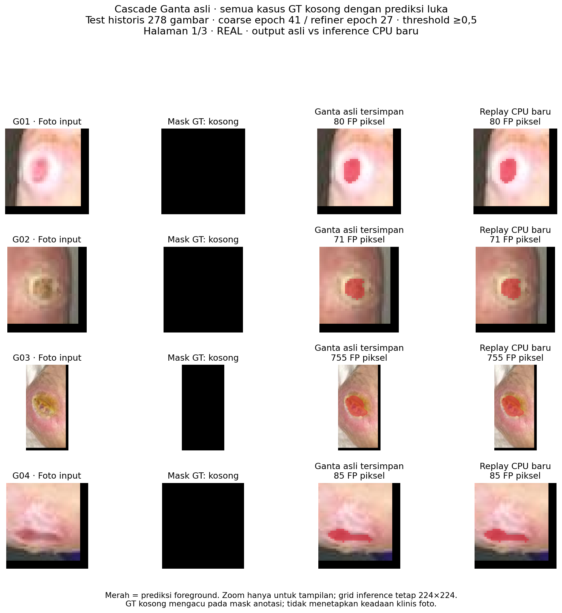
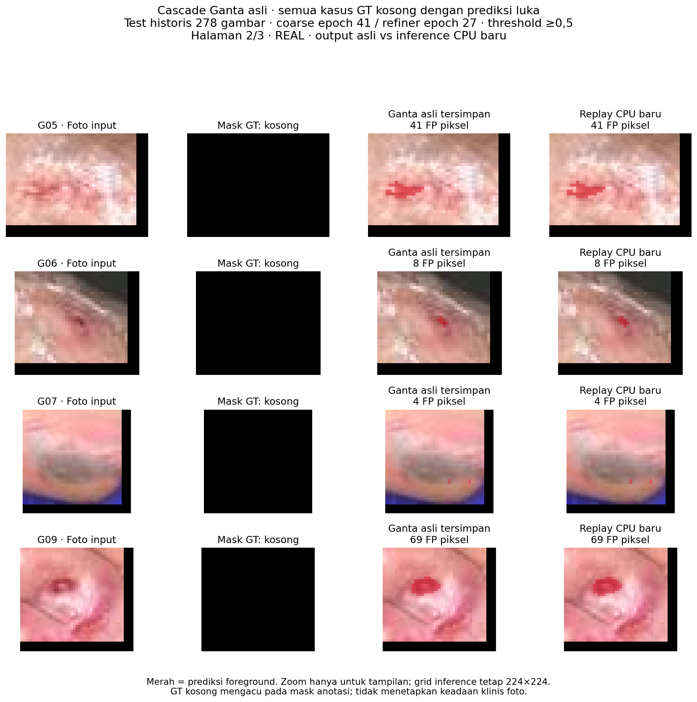
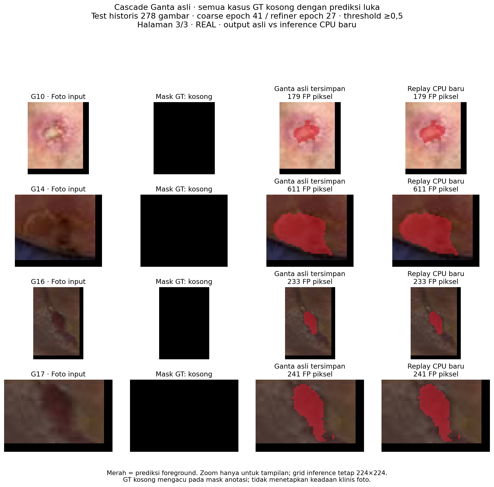
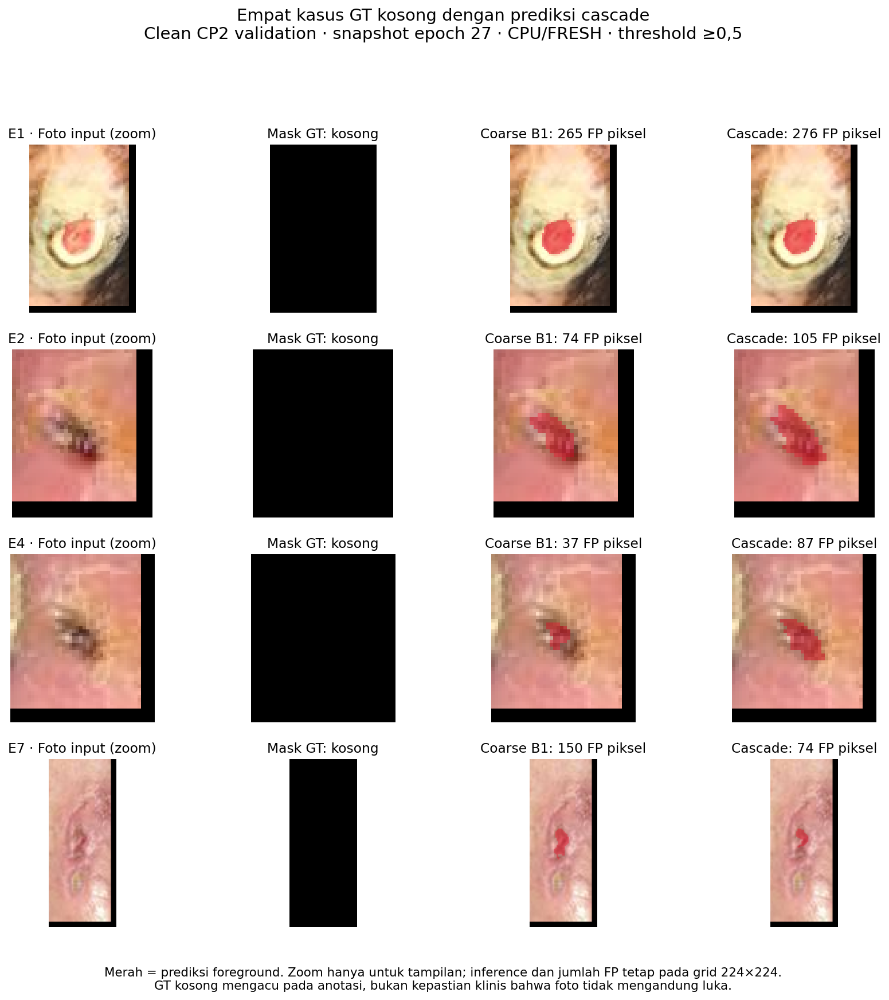

# Cascade — pemeriksaan prediksi pada GT kosong

**COMPLETED — DIAGNOSTIC INFERENCE, bukan training baru.** Dua pemeriksaan berikut memakai **model dan subset berbeda**; angka 7 dan 17 tidak boleh dicampur sebagai satu evaluasi.

| Pemeriksaan | Populasi asal | GT kosong diperiksa | Coarse dengan FP | Cascade dengan FP | FP pixels coarse → cascade |
| :--- | :--- | ---: | ---: | ---: | ---: |
| **Checkpoint asli Ganta** | Test historis 278 foto | **17** | 13/17 | **12/17** | 2.578 → 2.377 |
| Adaptasi Ganta ke Orie CP2, **snapshot sementara epoch27** | Validation bersih 118 foto | **7** | 4/7 | **4/7** | 526 → 542 |

FP (*false positive*) berarti piksel yang diprediksi sebagai luka ketika mask GT memberi label background. Satu gambar dihitung memiliki FP bila sedikitnya satu piksel melewati threshold **≥0,5**. Foto utuh tetap menjadi unit evaluasi; crop tidak dihitung sebagai observasi independen.

## 1. Cascade Ganta asli

Dua checkpoint asli partner digunakan: **coarse epoch41** dan **refiner epoch27**. Arsitektur, normalisasi ImageNet, proposal threshold0,3, connected components minimal4px, maksimal5 kandidat, crop margin0,5 dan threshold akhir0,5 berasal dari source Ganta. Tidak memakai bobot atau konfigurasi training CP2 Orie.

Seluruh **17 GT kosong dari 278 test historis** diperiksa ulang dengan CPU FP32, dua thread. Load state_dict strict lulus, tidak ada training atau update BatchNorm. Prediksi biner baru pada ketujuh belas foto **identik per piksel dengan PNG asli Ganta**: 0 piksel berubah. Ini khusus subset GT kosong; replay terdahulu atas seluruh278 tetap memiliki44 piksel berbeda dan catatan tersebut tidak diubah.

**Yang terlihat:** cascade mengurangi jumlah foto dengan FP dari13 menjadi12 dan total area FP dari2.578 menjadi2.377 piksel. **Artinya:** refinement menghapus satu kasus FP, tetapi12 dari17 mask kosong masih memperoleh prediksi foreground. **Perlu diingat:** ini checkpoint/split historis yang telah memiliki keterbatasan overlap RGB dan validasi crop GT; bukan hasil split bersih Orie atau bukti generalisasi klinis.

Seluruh12 kasus FP ditampilkan menurut urutan nama file, empat per halaman. Kolom memperlihatkan foto, GT, output asli tersimpan, dan inference ulang CPU. Merah adalah prediksi foreground. Zoom hanya untuk tampilan; inference dan hitungan piksel tetap pada grid224×224.

[Metrik seluruh17 foto](tables/cascade-empty-gt-original-ganta.csv) · [Provenance/hasil JSON](cascade-empty-gt-original-ganta.json) · [Replay seluruh278](ganta-cascade-replay.md).

## 2. Adaptasi Ganta ke protokol Orie — diagnostik sementara

Ini model berbeda: coarse adalah B1 CP2 yang dibekukan, sedangkan refiner dilatih baru pada split671/118/261. Snapshot best epoch27 dipertahankan dengan hard link terpisah dari checkpoint yang terus diperbarui training. Pemeriksaan selesai pada **tujuh mask kosong dalam validation118**, bukan pada test historis Ganta.

Keempat kasus dengan prediksi cascade ditampilkan seluruhnya. Jumlah foto FP sama dengan coarse, tetapi luas FP total bertambah16 piksel. Ini **bukan evaluasi akhir** atau pemilihan ulang checkpoint/threshold. Training tetap berjalan tanpa perubahan; test261 dan CO2 tidak dibuka untuk diagnostik ini. Checkpoint Ganta asli **belum diuji pada tujuh foto validation Orie yang sama** dalam pemeriksaan ini.

[Seluruh tujuh kasus, termasuk yang tanpa FP](figures/cascade-empty-gt-audit/cp2-epoch27-all.png) · [Metrik CSV](tables/cascade-empty-gt-cp2-epoch27.csv) · [Provenance JSON](cascade-empty-gt-cp2-interim.json).

## Kualitas anotasi dan atribusi

Beberapa foto menunjukkan area yang secara visual menyerupai luka walaupun seluruh mask GT bernilai nol. Hal ini menandai kebutuhan audit anotasi, **bukan penetapan diagnosis atau koreksi label otomatis**. Seluruh hitungan tetap mengikuti mask dataset. Foto dengan mask kosong tidak otomatis membuktikan foto bebas luka secara klinis.

Sumber contoh: [uwm-bigdata/wound-segmentation](https://github.com/uwm-bigdata/wound-segmentation/tree/42a272dfe0679f20675e826385925cb7562934b6), Chronic Wound/AZH wound-care-center patches, commit42a272dfe0679f20675e826385925cb7562934b6. Panel analisis mengikuti praktik contoh terpilih notebook CP1 dengan atribusi; [audit dataset dan keterbatasan lisensi](../docs/datasets.md) tetap berlaku. Dataset lengkap, mask/probability caches dan checkpoint tidak dimirror ke Git. Semua media dan file partner asli tetap utuh.

Reproduksi checkpoint asli mengikuti [panduan replay Ganta](../docs/ganta-cascade-replay.md). Bukti diagnostik lokal: `outputs/partner-cascade-diagnostics/20261119T144435Z` dan `outputs/cp2/diagnostics/cascade_empty/20261119T143731Z`; kode diagnostik dan cache numerik lengkap disimpan append-only di sana. [QA dan visual review](cascade-empty-gt-validation.json).
