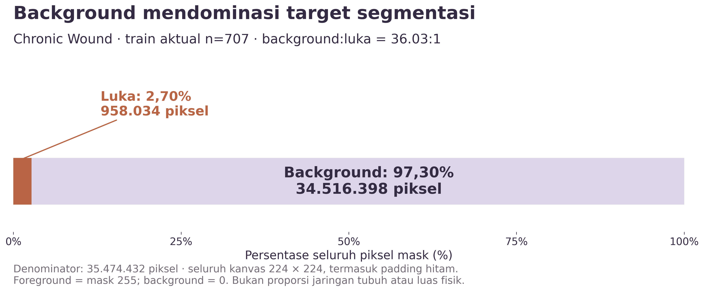
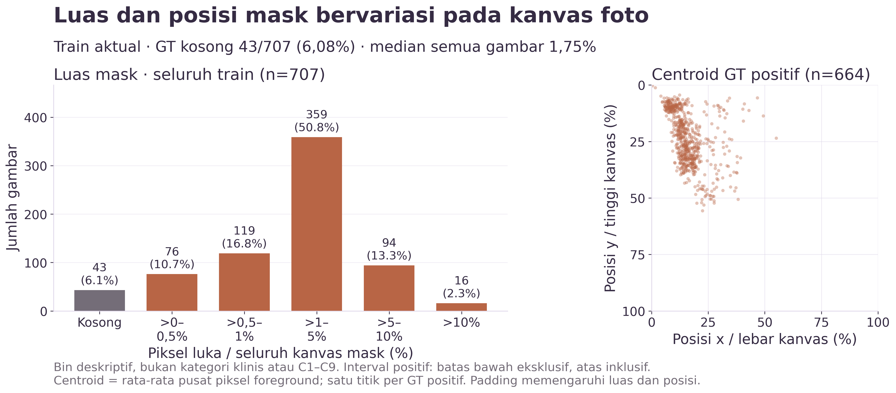
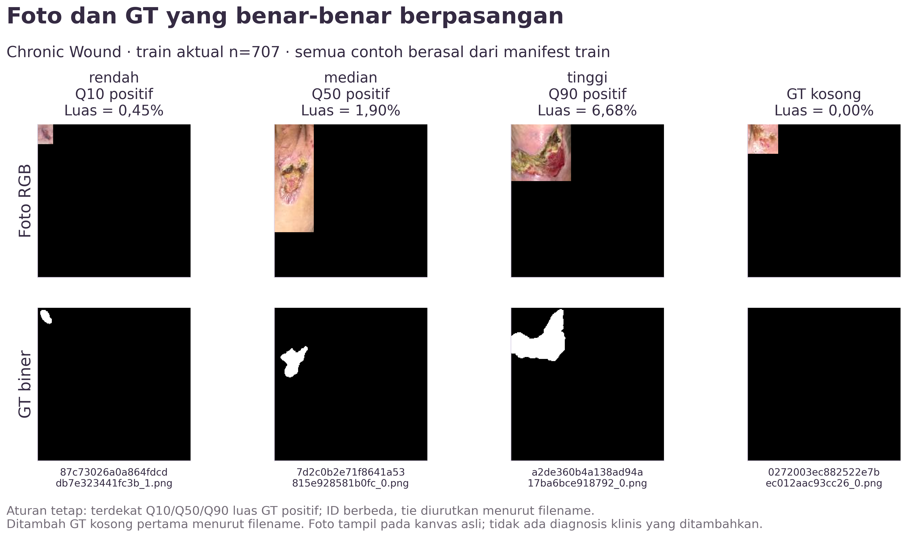
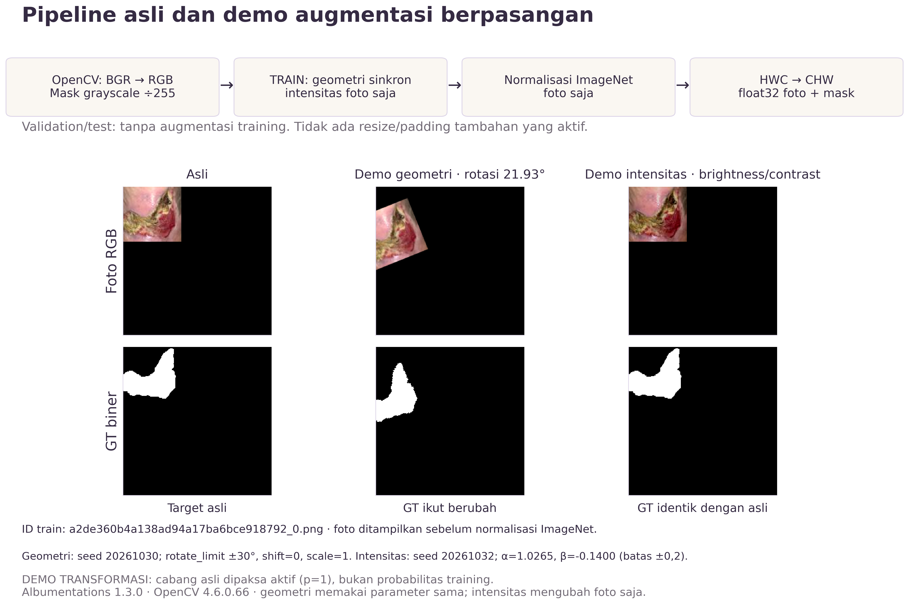

# CP1 · EDA train aktual dan preprocessing baseline

## FAKTA DATASET DARI EDA KAMI

Yang dianalisis adalah **707 foto + 707 GT** Chronic Wound pada train aktual `cp1-baseline-01`, bukan seluruh 831 source train. Membership dibaca langsung dari manifest yang disalin ke run selesai; tidak ada split baru, shuffle ulang, deduplikasi, training, atau inference. Tidak ada statistik piksel validation/test yang dicampurkan.

### Identitas data dan audit

- Manifest aktual lokal: `outputs/runs/cp1-baseline-01/split-manifest.json`. [Salinan publik byte-identik](tables/cp1-eda-split-manifest.json) disertakan agar membership dapat diaudit tanpa membentuk split baru.
- SHA-256 file: `596e3b0d61e372eb9001bbd8c567f6345e986e498f74b3514b96f6f9f954e5a2`.
- Fingerprint isi manifest: `7937d6b039db4eedf736dd0482a6379917fd9640d39d03c2c5fdac5047166925`; cocok dengan `environment.json` dan `status.json` run.
- Konfigurasi run: `outputs/runs/cp1-baseline-01/config.json`; SHA-256 `0231f9008e0cf6d311fb201af386b317f44122355a002a4a1a83bc10796d7e41`.
- 707 filename unik. Semua pasangan memakai filename sama, path unik, SHA-256 foto/mask cocok manifest, resolusi **224 × 224** untuk foto dan mask.
- Mask mentah terverifikasi hanya memiliki nilai **[0, 255]**. Mask RGB yang tersimpan memiliki tiga kanal identik. Nilai diperiksa sebelum binarisasi; foreground = grayscale **255**, background = **0**. Mask kosong ditentukan oleh tidak adanya piksel 255.
- Membership train/validation tidak beririsan menurut filename/path. Train/test diperiksa menurut path sumber, karena filename lintas direktori dapat berulang. Kesamaan isi RGB merupakan audit berbeda dan tetap menjadi keterbatasan.

### Angka utama

| Ukuran | Hasil |
| --- | --- |
| Jumlah foto / mask train | 707 / 707 |
| GT kosong | 43 (6,08%) |
| GT positif | 664 (93,92%) |
| Seluruh piksel mask | 35.474.432 |
| Piksel foreground / luka | 958.034 (2,7006%) |
| Piksel background / nonluka | 34.516.398 (97,2994%) |
| Rasio background:foreground | 36.0284:1 |



### Definisi dan denominator

`foreground_pct_global = Σ foreground_pixels / Σ(H × W) × 100`.
`background_pct_global = Σ background_pixels / Σ(H × W) × 100`.
`area_fraction_i = foreground_pixels_i / (H_i × W_i)`; persentase per gambar = `100 × area_fraction_i`.
Seluruh kanvas **termasuk padding hitam bawaan** dihitung; denominator bukan area tubuh, bukan area jaringan, dan bukan luas fisik. Rasio BG:FG adalah total background dibagi total foreground; bila foreground nol, kode menghasilkan JSON `null`, bukan pembagian nol.

Rata-rata persentase per gambar seluruh train = **2,7006%**, sama dengan persentase global karena semua resolusi seragam dan cakupan gambarnya sama. Rata-rata khusus GT positif mempunyai denominator gambar berbeda dan dilaporkan terpisah.

### Distribusi luas

Semua angka luas berikut dalam **persen seluruh kanvas mask**, kuantil linear (`numpy.quantile(method='linear')`).

| Cakupan | n | Min (%) | Q1 (%) | Median (%) | Q3 (%) | Max (%) | Mean (%) |
| --- | --- | --- | --- | --- | --- | --- | --- |
| Seluruh train | 707 | 0.0000 | 0.7733 | 1.7538 | 3.5814 | 27.3477 | 2.7006 |
| GT positif saja | 664 | 0.0060 | 0.8799 | 1.8943 | 3.7149 | 27.3477 | 2.8755 |

| Bin luas kanvas | Jumlah gambar | % dari seluruh train |
| --- | --- | --- |
| Kosong | 43 | 6.08 |
| >0–0,5% | 76 | 10.75 |
| >0,5–1% | 119 | 16.83 |
| >1–5% | 359 | 50.78 |
| >5–10% | 94 | 13.30 |
| >10% | 16 | 2.26 |

Bin positif memakai interval `(batas bawah, batas atas]`; bin kosong tepat nol. Bin ini deskriptif, **bukan kategori klinis dan bukan otomatis C1–C9 penulis**. Jumlah bin = 707 gambar.



Posisi dihitung sebagai centroid seluruh foreground, `mean(x+0.5)/W` dan `mean(y+0.5)/H`, pada 664 GT positif. GT kosong tidak mempunyai centroid. Posisi relatif terhadap kanvas dipengaruhi crop/padding; bukan lokasi anatomis. Bila mask memiliki beberapa komponen, satu centroid merangkum semuanya.

### Contoh foto–GT yang dapat diulang

Ambil foto paling dekat dengan kuantil Q10/Q50/Q90 luas **GT positif**, tanpa mengulang ID; tie diurutkan menurut filename. Tambahkan GT kosong pertama secara leksikografis. Tidak ada pemilihan berdasarkan test atau hasil model. Target kuantil, ID, dan alasan lengkap tersimpan di JSON; pasangan benar diverifikasi terhadap manifest.

| ID | Alasan | Luas (%) |
| --- | --- | --- |
| 87c73026a0a864fdcddb7e323441fc3b_1.png | Luas rendah · Q10 positif | 0.4504 |
| 7d2c0b2e71f8641a53815e928581b0fc_0.png | Luas median · Q50 positif | 1.9013 |
| a2de360b4a138ad94a17ba6bce918792_0.png | Luas tinggi · Q90 positif | 6.6845 |
| 0272003ec882522e7bec012aac93cc26_0.png | GT kosong | 0.0000 |



Galeri memperlihatkan variasi tampilan/crop dan anotasi pada contoh terpilih, bukan sampel acak yang mewakili seluruh populasi. Tidak ada label diagnosis, kelas jaringan, atau penilaian pencahayaan yang ditambahkan; brightness global yang terpengaruh padding tidak dipakai sebagai bukti pencahayaan.

## PENJELASAN METODE DARI PAPER/KODE

Rujukan: [paper FUSegNet v2](https://arxiv.org/abs/2305.02961v2), **§3.2.3** (Dice + Focal Loss), **Table 1 dan §3.2.5** (augmentasi/pengaturan training), serta **§3.2.2** (P-scSE). EDA ini tidak menguji manfaat atau efisiensi P-scSE.

Pada §3.2.3, penulis mengaitkan Focal Loss dengan ketidakseimbangan background/foreground: kontribusi contoh mudah diturunkan agar pembelajaran memberi perhatian lebih pada contoh sulit. Focal Loss digabung dengan Dice Loss. Angka EDA di atas adalah hitungan dataset kami; uraian fungsi loss ini berasal dari paper, bukan hasil eksperimen EDA. Implementasi baseline yang terkunci tidak diubah; [audit kode/loss](../docs/reference-audit.md) tetap berlaku.

### Urutan aktual baseline Chronic Wound

1. `cv2.imread` foto, kemudian konversi **BGR → RGB** (`uint8`, HWC).
2. `cv2.imread(mask, 0)` untuk grayscale, **bagi 255**, lalu tambahkan kanal (`float64`, HWC1 sebelum konversi akhir).
3. Training: panggil augmentasi dengan `image=...` dan `mask=...`; geometri memakai parameter acak yang sama pada keduanya. Transformasi intensitas mengubah foto saja.
4. Foto: normalisasi pretrained ImageNet dari encoder EfficientNet-B7, **`(RGB/255 − mean) / std`**, mean `[0.485, 0.456, 0.406]`, std `[0.229, 0.224, 0.225]`. Mask tidak mendapat normalisasi ImageNet.
5. Foto dan mask: **HWC → CHW**, `float32`; foto `[3,224,224]`, mask `[1,224,224]`.

Tidak ada `Resize` atau `PadIfNeeded` aktif tambahan; foto telah 224 × 224 di raw. Geometri tetap bisa mengubah isi kanvas dan mengisi border konstan hitam, dengan output berukuran sama. Validation/test menggunakan `get_validation_augmentation()` yang berisi Compose kosong, lalu normalisasi/tensor yang sama. Call site train/validation/evaluation diverifikasi melalui AST tanpa menjalankan engine.

### Konfigurasi augmentasi training dari sumber

| Tingkat | Konfigurasi aktual |
| --- | --- |
| Compose luar | p=0.9 |
| OneOf flip | p=0.5; HorizontalFlip p=0.8 / VerticalFlip p=0.4 |
| OneOf affine | p=0.9; scale ±0.5 saja / rotate ±30° saja / shift ±0.1 saja / ketiganya; setiap anak p=1, border_mode=0 |
| OneOf efek | p=0.2; Perspective / GaussNoise / Sharpen / Blur(blur_limit=3) / MotionBlur(blur_limit=3), setiap anak p=1 |
| OneOf intensitas | p=0.2; CLAHE / RandomBrightnessContrast(±0.2, ±0.2) / RandomGamma / HueSaturationValue, setiap anak p=1 |

`p` anak di dalam `OneOf` adalah **bobot pemilihan**, bukan probabilitas independen. Aktivasi bergantung Compose luar dan grup. Konfigurasi lengkap hasil serialisasi library, default parameter, jenis target, replay, dan hash source ada di [metadata preprocessing publik](tables/cp1-eda-preprocessing.json). Path raw/tensor di dalam metadata merujuk artefak lokal; tensor tidak dipublikasikan.

### Demo transformasi (bukan simulasi probabilitas training)

Sumber aman: AST loader proyek mengekstrak definisi Dataset/augmentasi/preprocessing dari `source/upstream/FUSegNet/60e8cfe0c8e2dacffa55fe208b8abb6815f7f6cc/fusegnet_train.py` (SHA-256 `2b3a7db429898e4cada9a30ef12383c09c4f1891fdb8556534043c7d44aaedfd`). Seluruh entrypoint training tidak diimpor; tidak ada model dibuat atau weights dimuat.

Demo memakai ID **`a2de360b4a138ad94a17ba6bce918792_0.png`**, contoh Q90 positif train untuk keterbacaan:

- Geometri: cabang **rotate-only baseline** `ShiftScaleRotate(scale_limit=0, rotate_limit=30, shift_limit=0, p=1, border_mode=0)`, seed **20261030**; terambil angle **21.930167°**, scale **1.0**, dx/dy **0.0/0.0**. Foto interpolasi linear (OpenCV 1), mask nearest-neighbor (implementasi `apply_to_mask`); parameter geometrik sama diverifikasi terhadap keluaran aktual.
- Intensitas: cabang **RandomBrightnessContrast(brightness_limit=0.2, contrast_limit=0.2, p=1)**, seed **20261032**; terambil alpha **1.026522**, beta **-0.139994**, `brightness_by_max=True`. Foto berubah, mask **bitwise identik** dengan asli.
- Cabang sumber diisolasi dalam `ReplayCompose(p=1)` agar aktif: **DEMO TRANSFORMASI**, bukan probabilitas training. Seed tetap; tidak dipilih melalui hasil model/test. Demos menampilkan foto **sebelum** normalisasi ImageNet; tensor sesudah normalisasi disimpan dan diverifikasi terpisah.
- Cabang rotate x-FUSegNet mempunyai `shift_limit=0.1`; baseline Chronic Wound **0**. Demo mengikuti baseline.



## INTERPRETASI ATAU HIPOTESIS KAMI

- Dominasi piksel background (97,30%) memberi **konteks empiris** untuk alasan Focal Loss di §3.2.3. EDA tidak menunjukkan loss tersebut lebih baik dari alternatif.
- Variasi luas/centroid mask pada kanvas dan tampilan foto pada galeri memberi konteks augmentasi geometrik/intensitas pada Table 1. Hipotesis bahwa augmentasi meningkatkan generalisasi perlu eksperimen terkontrol dengan protokol validasi yang tepat.
- Mask 0/255 menetapkan target **segmentasi biner luka vs background**, bukan diagnosis atau jenis jaringan. EDA tidak memvalidasi kualitas anotasi secara klinis.
- Manfaat Focal Loss, augmentasi, atau P-scSE tidak dapat disimpulkan dari grafik ini. Dibutuhkan perbandingan terkontrol; EDA ini tidak membuat hasil model baru.

## Keterbatasan

1. **Padding/crop** masuk denominator dan koordinat. Proporsi kanvas bukan luas tubuh/fisik; perubahan brightness juga bisa mengubah padding. Tidak ada kuantifikasi pencahayaan fisiologis/klinis.
2. **Duplikat dipertahankan**: ditemukan 11 grup RGB identik di dalam train, melibatkan 22 gambar. Audit overlap sebelumnya melaporkan 2 gambar validation dan 16 test dengan RGB identik di actual train; angka itu hanya dirujuk dari [audit terdahulu](cp1-analysis-01.md), bukan dihitung sebagai EDA validation/test di sini. Tidak ada split diubah atau data dihapus.
3. **Independensi pasien belum terverifikasi**: identifier pasien/luka yang memadai tidak tersedia; audit RGB tidak mendeteksi seluruh kemiripan atau foto lain dari pasien yang sama. Nama file tidak dianggap ID pasien.
4. **Batas reproduksi**: yang pasti adalah 707 anggota baseline lokal tersimpan. Split train/validation asli penulis tidak tersedia; jumlah source publik 831/278 berbeda dari 810/200 yang disebut paper. Tidak diklaim identik dengan membership asli paper.
5. **Generalisasi/efikasi belum diuji oleh EDA ini**. Nilai area tidak punya kalibrasi fisik, kategori klinis, atau bukti metode lebih unggul. Semua data wajib dan pipeline demo tersedia; hal klinis/independensi pasien di atas tetap tidak dapat diverifikasi dari artefak ini.

## Rekomendasi dua slide untuk presentasi 10 menit

**Satu slide EDA (~50 detik).** Judul: “Background mendominasi, ukuran target bervariasi”. Gunakan grafik komposisi dan panel bin luas dari grafik distribusi; centroid/galeri detail dapat menjadi cadangan. Tampilkan hanya tiga angka kunci: luka **2,70%**, background:luka **36.0:1**, GT kosong **43/707**. Tulis footer “707 train aktual; seluruh kanvas 224×224 termasuk padding”. Narasi: “Ini konteks pemilihan Focal Loss dan augmentasi penulis, bukan bukti keunggulan metode.”

**Satu slide preprocessing (~50 detik).** Gunakan galeri preprocessing/augmentasi: asli → demo geometri (GT ikut berubah) → demo intensitas (GT tetap), plus alur BGR→RGB, mask÷255, train augmentation, ImageNet, CHW float32. Sebutkan “demo dipaksa aktif; validation/test tanpa augmentasi training; tidak ada resize tambahan”. Jangan tampilkan tensor ternormalisasi sebagai foto RGB biasa.

## Reproduksibilitas dan pemeriksaan

Jalankan dari root proyek:
```bash
.venv-analysis/bin/python scripts/build_cp1_eda.py
```
Builder memakai `.venv-training` yang sudah dipin untuk pembacaan sumber/augmentasi, `.venv-analysis` yang sudah dipin untuk plot dan eksekusi notebook. Tidak ada dependency diinstal atau diganti.

Versi data/augmentasi: python=3.10.4, numpy=1.22.4, pandas=1.4.2, Pillow=9.1.1, opencv-python-headless=4.6.0.66, albumentations=1.3.0, torch=1.11.0+cu113, torchvision=0.12.0+cu113.

Versi plot/notebook: python=3.10.4, numpy=1.24.1, pandas=1.5.3, Pillow=9.4.0, matplotlib=3.7.5, nbformat=5.10.4, nbclient=0.10.2, ipykernel=6.29.5.

Audit otomatis: membership saved run, hash seluruh 707 foto dan mask, mask 0/255, jumlah piksel, rentang area, kuantil semua/positif, jumlah bin, ID galeri, mask demo, tensor/dtype, dan pemanggilan augmentasi train vs validation/evaluation cocok. Artefak baseline dan file tracked selain output EDA dilindungi dengan snapshot hash/stat per build, termasuk notebook 01 yang sebelumnya sudah termodifikasi. [Hasil akhir pemeriksaan](tables/cp1-eda-verification.json) disertakan untuk audit.

Output:
- [Notebook yang sudah dieksekusi](../notebooks/04_cp1_eda.ipynb).
- [CSV per gambar](tables/cp1-eda-per-image.csv), [JSON ringkasan](tables/cp1-eda-summary.json).
- [Figure PNG dan SVG](figures/cp1-eda-01/), 300 dpi untuk PNG, latar putih; salinan lokal tetap di `outputs/analysis/cp1-eda-01/figures/`.
- [Manifest yang digunakan](tables/cp1-eda-split-manifest.json), [metadata dan replay](tables/cp1-eda-preprocessing.json), serta [verifikasi](tables/cp1-eda-verification.json).
- Foto/mask demo terpilih tertanam pada figure; input terpisah dan tensor preprocessing tetap lokal di `outputs/analysis/cp1-eda-01/preprocessing/`.
- [Builder](../scripts/build_cp1_eda.py), [worker aman](../scripts/cp1_eda.py).

Notebook, tabel, manifest, metadata, dan figure merupakan artefak publikasi Git. Raw dataset lengkap, checkpoint, tensor, dan dokumen pribadi tetap lokal. Foto/GT contoh berasal dari [dataset Chronic Wound publik UWM](https://github.com/uwm-bigdata/wound-segmentation/tree/master/data/wound_dataset); tidak ada hasil model baru dibuat untuk EDA ini.
