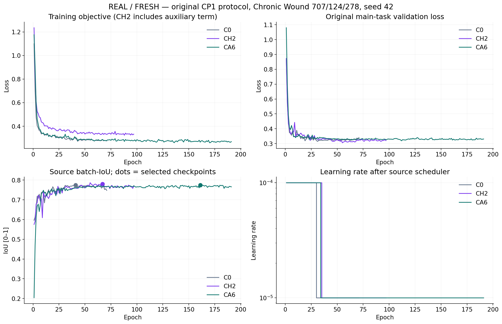
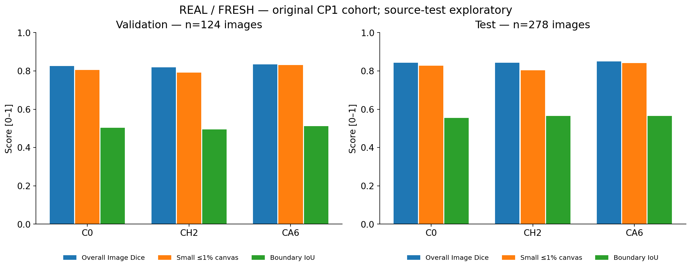
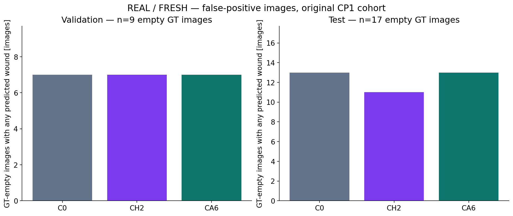

# Original CP1 protocol — H2 and CBAM model-only comparison

**COMPLETED — REAL TRAINING AND EVALUATION.**

Run: `outputs/cp2/cp1_matched/20261114T075755Z`. Original split **707/124/278**, fingerprint `7937d6b039db4eedf736dd0482a6379917fd9640d39d03c2c5fdac5047166925`.

Semua original config keys CP1 identik, termasuk sigmoid output, focal input mismatch, source TrainEpoch/ValidEpoch, augmentation, Adam 1e-4, WD 1e-5, batch 2, 4 workers, FP32/TF32, scheduler, checkpoint if-loss/elif-IoU, dan early stopping. C0 adalah kontrol fresh; CH2 hanya menambah boundary supervision; CA6 hanya mengganti attention stage 2–3 dengan CBAM gain historis 3.

Pada CH2, training menambahkan 0,1×source loss pada target batas dari mask sesudah augmentasi. Validation/checkpoint/scheduler tetap memantau main source loss. Source training statements identik; satu konstanta assertion jumlah parameter disesuaikan untuk arsitektur yang memang berubah. Tidak mengedit engine sumber.

| Model | Split | Image Dice | Data Dice | Small Dice | Boundary IoU | Miss | Empty FP | Epoch selected/completed |
|---|---|---:|---:|---:|---:|---:|---:|---:|
| C0 | validation | 0.8263 | 0.8709 | 0.8050 | 0.5028 | 1 | 7 | 41/71 |
| C0 | test | 0.8424 | 0.9225 | 0.8269 | 0.5552 | 2 | 13 | 41/71 |
| CH2 | validation | 0.8185 | 0.9041 | 0.7913 | 0.4948 | 1 | 7 | 67/97 |
| CH2 | test | 0.8432 | 0.9237 | 0.8029 | 0.5649 | 2 | 11 | 67/97 |
| CA6 | validation | 0.8345 | 0.8423 | 0.8314 | 0.5120 | 0 | 7 | 161/191 |
| CA6 | test | 0.8490 | 0.9237 | 0.8413 | 0.5640 | 0 | 13 | 161/191 |

Seleksi validation sebelum test memilih **CA6**. Source-test sudah pernah dianalisis; hasil bersifat eksploratif.

**Yang terlihat:** training loss CH2 mencakup auxiliary term, sedangkan validation loss semua arm adalah main task. Titik menunjukkan checkpoint sumber yang dipilih.
**Artinya:** prosedur optimisasi CP1 dikendalikan; besar training loss antar-objective tidak menjadi ranking kualitas.
**Perlu diingat:** source policy bukan pemilihan puncak Image Dice; anggaran epoch aktual dapat berbeda.

**Yang terlihat:** overall, luka kecil dan boundary diukur pada gambar yang sama untuk ketiga model.
**Artinya:** manfaat harus dibaca bersama tradeoff antar-subgroup dan FP/FN.
**Perlu diingat:** small di sini berarti ≤1% full padded canvas, bukan kategori klinis atau ukuran fisik.

**Yang terlihat:** jumlah gambar GT kosong dengan sedikitnya satu pixel prediksi luka.
**Artinya:** peningkatan segmentasi pada GT positif dapat disertai false positive.
**Perlu diingat:** jumlah gambar kosong kecil dan tidak menentukan toleransi klinis.

Audit mempertahankan 30 duplicate RGB groups, 18 cross-split groups, dan 28 conflicting-mask groups. Tidak ada gambar dihapus/dipindahkan. Ini sengaja mengikuti CP1, bukan bukti clean/patient-independent generalization.

Seluruh bobot sumber dipasangkan dan cocok dengan rekonstruksi CP1 historis. Initial training RNG, actual input order dan augmented bytes diperiksa. Satu langkah kontrol CPU yang diberi observasi juga menghasilkan state/logs identik dengan engine CP1 asli; ketiga smoke GPU dijalankan terpisah. Ini tidak menjanjikan seluruh training GPU mengulang skor historis bit-for-bit.

Laporan/metrics ini berbeda dari eksperimen sebelumnya pada split CP2 671/118/261. Semua artefak lama dipertahankan. Tidak menggabungkan skor dua cohort sebagai perbandingan terkontrol. Semua ini satu seed dengan validation/test yang sudah terekspos, tanpa klaim novelty global atau superioritas konfirmatori.

## Resource use

- C0: 244.6 minutes; 71 epochs; peak allocated 2.22 GiB; reserved 2.36 GiB.
- CH2: 305.7 minutes; 97 epochs; peak allocated 2.23 GiB; reserved 2.36 GiB.
- CA6: 530.1 minutes; 191 epochs; peak allocated 2.21 GiB; reserved 2.35 GiB.

Raw data, checkpoints dan NPZ tetap lokal. Grafik agregat memerlukan direct visual review sebelum delivery akhir.

Reproduce: `scripts/run_cp1_matched.py --root outputs/cp2/cp1_matched/<new-run> --stage prepare`, lalu `--stage preflight --device cuda:0` dan `--stage train --device cuda:0`. Gunakan interpreter `.venv-training/bin/python` tanpa mengubah environment.
