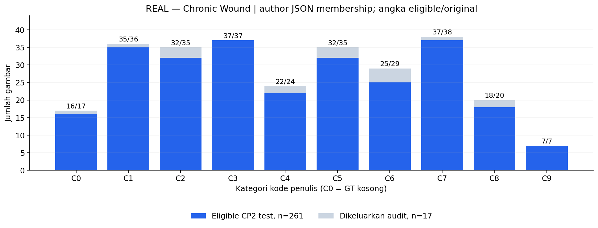
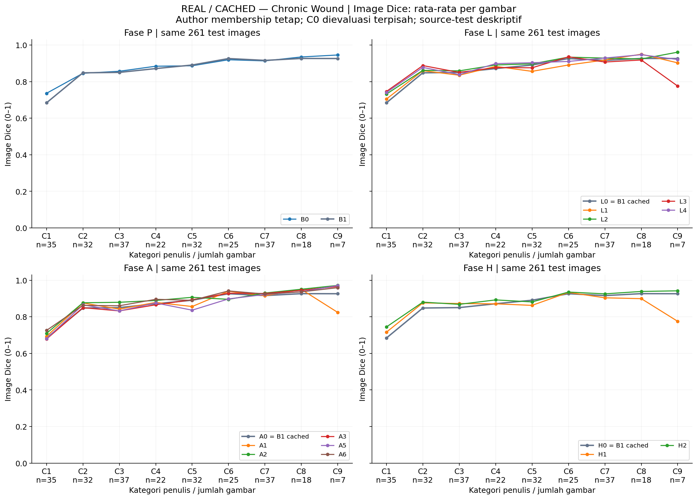
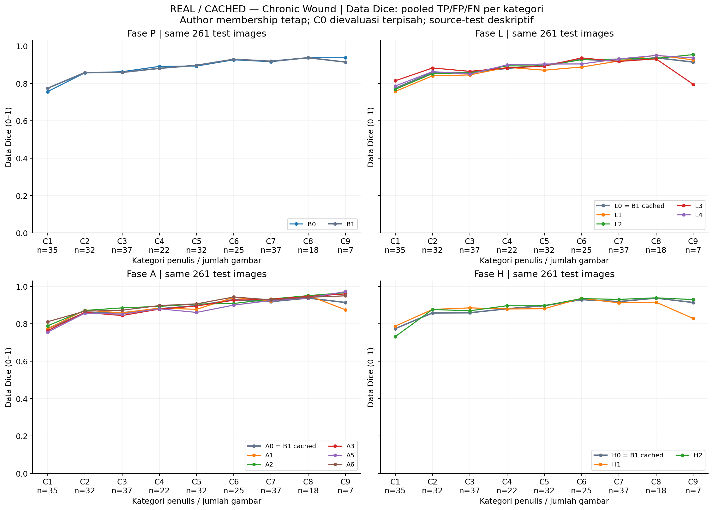
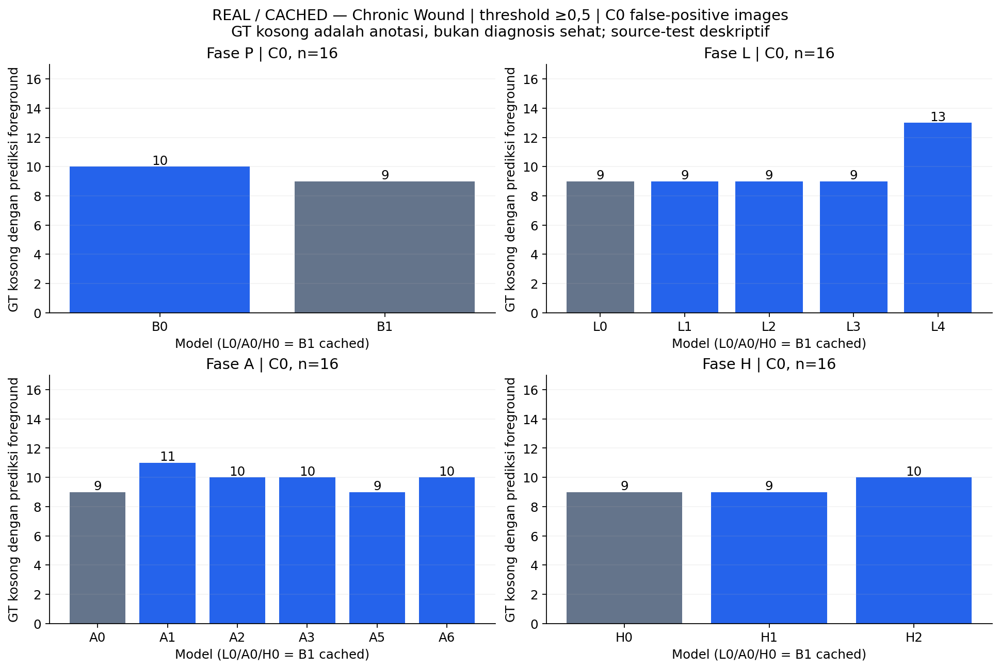

# CP2 — evaluasi tambahan menurut kategori asli penulis

**COMPLETED — CPU posthoc atas prediksi tersimpan; tanpa training, inference, atau pemilihan ulang.**

[Metrik JSON](cp2-author-categories-results.json) · [QA](cp2-author-categories-validation.json) · [Tabel semua metrik](tables/cp2-author-categories-metrics.csv) · [Per gambar](tables/cp2-author-categories-per-image.csv)

Analisis mencakup seluruh completed primary models fase P/L/A/H: **13 checkpoint unik, 3.393 prediksi test**. L0, A0 dan H0 adalah alias B1, bukan tiga training atau observasi independen baru. Tidak memasukkan smoke, inference interventions atau auxiliary heads sebagai model primary tambahan.

## Keanggotaan dan populasi

Keanggotaan mengikuti `categorized_oldDfu.json` penulis pada revision `60e8cfe0c8e2dacffa55fe208b8abb6815f7f6cc`. Kode memakai C0–C9; Figure 5 paper memakai kategori 1–10, sehingga paper ID = kode ID + 1. Tidak merekonstruksi batas dari komentar kode/OCR yang ambigu. Rentang di bawah adalah nilai GT yang benar-benar teramati pada anggota CP2 tersisa, **bukan definisi cutoffs baru**.

| Kode / paper | Original n | CP2 eligible n | Excluded n | Rentang GT teramati (% kanvas) |
|---|---:|---:|---:|---:|
| C0 / 1 | 17 | 16 | 1 | 0.000–0.000 |
| C1 / 2 | 36 | 35 | 1 | 0.040–0.598 |
| C2 / 3 | 35 | 32 | 3 | 0.622–0.993 |
| C3 / 4 | 37 | 37 | 0 | 1.002–1.497 |
| C4 / 5 | 24 | 22 | 2 | 1.557–1.983 |
| C5 / 6 | 35 | 32 | 3 | 2.005–2.974 |
| C6 / 7 | 29 | 25 | 4 | 3.077–3.998 |
| C7 / 8 | 38 | 37 | 1 | 4.020–5.921 |
| C8 / 9 | 20 | 18 | 2 | 6.108–8.821 |
| C9 / 10 | 7 | 7 | 0 | 11.585–30.875 |

**Yang terlihat:** JSON memuat 278 original source-test IDs; 261 dipertahankan dan 17 tetap dikeluarkan sesuai audit konflik anotasi CP2. Tidak ada gambar yang dikembalikan untuk menyamakan support paper.

**Artinya:** model-model CP2 dapat dibandingkan pada kategori dan cohort yang sama. Perbandingan numerik langsung dengan paper/CP1 tetap dibatasi perubahan cohort, split dan evaluator. Ukuran GT adalah luas pada kanvas berpadded 224×224, bukan cm² atau ukuran setiap luka klinis.

**Perlu diingat:** JSON hanya memuat original test IDs. **Validation C0–C9: NOT COMPUTED — author membership unavailable for validation identities.** Kategori kecil/sedang/besar CP2 pada validation/test tetap utuh dan berbeda definisinya.



Batang memperlihatkan support original versus eligible; numerator/denominator di atas adalah eligible/original. Kategori tidak seimbang, sehingga perubahan pada beberapa gambar dapat menggeser mean kategori kecil.

## Image Dice per kategori positif

Semua angka persen. Ini mean Dice per gambar, bukan Data Dice; C0 dipisahkan karena empty rules membuat per-image Dice hanya 0 atau 1.

| Model unik | C1 | C2 | C3 | C4 | C5 | C6 | C7 | C8 | C9 |
|---|---:|---:|---:|---:|---:|---:|---:|---:|---:|
| B0 | 73.60 | 84.54 | 85.65 | 88.41 | 88.64 | 91.94 | 91.31 | 93.46 | 94.55 |
| B1 | 68.39 | 84.79 | 85.02 | 87.12 | 89.06 | 92.60 | 91.59 | 92.65 | 92.60 |
| L1 | 70.46 | 85.96 | 83.48 | 88.31 | 85.60 | 89.08 | 91.80 | 94.97 | 90.24 |
| L2 | 73.15 | 86.15 | 85.86 | 89.08 | 89.70 | 93.37 | 92.84 | 92.36 | 96.08 |
| L3 | 74.60 | 88.75 | 85.01 | 87.65 | 87.55 | 93.55 | 90.69 | 91.81 | 77.53 |
| L4 | 74.00 | 87.76 | 83.81 | 89.83 | 90.30 | 91.02 | 92.88 | 94.69 | 92.05 |
| A1 | 69.30 | 87.56 | 84.17 | 87.86 | 85.61 | 93.94 | 91.48 | 94.95 | 82.37 |
| A2 | 70.91 | 87.65 | 87.93 | 88.91 | 90.64 | 89.55 | 92.99 | 95.06 | 97.17 |
| A3 | 67.84 | 84.97 | 83.21 | 86.54 | 89.32 | 92.87 | 92.75 | 94.48 | 96.57 |
| A5 | 68.07 | 86.55 | 83.18 | 87.55 | 83.61 | 89.78 | 92.19 | 93.68 | 97.08 |
| A6 | 72.54 | 86.24 | 86.03 | 89.55 | 89.00 | 94.13 | 92.44 | 93.64 | 95.90 |
| H1 | 71.57 | 87.59 | 87.24 | 87.08 | 86.24 | 93.33 | 90.37 | 89.91 | 77.52 |
| H2 | 74.43 | 88.01 | 86.80 | 89.23 | 88.12 | 93.51 | 92.53 | 93.85 | 94.19 |



Mean per gambar memberi bobot sama pada tiap anggota kategori. L0/A0/H0 mengulang cached B1 hanya untuk konteks fase.



Data Dice dihitung dari TP/FP/FN gabungan dalam kategori, bukan mean Image Dice. Gambar dengan foreground lebih besar dapat memberi kontribusi hitungan lebih besar.

## Contoh interpretasi hasil yang benar-benar dihitung

**Yang terlihat:** pada C1, n=35, Image Dice B1 **68.39%** dan H2 **74.43%**. Namun pada C5, H2 **88.12%**, di bawah B1 **89.06%**. H1 pada C9 **77.52%**, dibanding B1 **92.60%**.

Data Dice C1 justru turun **77.40% → 73.15%** pada B1→H2. Mean Image Dice yang naik tidak menjamin pooled pixel score naik; kedua agregasi memberi bobot berbeda pada kesalahan antargambar.

**Artinya:** skor overall atau small CP2 dapat menyembunyikan tradeoff antarkategori penulis. Tidak ada klaim semua ukuran membaik; lihat seluruh baris dan metrik, bukan kategori yang paling menguntungkan.

**Perlu diingat:** C9 hanya mempunyai 7 gambar. Ini satu seed dan analisis test posthoc, bukan pemilihan model baru atau bukti signifikansi. B1 tetap baseline terpilih menurut guard validation fase sebelumnya.

## GT kosong dan interpretasi



C0 memuat 16 gambar eligible. Nilai batang adalah jumlah gambar dengan setidaknya satu pixel prediksi foreground; bukan jumlah pixel FP. Tabel CSV juga menyimpan pixel FP, total foreground misses, Dice/IoU/precision/recall image-based dan data-based, Boundary IoU serta PFOM. Undefined aggregate Dice tetap null; tidak diisi nilai buatan.

Perbandingan ini **posthoc/deskriptif** atas source-test yang sudah terekspos CP1/P/L/A/H. Tidak mengubah checkpoint, threshold ≥0,5, empty rules, kategori CP2 lama, atau keputusan guard validation. Tidak memilih kategori/model berdasarkan skor baru, tidak mengklaim generalisasi patient-level, dan tidak menyatakan kesetaraan protokol paper.

## Reproduksi dan bukti

```bash
.venv-xfuseg/bin/python scripts/analyze_cp2_author_categories.py \
  --root outputs/cp2/author_categories/<new-timestamp>
```

Runner CPU-only memverifikasi completed status, shared cohort, checkpoint/index hashes, checksum 3.393 NPZ, raw GT, threshold, seluruh metrik lama dan per-image CSV; baru kemudian mengelompokkan ulang. Tidak memuat bobot model ke Python atau GPU. Run completed tidak ditimpa. `--publish` hanya untuk publikasi pertama; flag itu menolak overwrite laporan publik yang sudah ada. Semua artefak lama dan perubahan lokal pengguna dilindungi hash sebelum/sesudah; raw data, GT, NPZ dan checkpoints tetap lokal.

Sumber: [paper Figure 5](https://arxiv.org/pdf/2305.02961v2#page=12), [JSON penulis](https://github.com/mrinal054/FUSegNet/blob/60e8cfe0c8e2dacffa55fe208b8abb6815f7f6cc/categorized_oldDfu.json), [protokol CP2](../docs/cp2-phase-p.md).
