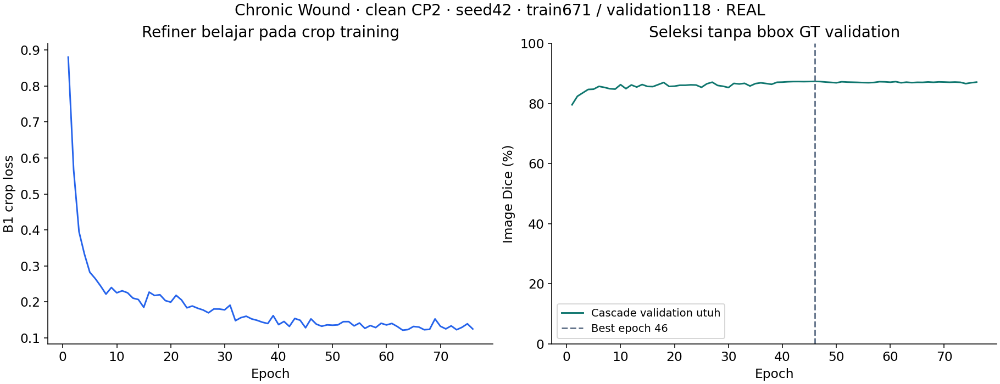
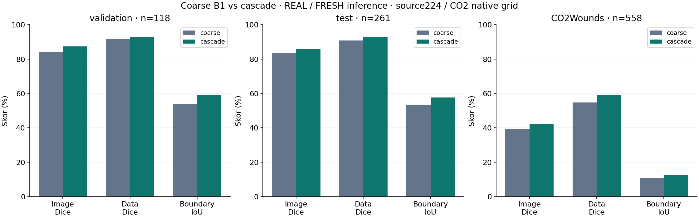

# Cascade Ganta pada split bersih Orie

**COMPLETED — ONE REAL REFINER TRAINING, seed42.** Run `outputs/cp2/cascade/20261118T161151Z`.
Coarse adalah B1 CP2 yang sudah completed dan dibekukan. Refiner baru memakai arsitektur Ganta dengan seluruh active initial tensors dipetakan dari initializer CP2; checkpoint terlatih partner tidak dipakai. Ini adaptasi desain Ganta ke protokol CP2, bukan replay historis atau klaim novelty.

## Data dan protokol

Train671 / validation118 / test261; manifest `fa9f4914a55806248d25c4a4092361db2658bfc63a0031122b63028202ef8ed5`. Kelompok RGB identik tidak melintasi partisi; **bukan patient-level**. Semua crop dari satu foto mengikuti foto sumber. Refiner dilatih pada crop GT training (margin0.3–0.8, peluang random crop0.2). Validation/test/external memakai proposal coarse saja: threshold0.3, komponen8-connected ≥4px, maksimal5, margin0.5, minimum sisi0.25, crop224. Area overlap mengambil maximum probability; luar crop tetap coarse. Final threshold≥0.5.

Loss B1 corrected-logit focal + source Dice, Adam1e-4/WD1e-5, batch2, FP32 tanpa AMP. Scheduler dan early stopping memonitor **mean Image Dice cascade pada 118 foto validation utuh**, tanpa bbox GT validation. Max200 epoch, patience30; earliest strict best. Seleksi berdasarkan guard penelitian dikunci sebelum test/CO2. Batas tambahan parameter1% untuk eksperimen attention tunggal tidak diterapkan pada cascade dua model; biaya tambahan dilaporkan.

## Hasil

| Split | Model | n | Image Dice | Data Dice | Small Dice | Boundary IoU | Miss GT+ | FP GT kosong |
| :--- | :--- | ---: | ---: | ---: | ---: | ---: | ---: | ---: |
| validation | coarse | 118 | 84.28% | 91.51% | 77.29% | 53.93% | 0 | 4/7 |
| validation | cascade | 118 | 87.37% | 92.88% | 84.71% | 59.04% | 0 | 4/7 |
| test | coarse | 261 | 83.29% | 90.77% | 76.21% | 53.54% | 4 | 9/16 |
| test | cascade | 261 | 85.86% | 92.78% | 80.64% | 57.53% | 3 | 8/16 |
| CO2Wounds | coarse | 558 | 39.33% | 54.69% | 9.52% | 10.85% | 143 | N/A (n=0) |
| CO2Wounds | cascade | 558 | 42.27% | 58.99% | 12.33% | 12.68% | 153 | N/A (n=0) |

Keputusan berdasarkan validation: **cascade**. Guards: `{"overall_image_dice_higher": true, "small_image_dice_not_lower": true, "boundary_iou_not_lower": true, "no_additional_foreground_misses": true, "no_additional_empty_fp_images": true}`.
Evaluasi ulang validation di CPU dapat sedikit berbeda dari validation training di GPU; keduanya disimpan dan tidak dipakai untuk memilih ulang epoch.

**Yang terlihat:** crop loss dan skor cascade validation lengkap sepanjang training; garis menandai checkpoint yang dipilih. **Artinya:** refiner dipilih menurut dampak pada foto utuh, bukan keberhasilan pada crop GT ideal. **Perlu diingat:** validation yang sama sudah dipakai dalam pengembangan CP2; hasil eksploratif satu seed.

**Yang terlihat:** coarse dan cascade dievaluasi pada gambar identik dalam setiap panel. **Artinya:** perbedaan di dalam split menunjukkan dampak refinement untuk coarse yang sama. **Perlu diingat:** source memakai grid224; CO2 native resolution. Domain, anotasi dan grid berbeda, jadi selisih antardataset tidak mengisolasi domain shift.

## Biaya, integritas dan keterbatasan

Best epoch46, completed76epoch, training invocation53.98jam. Peak Torch allocated2.21GiB / reserved2.36GiB. Refiner64,898,248 active/trainable parameters, coarse64,898,248 active: cascade129,796,496 active, di luar tensor sumber yang terdaftar tetapi tidak dipanggil. Inference membutuhkan1+jumlah proposal forward; bukan model murah yang memenuhi guard attention1%. Timing CPU shared dan proposal counts ada di JSON; bukan benchmark latency GPU eksklusif.

1874 prediction records diverifikasi ulang dari probability, raw GT, threshold, region/boundary metrics dan CSV. Checkpoint reload bit-exact pada device training. Historical/user files522 tidak berubah. Visual review: **PASSED**; kedua actual PNG telah dibuka dan diperiksa. Canonical QA saat generasi tetap utuh, dengan bukti review tambahan pada [QA publik](cp2-cascade-clean-validation.json).

CO2Wounds-V2 Mendeleyv1:558 eligible dari607 labeled,49 konflik identik-RGB dikarantina;157 tanpa label tidak dievaluasi. Seluruh558 GT positif: tidak mengukur false positive GT kosong eksternal. License ambiguity sebelumnya tetap berlaku; media/probability/checkpoint tetap lokal. Source test dan CO2 sudah pernah dilihat, bukan untouched confirmatory datasets. Tidak ada fitting, threshold tuning atau seleksi konfigurasi dari CO2. Tidak menyimpulkan kesalahan paper atau generalisasi klinis dari satu run.

## Reproduksi

`configs/cp2/cascade_clean.json`, `docs/cp2-cascade-clean.md`, `scripts/run_cp2_cascade.py`. Run menolak overwrite dan memerlukan inspected `--resume` untuk checkpoint terputus. Gunakan environment proyek tanpa upgrade. Training Phase C tidak diubah; worker cascade menunggu workflow Phase C completed sebelum mengalokasikan CUDA.

## Interpretasi hasil akhir

**Source validation:** Image Dice meningkat84,2773%→87,3738% (+3,0965pp), Small Dice77,2872%→84,7083%, dan Boundary IoU53,9269%→59,0425%. Foreground miss tetap0 dan GT-empty FP tetap4/7; seluruh guard penelitian yang dipreregister lolos. Pemilihan cascade dilakukan pada21November00:31UTC, sebelum evaluasi test dan CO2, tanpa mengubah epoch terbaik46 yang dipilih saat training.

**Source test:** Image Dice83,2880%→85,8562% (+2,5682pp), foreground miss4→3, serta GT-empty FP9/16→8/16. Ini perbandingan berpasangan pada261 foto yang sama; source test sudah terekspos sebelumnya sehingga merupakan bukti deskriptif, bukan konfirmasi independen baru.

**CO2Wounds:** Image Dice39,3336%→42,2745% (+2,9409pp), Data Dice54,6885%→58,9912%, dan Boundary IoU10,8480%→12,6803%. **Namun total foreground miss bertambah143→153 dari558 foto positif.** Kenaikan skor agregat tidak berarti semua jenis error membaik. Small Dice tetap rendah,9,5226%→12,3311%, dan tidak ada GT kosong untuk menilai false-positive rate pada negative images. CO2 tidak digunakan untuk memilih model; hasil yang kurang baik ini tetap dilaporkan.

Angka pembanding adalah coarse B1 yang direplay dengan pipeline CPU yang sama dengan cascade, bukan mencampurkan cache GPU baseline dengan inference CPU. Perbedaan sangat kecil dari baseline historis dicatat, bukan disembunyikan. Cascade memakai dua model dan tambahan forward per proposal; improvement ini tidak membuktikan attention/loss tunggal lebih unggul, tidak memisahkan efek kapasitas dari refinement, dan belum dikonfirmasi multiseed atau patient-level cohort.

## Pemulihan laporan dan jejak publikasi

Training selesai pada21November2026 **00:30:27UTC (07:30WIB)**; inference validation/test/CO2 juga selesai. Report worker kemudian berhenti karena source partner dipindah dari `notebook/` ke `notebook/scripts/`. SHA256 tetap `c476b328f47e241e6114eebb310ddf5ada9f2c714d2fa8fadbc2491b7091c371`. Dispatcher terpisah [`publish_cp2_cascade.py`](../scripts/publish_cp2_cascade.py) menerima hanya relokasi eksplisit dengan isi byte identik; file lain yang berubah tetap menyebabkan kegagalan.

Tidak ada training, model inference, perubahan checkpoint, pemilihan ulang epoch, threshold tuning atau penulisan ulang canonical metrics saat pemulihan. **1.874 prediction records** (2model ×(118+261+558)) dihitung ulang dari probability caches dan GT, termasuk pemeriksaan boundary, subgroup, CSV, checksum, serta kronologi seleksi. Original failed `workflow.json`/failure log dan canonical QA dipertahankan; `report_publication.json` mencatat penyelesaian tahap pelaporan secara terpisah. [Manifest publikasi](cp2-cascade-clean-publication.json) merekam hash artefak dan preservation.

[History76epoch](training/cp2-cascade-clean-refiner-history.csv) memakai fraction untuk skor validation; grafik dan tabel laporan memakai persen. Enam tabel per gambar dan [ringkasan](tables/cp2-cascade-clean-summary.csv) tersedia di `reports/tables/cp2-cascade-clean-*`. Checkpoint, source media, masks dan probability caches tetap lokal. Gambar/caption P0 sebelumnya merupakan snapshot sebelum hasil final; laporan ini melengkapi hasil completed terbaru, tanpa mengubah figure atau hasil lama tersebut.
