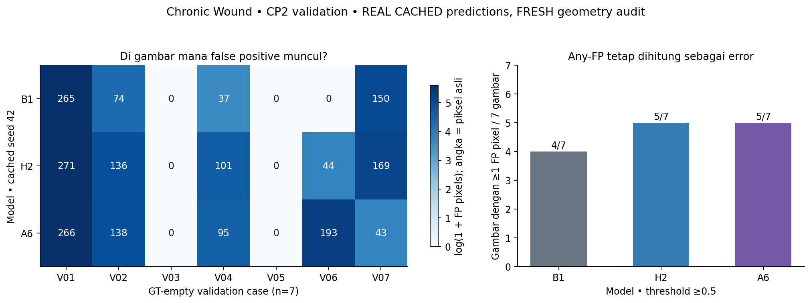

# CP2 — audit false positive sebelum konfirmasi seed

**EXECUTED — cached real seed42 validation; tidak ada training/inference baru.**

Split tetap 671/118/261, duplicate-RGB-group split, bukan patient-level. Seluruh 354 probability/GT pairs validation diperiksa ulang beserta checksum, raw mask, threshold dan metrik.

| Model | GT-empty dengan FP | Total FP pixels | Largest connected FP component |
|---|---:|---:|---:|
| B1 | 4/7 | 526 | 265 |
| H2 | 5/7 | 721 | 271 |
| A6 | 5/7 | 735 | 266 |

**Yang terlihat:** angka per kotak menunjukkan luas prediksi luka pada setiap GT kosong. Skala warna logaritmik ditulis eksplisit; angka anotasi memakai jumlah piksel asli.

**Artinya:** jumlah gambar error dan luas error memberi informasi berbeda. Satu piksel dan ratusan piksel sama-sama membuat Image Dice gambar kosong menjadi 0. Data Dice tetap peka pada jumlah pikselnya.

**Perlu diingat:** hanya tujuh contoh kosong, validation dipakai berulang, dan geometry mask tidak membuktikan penyebab medis atau label salah. Tidak ada adjudikasi klinis, relabeling, component filtering, atau penyesuaian threshold. Semua kasus ditampilkan tanpa cherry-picking.

Matriks ini menjadi diagnosis awal; kandidat belum diterima. Konfirmasi menggunakan seed 42 cached dan seed 43/44 fresh, dengan aturan seleksi tersendiri yang dipraspesifikasikan.

## Temuan spesifik dan review visual

H2 dan A6 menambah error pada **kasus yang sama, V06**: B1=0, H2=44, A6=193 pixel. Empat kasus error B1 tetap error pada kedua kandidat; tidak ada kasus B1 yang diselesaikan. Seluruh komponen FP pada tujuh gambar ini masing-masing tersambung tunggal, dan tidak ada FP di pita terluar 3 pixel kanvas. Ini tidak mengidentifikasi jaringan/anatomi atau membuktikan anotasi benar/salah.

Grafik telah diperiksa langsung: angka heatmap cocok dengan cache, skala log dinyatakan, colorbar/sumbu/font/legend terbaca, seluruh kasus ditampilkan, dan bar dimulai dari nol.
