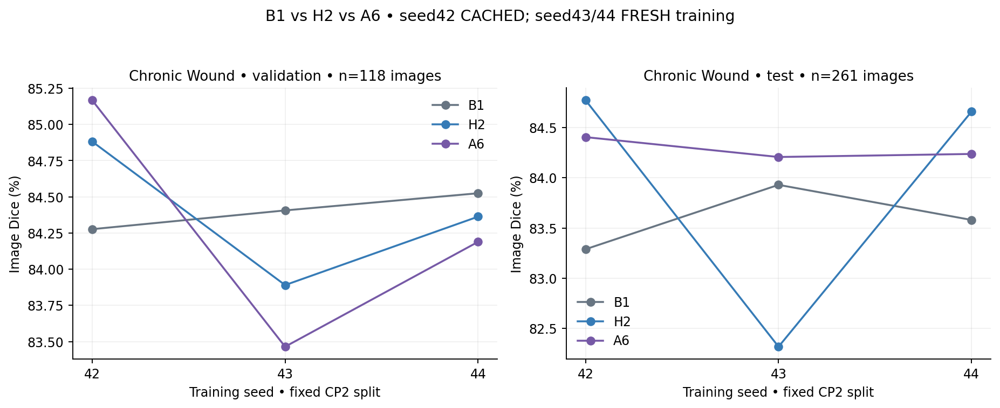
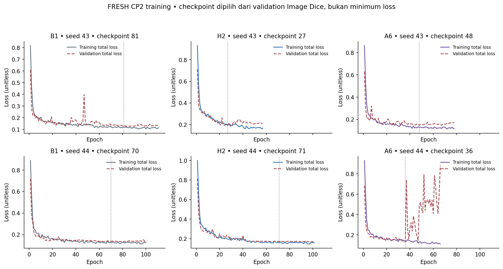

# CP2 — konfirmasi B1/H2/A6 pada tiga seed

**COMPLETED — six new real training runs; three historical seed42 runs preserved.**

Same duplicate-group split 671/118/261, corrected focal B1, Image-Dice checkpoint, FP32/TF32, batch2, Adam, scheduler dan early stopping CP2. Seed mengubah initialization/training randomness, bukan membership. Semua model memakai bobot awal source yang dipasangkan dalam seed yang sama.

| Model | Split | Image Dice mean ± SD | Data Dice mean ± SD | Small Dice mean | Empty-FP images mean |
|---|---|---:|---:|---:|---:|
| B1 | validation | 0.8440 ± 0.0012 | 0.9213 ± 0.0053 | 0.7901 | 4.67 |
| B1 | test | 0.8360 ± 0.0032 | 0.9149 ± 0.0101 | 0.7691 | 9.33 |
| H2 | validation | 0.8438 ± 0.0050 | 0.9222 ± 0.0077 | 0.7991 | 5.00 |
| H2 | test | 0.8392 ± 0.0139 | 0.9146 ± 0.0056 | 0.8012 | 10.00 |
| A6 | validation | 0.8427 ± 0.0086 | 0.9184 ± 0.0124 | 0.7893 | 5.00 |
| A6 | test | 0.8428 ± 0.0011 | 0.9190 ± 0.0050 | 0.7899 | 9.33 |

**Validation-only selection:** B1. **Next route for review:** `REVIEW_PRESENCE_SUPERVISION`. Tidak ada training kombinasi/presence otomatis; kegagalan screening seed42 tetap dicatat.

**Yang terlihat:** semua seed ditampilkan, termasuk hasil yang lebih buruk. Panel test bersifat deskriptif dan dibuka setelah selection tersimpan.

**Artinya:** selisih berpasangan dalam seed adalah pembanding utama; seed terbaik tidak dipilih.

**Perlu diingat:** tiga seed pada satu split tidak membuktikan patient independence. Validation digunakan berulang dan kandidat dipilih dari screening sebelumnya; ini konfirmasi kestabilan internal yang eksploratif, bukan bukti konfirmatori independen atau manfaat klinis.

**Yang terlihat:** garis vertikal menandai checkpoint validation-Dice, dan H2 total loss mencakup auxiliary term 0.1. **Artinya:** nilai loss lintas model tidak menjadi ranking performa. **Perlu diingat:** adaptive scheduler/early stopping menghasilkan anggaran update berbeda.

Artifact QA: **passed**; run `outputs/cp2/confirmation/20261115T080014Z`. Raw clinical media, probabilities dan checkpoints tetap lokal. Kedua grafik hasil sudah diperiksa langsung: font, label, legend, marker checkpoint dan skala terbaca; kurva yang tidak stabil tetap ditampilkan.

## Interpretasi hasil dan langkah berikutnya

H2 memperbaiki mean small validation Dice sebesar **+0,903 poin persentase** dan Boundary IoU **+0,458 poin**, tetapi overall Dice turun **0,024 poin** dan mean empty-FP image count naik **4,67→5,00 dari 7**. A6 overall validation turun **0,129 poin** serta small/boundary sedikit lebih rendah. H2 dan A6 masing-masing **0/3 seed** memenuhi seluruh guard individual, sehingga keduanya tidak diterima. Ini bukan bukti statistik bahwa H2 lebih buruk: selisih overall mean sangat kecil dan hanya tiga seed.

A6 mean source-test Image Dice **84,28%** lebih tinggi daripada B1 **83,60%**, tetapi test sudah terekspos dan tidak digunakan memilih ulang model. A6 tidak menjadi model terpilih dari skor test. Hasil antar-seed/split yang berbeda menunjukkan manfaat yang belum konsisten. Tetap B1 sebagai baseline; rekomendasi berikutnya adalah preregistration jalur **N/presence supervision** untuk menguji kontrol FP dengan guard luka kecil/recall yang sama. Tidak ada training N, kombinasi, atau H3 yang dijalankan otomatis.

Pada **A6 seed44**, validation total loss melonjak pada epoch-epoch setelah checkpoint terpilih36, sementara training loss tetap menurun. Kurva tersebut dipertahankan secara utuh. Tidak ada loss/gradient nonfinite yang diterima trainer; checkpoint dan evaluasi tetap memakai epoch36 dari validation Image Dice. Penyebab ketidakstabilan ini belum diisolasi; tidak boleh langsung diatribusikan kepada anotasi, BatchNorm, atau satu mekanisme tertentu.

## Run aktual dan resource

| Seed | Model | Selected / completed epoch | Training invocation (jam) | Peak allocated / reserved (GiB) |
|---|---|---:|---:|---:|
| 43 | B1 | 81 / 111 | 3.83 | 2.22 / 2.33 |
| 43 | H2 | 27 / 57 | 4.10 | 2.23 / 2.33 |
| 43 | A6 | 48 / 78 | 8.08 | 2.20 / 2.32 |
| 44 | B1 | 70 / 100 | 6.77 | 2.22 / 2.33 |
| 44 | H2 | 71 / 101 | 6.66 | 2.23 / 2.33 |
| 44 | A6 | 36 / 66 | 4.62 | 2.20 / 2.32 |

Enam fresh training memerlukan sekitar **34,1 jam invocation** total pada GPU bersama; seluruh training dan ekspor prediksi selesai sekitar **34 jam27 menit sejak launch**. Waktu shared-GPU bukan benchmark hardware eksklusif. Seed42 cached tidak dilatih ulang.

## Kegagalan teknis dan pemulihan transparan

Workflow asli berhenti **sesudah seluruh training dan prediksi validation/test selesai**, saat validator membandingkan nested dictionary keputusan: Python memakai integer seed keys, sedangkan JSON mengubahnya menjadi string. Seluruh nilai ilmiah, guard dan keputusan B1 cocok persis sesudah JSON roundtrip. Ini kesalahan pemeriksaan pascaproses, bukan kegagalan training atau ketidakcocokan skor.

Helper CPU terpisah `scripts/finish_cp2_confirmation.py` menjalankan **code object validator asli**, dengan hanya output fungsi seleksi diserialisasi ke representasi JSON yang sama sebelum pembandingan. Tidak mengedit sumber training frozen, checkpoint, prediksi, selection.json, atau catatan workflow gagal asli. Tidak melakukan training, inference atau model selection baru. Semua pemeriksaan checksum/GT/threshold/metrics, pairing, earliest-best epoch, chronology dan preservation tetap dijalankan.

**153 tests lulus**, termasuk tiga regression tests untuk integer/string keys dan penolakan perubahan skor/keputusan nyata. **2.274 prediksi fresh + 1.137 cached** diverifikasi pada semua model×seed×split. **16.325 file historis/user** tetap utuh. Bukti kegagalan dan pemulihan disimpan terpisah; status recovery akhir ada di `postprocess_workflow.json` dan final QA. Ruff tidak tersedia pada environment existing; tidak dijalankan dan tidak ada package yang diubah.

[QA/recovery/visual review](cp2-confirmation-validation.json) · [Metrik per model/seed/split](tables/cp2-confirmation-metrics.csv). Hasil masih eksploratif pada satu duplicate-group split dengan validation reuse; bukan patient-independent clinical validation.
