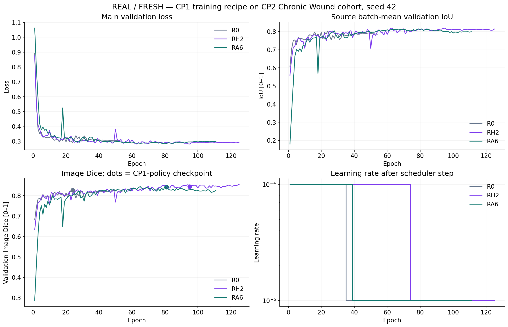
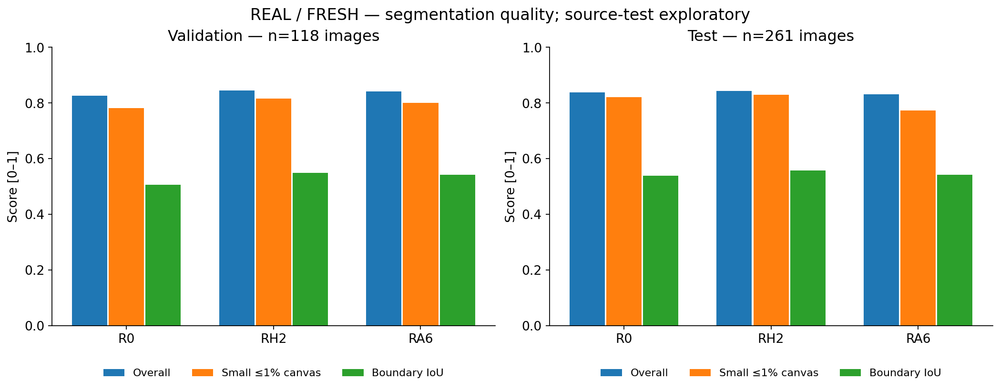
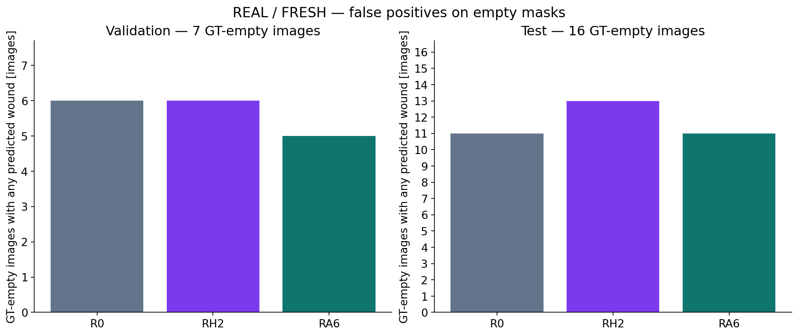

# CP2 — Targeted CP1 training-recipe comparison

Run: `outputs/cp2/cp1_recipe/20261113T082016Z`. Seed 42; split 671/118/261 tetap. Ini eksperimen eksploratif satu seed, bukan reproduksi CP1 identik.

## Pertanyaan dan protokol

Apakah H2 atau A6 memberi manfaat ketika checkpoint if-loss/elif-IoU, scheduler main validation loss, early stopping sumber dan evolving RNG CP1 digunakan? Sesuai pilihan pengguna, semua arm memakai B0 sumber termasuk focal input mismatch, preprocessing/augmentasi sumber, Adam 1e-4, WD 1e-5, batch 2, FP32 tanpa AMP. Bobot awal sumber dibuktikan identik; bukan warm-start checkpoint CP1.

R0 = P-scSE asli; RH2 = auxiliary boundary head 33 parameter, auxiliary B0 berbobot 0,1; RA6 = CBAM stage 2–3 dengan gain historis 3. Pada H2, scheduler/checkpoint memakai loss mask utama saja, bukan auxiliary loss. Source IoU memakai threshold >0,5 dan batch averaging; pelaporan akhir tetap threshold ≥0,5 dan evaluator CP2.

## Hasil yang benar-benar dijalankan

| Model | Split | Image Dice | Data Dice | Small Dice | Boundary IoU | Miss | Empty FP | Epoch dipilih/selesai |
|---|---|---:|---:|---:|---:|---:|---:|---:|
| R0 | validation | 0.8263 | 0.9157 | 0.7811 | 0.5058 | 0 | 6 | 24/54 |
| R0 | test | 0.8384 | 0.9104 | 0.8217 | 0.5385 | 2 | 11 | 24/54 |
| RH2 | validation | 0.8444 | 0.9236 | 0.8154 | 0.5491 | 0 | 6 | 95/125 |
| RH2 | test | 0.8436 | 0.9246 | 0.8302 | 0.5580 | 1 | 13 | 95/125 |
| RA6 | validation | 0.8424 | 0.9202 | 0.8004 | 0.5423 | 0 | 5 | 81/111 |
| RA6 | test | 0.8311 | 0.9126 | 0.7740 | 0.5427 | 4 | 11 | 81/111 |

Seleksi validation dengan guard historis terhadap R0 memilih **RH2**. Keputusan tersimpan sebelum semua prediksi test baru.



**Yang terlihat:** checkpoint sumber dapat berbeda dari puncak Image Dice; titik menunjukkan epoch yang benar-benar dipilih.
**Artinya:** prosedur training/checkpoint merupakan bagian dari metode yang sedang diuji.
**Perlu diingat:** paket kebijakan berubah bersamaan; hasil ini tidak mengisolasi scheduler, RNG atau checkpoint secara individual.



**Yang terlihat:** overall, luka kecil dan boundary diukur terpisah pada populasi yang sama untuk ketiga arm.
**Artinya:** perubahan overall harus dibaca bersama perubahan subgroup dan bentuk batas.
**Perlu diingat:** mean per gambar dan pooled Data Dice bukan metrik yang sama; source-test sudah pernah dianalisis.



**Yang terlihat:** grafik menghitung gambar GT kosong dengan setidaknya satu pixel prediksi luka.
**Artinya:** peningkatan Dice pada GT positif dapat disertai pertukaran false positive.
**Perlu diingat:** hanya tujuh GT kosong validation; tidak menetapkan toleransi klinis dari jumlah kecil ini.

## Biaya dan keterbatasan

- R0: 90.6 menit; active parameters 64,898,248; registered 70,968,939; peak allocated 2.22 GiB, reserved 2.36 GiB.
- RH2: 199.2 menit; active parameters 64,898,281; registered 70,968,972; peak allocated 2.22 GiB, reserved 2.36 GiB.
- RA6: 166.9 menit; active parameters 64,891,593; registered 70,975,382; peak allocated 2.21 GiB, reserved 2.36 GiB.

Validation sudah dipakai berulang untuk pengembangan. Pemilihan H2/A6 berdasarkan validation sebelumnya adalah adaptif dan eksploratif; tidak membuktikan generalisasi atau signifikansi. Tidak ada patient ID, sehingga ini duplicate-RGB-group split, bukan patient-level split. Tidak ada data eksternal, perubahan label, pemilihan seed terbaik, atau pengembalian data konflik. Guard tidak dilonggarkan setelah hasil. Run lama tetap baseline historis, bukan dicampur sebagai arm protokol baru.

## Reproduksi

```bash
.venv-training/bin/python scripts/run_cp2_cp1_recipe.py --root outputs/cp2/cp1_recipe/<new-run> --stage prepare
.venv-training/bin/python scripts/run_cp2_cp1_recipe.py --root outputs/cp2/cp1_recipe/<new-run> --stage preflight --device cuda:0
.venv-training/bin/python scripts/run_cp2_cp1_recipe.py --root outputs/cp2/cp1_recipe/<new-run> --stage train --device cuda:0
```

Gunakan `--resume` setelah pemeriksaan run terinterupsi; completed stages diverifikasi dan tidak dilatih ulang. Checkpoint, raw data dan probability maps tetap lokal.

## Review dan bukti validasi final

[Review hasil, tradeoff, bootstrap dan perbandingan historis](cp2-cp1-recipe-review.md) · [QA final](cp2-cp1-recipe-validation.json) · [Analisis numerik](cp2-cp1-recipe-analysis.json). Seluruh angka berasal dari training dan prediksi yang benar-benar dijalankan.
