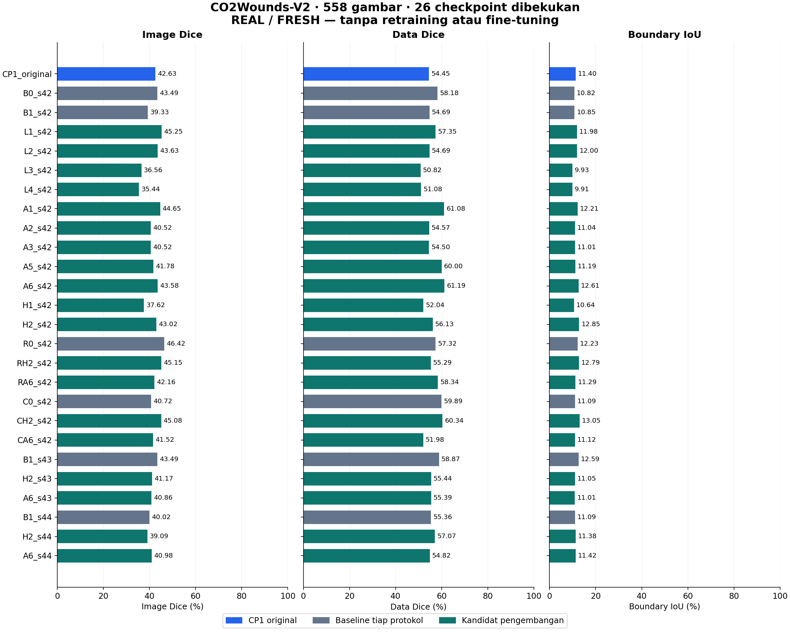
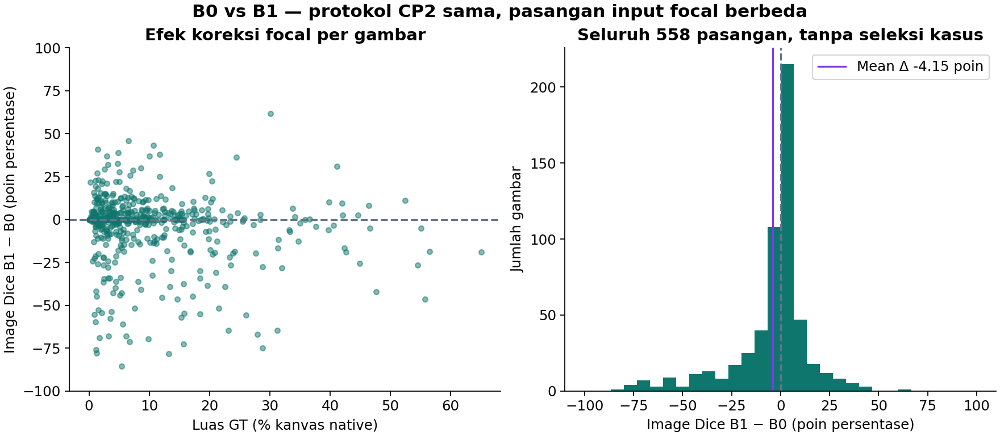
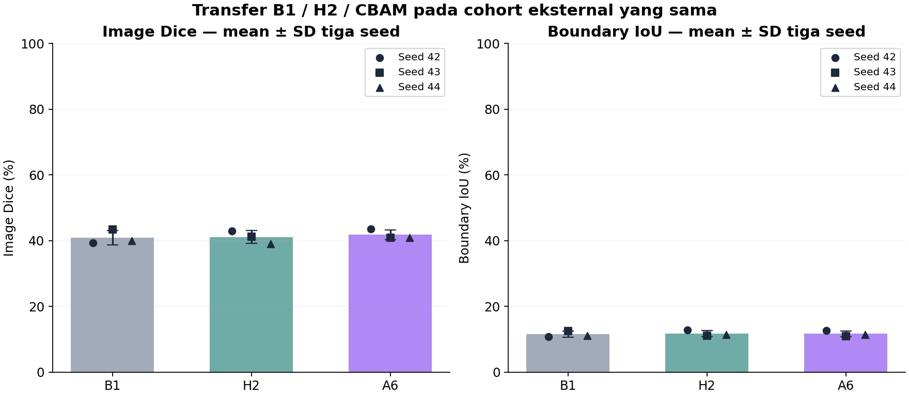

# CP2 — perbandingan eksternal seluruh checkpoint CP1/CP2

**COMPLETED — 26 frozen checkpoints, 558 gambar per model, 14,508 prediksi diverifikasi. Tidak ada training/fine-tuning.**

Run: `outputs/cp2/external/20261118T040007Z`. Protokol, roster checkpoint dan SHA256 disimpan sebelum target prediction. [Panduan/protokol](../docs/cp2-external-evaluation.md) · [Registry](../configs/cp2/external.json) · [Seluruh metrik CSV](tables/cp2-external-evaluation-metrics.csv) · [Hasil JSON](cp2-external-evaluation.json).

## Apa yang diuji?

Apakah model yang memperoleh skor tinggi pada Chronic Wound tetap bekerja baik pada foto dari sumber dan jenis luka lain? Semua bobot tetap; inference membaca foto, bukan GT. **Loss tidak dihitung untuk mengubah prediksi saat inference**: yang dibandingkan adalah bobot hasil training sebelumnya.

Target adalah [CO2Wounds-V2 Mendeley version 1](https://data.mendeley.com/datasets/s2w7rjwz49/1), DOI 10.17632/s2w7rjwz49.1: foto luka kronis pasien kusta di Kolombia, dikumpulkan dengan kamera smartphone. Perubahan sumber sekaligus patologi ini bukan pengujian khusus DFU lintas rumah sakit saja. Atribusi: Sanchez et al., ICIP 2024, pp.69–75.

## Audit data sebelum membuka skor

- Provider menyediakan 607 pasangan berlabel (485 train/122 val), dan 157 test tanpa mask. Provider-train/val menjadi evaluasi eksternal kita, tanpa fitting pada keduanya.
- Ditemukan 23 kelompok RGB identik dengan mask berbeda, berjumlah 49 gambar. Seluruh kelompok dikarantina sesuai aturan sebelum inference, tanpa memilih/menggabungkan mask. Perbedaan anotasi tidak otomatis ditafsirkan sebagai kesalahan klinis.
- Primary cohort: **558 gambar**, 447 provider-train dan 111 provider-val, sama untuk seluruh 26 model.
- Tidak ditemukan exact RGB overlap atau kandidat near-duplicate pada audit terhadap 1.109 gambar sumber. Screening sempit tidak menjamin ketiadaan semua hubungan crop/pasien.
- Mask memakai 0/1, bukan 0/255. Foto JPG/JPEG/PNG dipasangkan berdasarkan nama terverifikasi. Seluruh pasangan decode dan cocok dimensi/identitas COCO.
- Seluruh 558 GT berisi luka; **GT-empty external evaluation tidak tersedia**. Pixel precision masih menilai FP pada latar foto luka, tetapi tidak membuktikan kemampuan menolak foto tanpa luka.
- Rilis total menyebut 96 pasien, tetapi patient ID tidak tersedia dalam metadata yang diuji. Tidak ada patient-clustered confidence interval atau klaim patient independence.

Mendeley menampilkan CC BY 4.0, sedangkan README penulis dan license COCO di arsip menyebut CC BY-NC-ND 4.0. Data/derived media/cache tetap lokal untuk riset nonkomersial. Yang dibagikan di repo adalah kode, metrik numerik dan grafik agregat. Raw bytes tidak diubah.

## Proses inference yang sama

RGB → resize dengan aspect ratio tetap → black letterbox 224×224 → normalisasi ImageNet source → model eval/no-grad → probability map → buang padding → bilinear kembali ke koordinat native → threshold ≥0,5 → evaluasi pada GT native.

Tidak ada GT crop, augmentation target, update parameter/BatchNorm, pseudo-label training, statistik normalisasi target, atau threshold search. Model probability-output tidak disigmoid ulang; model logit-output disigmoid sekali. Seluruh state checkpoint dimuat `strict=True`, termasuk auxiliary head; inference H1/H2/CH2/RH2 menggunakan mask utama dari base network saja.

Metrik memakai ordinary confusion counts, mean Image Dice dan pooled Data Dice/IoU/precision/recall, Boundary IoU inner-band 1% diagonal native, PFOM CP1, ukuran luka menurut persentase kanvas native, dan foreground miss (GT positif dengan TP=0). Small ≤1% kanvas bukan ukuran fisik; target native berbeda dari source yang berpadded. PFOM native juga dipengaruhi resolusi sehingga tidak dibandingkan langsung lintas grid sebagai satu skor identik.

## Seluruh hasil

Source columns adalah hasil historis, tidak dihitung ulang. **CP1 original/matched menggunakan split 707/124/278; kelompok CP2 dan CP1-recipe memakai 671/118/261.** Karena itu source columns lintas keluarga tidak menjadi perbandingan terkontrol. Kolom external memakai cohort dan preprocessing yang sama.

Besarnya selisih source–target juga dipengaruhi perbedaan populasi dan grid evaluasi: source historis dihitung pada grid input, sedangkan target ini pada koordinat native. Karena itu angka penurunan absolut tidak mengisolasi domain shift saja. Perbandingan antar-model pada target memakai evaluator identik.

| Model | Source val Image Dice | Source test Image Dice | External Image Dice | External Data Dice | External Boundary IoU | Miss |
| :--- | ---: | ---: | ---: | ---: | ---: | ---: |
| CP1_original | 82.34% | 86.42% | 42.63% | 54.45% | 11.40% | 96 |
| B0_s42 | 83.61% | 83.73% | 43.49% | 58.18% | 10.82% | 84 |
| B1_s42 | 84.28% | 83.29% | 39.33% | 54.69% | 10.85% | 143 |
| L1_s42 | 83.31% | 82.96% | 45.25% | 57.35% | 11.98% | 65 |
| L2_s42 | 83.94% | 84.78% | 43.63% | 54.69% | 12.00% | 84 |
| L3_s42 | 83.60% | 83.97% | 36.56% | 50.82% | 9.93% | 144 |
| L4_s42 | 82.80% | 83.24% | 35.44% | 51.08% | 9.91% | 149 |
| A1_s42 | 84.63% | 82.50% | 44.65% | 61.08% | 12.21% | 110 |
| A2_s42 | 84.50% | 84.55% | 40.52% | 54.57% | 11.04% | 103 |
| A3_s42 | 84.21% | 83.01% | 40.52% | 54.50% | 11.01% | 107 |
| A5_s42 | 83.90% | 82.58% | 41.78% | 60.00% | 11.19% | 155 |
| A6_s42 | 85.17% | 84.41% | 43.58% | 61.19% | 12.61% | 128 |
| H1_s42 | 83.60% | 83.33% | 37.62% | 52.04% | 10.64% | 128 |
| H2_s42 | 84.88% | 84.77% | 43.02% | 56.13% | 12.85% | 111 |
| R0_s42 | 82.63% | 83.84% | 46.42% | 57.32% | 12.23% | 56 |
| RH2_s42 | 84.44% | 84.36% | 45.15% | 55.29% | 12.79% | 78 |
| RA6_s42 | 84.24% | 83.11% | 42.16% | 58.34% | 11.29% | 124 |
| C0_s42 | 82.63% | 84.24% | 40.72% | 59.89% | 11.09% | 146 |
| CH2_s42 | 81.85% | 84.32% | 45.08% | 60.34% | 13.05% | 119 |
| CA6_s42 | 83.45% | 84.90% | 41.52% | 51.98% | 11.12% | 74 |
| B1_s43 | 84.41% | 83.93% | 43.49% | 58.87% | 12.59% | 124 |
| H2_s43 | 83.89% | 82.32% | 41.17% | 55.44% | 11.05% | 108 |
| A6_s43 | 83.46% | 84.21% | 40.86% | 55.39% | 11.01% | 134 |
| B1_s44 | 84.52% | 83.58% | 40.02% | 55.36% | 11.09% | 118 |
| H2_s44 | 84.36% | 84.66% | 39.09% | 57.07% | 11.38% | 156 |
| A6_s44 | 84.19% | 84.24% | 40.98% | 54.82% | 11.42% | 125 |

`_s42/_s43/_s44` adalah seed training historis. B0/B1: source versus corrected focal; L1/L2: Tversky/Focal Tversky; L3/L4: tambahan Boundary Loss; A1/A2/A3: local attention dengan fixed/learned-constant/input-dependent fusion; A5: kontrol kapasitas; A6: CBAM. H1/H2: auxiliary segmentation/boundary. R0/RH2/RA6: resep CP1 pada split CP2; C0/CH2/CA6: resep serta split CP1 dengan perubahan model saja. L0/A0/H0 adalah alias B1 dan tidak dihitung ulang.

**Yang terlihat:** seluruh 26 checkpoint ditampilkan dalam urutan registry, termasuk hasil yang lebih buruk. Angka tertinggi Image Dice pada tabel ini adalah **R0_s42 = 46.42%**. **Artinya:** ini ranking deskriptif pada target dan preprocessing yang diuji. **Perlu diingat:** pemenang satu checkpoint dari banyak percobaan bukan bukti superioritas antar-seed/pasien atau dasar meloloskan ulang guard internal.

## Kontras utama: koreksi focal B0 versus B1

Pada source validation, B0 **83.61%** dan B1 **84.28%**. Pada target yang sama, B0 **43.49%** dan B1 **39.33%**.

External Image Dice B1 lebih rendah daripada B0 dengan mean delta **-4.155 poin persentase**. Dari 558 pasangan, B1 membaik pada **233**, memburuk pada **249**, dan sama pada **76** gambar. Pembagian ini tidak memperlakukan piksel sebagai sampel independen dan bukan uji signifikansi pasien.

B0/B1 menggunakan source split, arsitektur, inisialisasi, augmentasi dan aturan seleksi yang dipasangkan. Jumlah epoch/checkpoint aktual berbeda sebagai konsekuensi validation. Kontras ini menguji efek objective dalam recipe tersebut, bukan isolasi fixed-update-budget atau bukti langsung penyebab skor paper.

Pada target ini, pixel precision B0/B1 adalah 64.98%/72.02%, sedangkan pixel recall 52.67%/44.08%. B1 menghasilkan lebih sedikit false positive relatif terhadap prediksi positif, tetapi melewatkan lebih banyak piksel luka. Foreground miss meningkat dari 84 menjadi 143 gambar. Ini trade-off pada checkpoint dan threshold tetap yang diuji, bukan jaminan bahwa mismatch selalu menguntungkan.

**Yang terlihat:** sumbu vertikal positif berarti koreksi focal membantu gambar tersebut; negatif berarti sebaliknya. Seluruh gambar dimasukkan. **Artinya:** selisih mean dapat menyembunyikan kasus yang membaik dan memburuk. **Perlu diingat:** ukuran GT berasal dari native canvas dan tidak memberi ukuran luka fisik atau identitas pasien.

## Kestabilan B1/H2/CBAM pada tiga seed

| Model | Seeds | External Image Dice mean ± SD | External Data Dice mean ± SD | External Boundary IoU mean ± SD |
| :--- | :--- | ---: | ---: | ---: |
| B1 | 42, 43, 44 | 40.95 ± 2.23% | 56.31 ± 2.24% | 11.51 ± 0.94% |
| H2 | 42, 43, 44 | 41.09 ± 1.97% | 56.21 ± 0.82% | 11.76 ± 0.96% |
| A6 | 42, 43, 44 | 41.80 ± 1.54% | 57.13 ± 3.53% | 11.68 ± 0.83% |

SD adalah variasi tiga training pada source split yang sama, **bukan confidence interval klinis**. Ketiga seed selalu ditampilkan; tidak dipilih seed terbaik berdasarkan target.

- H2 − B1 pada seed 42/43/44: +3.68, -2.32, -0.94 poin; membaik pada 1/3 seed.
- A6 − B1 pada seed 42/43/44: +4.24, -2.63, +0.95 poin; membaik pada 2/3 seed.

Rerata H2/CBAM belum menunjukkan peningkatan yang konsisten pada semua seed. Tiga seed dari satu sumber target tidak cukup untuk menyatakan superioritas atau signifikansi klinis.

**Yang terlihat:** titik menunjukkan setiap seed; bar dan error bar menunjukkan mean/SD. **Artinya:** manfaat yang hanya muncul pada satu seed tidak cukup untuk menyatakan peningkatan konsisten. **Perlu diingat:** satu target, metadata pasien tidak tersedia, dan cohort tidak memiliki GT kosong.

## Menjawab dugaan tentang konfigurasi paper

CP1 original memperoleh external Image Dice **42.63%** dan Data Dice **54.45%**. Ini checkpoint reproduksi lokal, **bukan bobot asli penulis paper**.

Perbedaan ranking source–target, jika ada, mendeskripsikan ketergantungan pada data dan protokol. Itu belum membuktikan bahwa skor paper tinggi karena salah konfigurasi. Perbandingan CP1–CP2 sekaligus mengubah cohort training, loss, checkpoint/scheduler dan RNG. Perubahan patologi, kamera, skala luka dan kualitas anotasi target juga terjadi bersamaan.

Audit sebelumnya memang membuktikan focal input mismatch pada kode sumber serta perbedaan evaluator inline/offline. Namun evaluator dan cohort tepat yang menghasilkan headline paper belum dipastikan. [Audit sumber](../docs/reference-audit.md) tetap menjadi bukti terpisah; hasil eksternal ini tidak menggantikan audit tersebut atau mengubah skor historis.

Guard validation internal tetap berlaku. Tidak ada checkpoint baru, perubahan threshold, kombinasi architecture, training presence supervision, atau reselection berdasarkan target. Pengembangan setelah melihat CO2Wounds menjadi eksploratif dan memerlukan dataset independen lain. **DFUC2022: NOT RUN — ACCESS REQUIRED**; [sumber resmi](https://dfu-challenge.github.io/dfuc2022.html) masih menautkan permohonan akses dan tidak ada pesan/provider request dikirim.

## Eksekusi, QA dan reproduksi

- Torch 1.11.0+cu113 di CPU, float32, batch1, empat worker ×empat thread; GPU sibuk dengan job lain dan tidak digunakan. Tidak ada dependency/precision yang diubah.
- 26/26 real-input smoke tests lulus: strict checkpoint load, finite probability, deterministic repeat CPU, frozen parameter dan buffer BatchNorm tidak berubah.
- Seluruh **558 input tensors** direkonstruksi ulang dari RGB mentah dan source preprocessing, termasuk koordinat letterbox, tanpa membaca GT untuk menentukan input.
- **14,508 probability caches** diverifikasi checksum dan native region metrics dihitung ulang. **78** native boundary/PFOM cases diperiksa ulang deterministik; seluruh agregasi boundary/PFOM CSV/JSON juga cocok.
- **461 file historis/user** yang diinventaris sebelum perubahan tetap cocok SHA256. Seluruh checkpoint juga cocok dengan identitas completion/status historis. Tidak ada CP1/CP2 canonical result yang ditimpa.
- Dataset download 115,1 MB dan ekstraksi 121,6 MB, dalam batas download256MiB/extraction1GiB. ZIP CRC dan SHA256 lokal dicatat; provider checksum terpisah tidak tersedia.
- Dua kegagalan persiapan dicatat: adapter awal mengasumsikan JPG dan launcher pertama me-resolve symlink virtualenv ke Python dasar. Keduanya diperbaiki sebelum full inference tanpa mengganti environment atau scientific configuration.
- Suite pengujian: **175 passed**, 29 warning deprecation yang sudah ada; compile checks dan dependency checks dua environment lulus. Ruff **NOT RUN — belum terpasang**; environment tidak diubah untuk memasangnya.
- Ketiga figure diperiksa secara visual: judul, label/satuan, urutan model, skala 0–100 atau delta simetris, legend, marker seed dan keterbacaan angka lulus. Grafik agregat tidak memuat foto atau mask pasien.

Timing dalam CSV adalah biaya pada shared CPU, termasuk kondisi proses paralel; tidak menjadi benchmark latency eksklusif atau perbandingan dengan RTX2080Ti paper. Tidak ada klaim patient-level inference uncertainty, novelty global, clinical benefit, atau SOTA dari run ini.

Reproduksi mengikuti [panduan](../docs/cp2-external-evaluation.md). Raw/local artifacts: `models/<id>/probabilities/`, per-image CSV, prediction manifests, config/checkpoint hashes, `input_cache.json`, native geometry, logs dan validation. Public artifacts: [metrics CSV](tables/cp2-external-evaluation-metrics.csv), [paired effects](tables/cp2-external-evaluation-paired-effects.csv), [three seeds](tables/cp2-external-evaluation-three-seed.csv), [validation](cp2-external-evaluation-validation.json).
