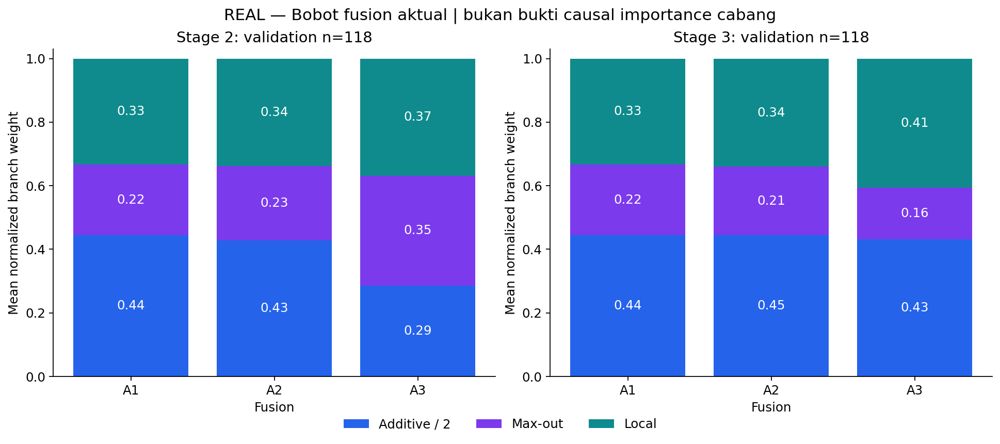

# CP2 Fase A — keputusan dan review attention

**Screening selesai:** A1, A2, A3, A5 dan A6 benar-benar dilatih, total **383 completed epochs**, seed 42. **A0 = L0/B1 dipertahankan** oleh aturan validation yang dipraspesifikasikan. Tidak mengulang B0/B1, tidak memakai L3, dan tidak melanjutkan matriks lain secara otomatis.

[Hasil lengkap dan sembilan grafik](cp2-phase-a.md) · [Metrik](cp2-phase-a-results.json) · [Analisis gate/skala](cp2-phase-a-analysis.json) · [QA artefak](cp2-phase-a-validation.json) · [QA visual/engineering](cp2-phase-a-quality.json) · [Protokol](../docs/cp2-phase-a.md)

## Hasil utama dan keputusan

Angka adalah **mean Image Dice, skala 0–1**. Small berarti 0 < luas GT ≤1% kanvas berpadded 224×224, bukan luas fisik. Semua baris memakai membership dan evaluator yang sama: **671 train, 118 validation, 261 source-test**.

| Model | Epoch dipilih / selesai | Validation Dice | Small validation | Boundary IoU validation | Empty FP validation | Source-test Dice |
|---|---:|---:|---:|---:|---:|---:|
| A0: P-scSE asli, B1 cached | 25 / 55 | 0.8428 | 0.7728 | 0.5393 | 4/7 | 0.8329 |
| A1: local + fixed fusion | 39 / 69 | 0.8463 | 0.8011 | 0.5431 | 5/7 | 0.8250 |
| A2: local + learned constant fusion | 36 / 66 | 0.8450 | 0.7992 | 0.5461 | 5/7 | 0.8455 |
| A3: local + input-dependent global gate | 27 / 57 | 0.8421 | 0.7724 | 0.5380 | 4/7 | 0.8301 |
| A5: tambahan conv, kontrol kapasitas | 21 / 51 | 0.8390 | 0.7804 | 0.5255 | 5/7 | 0.8258 |
| A6: CBAM pada dua stage yang sama | 110 / 140 | 0.8517 | 0.8177 | 0.5543 | 5/7 | 0.8441 |

**Yang terlihat:** A6 mempunyai validation Dice, small Dice dan Boundary IoU tertinggi. Namun A1/A2/A6 menambah satu gambar kosong dengan FP; A3 gagal guard overall/small/boundary; A5 gagal overall/boundary/empty FP. Semua model tetap 0/111 total foreground misses pada validation.

**Artinya:** belum ada kandidat yang memenuhi seluruh kriteria penerimaan. Selection memilih **A0 pada 9 November 2026, 08:45:22 UTC**, sebelum semua ekspor test baru. A2 yang kemudian mencatat source-test Dice tertinggi tidak mengganti keputusan tersebut. A1 telah dianalisis sendiri dan melewati gate *kelayakan perluasan* sebelum A2 dimulai; gate itu tidak sama dengan aturan menerima kandidat.

**Perlu diingat:** hanya tujuh GT-empty validation images. Pada evaluator yang tetap, satu tambahan empty FP mengurangi overall mean sebesar **1/118 = 0,847 poin persentase** jika skor lain tetap. A1 memperbaiki kontribusi kelompok positif +1,202 poin, lalu kehilangan 0,847 poin pada kelompok kosong, sehingga net +0,354 poin. A6 mempunyai pola +1,739 −0,847 = +0,892 poin. GT kosong bukan diagnosis sehat; tidak ada relabeling atau perubahan empty rule setelah melihat model.

## Apa yang dipelajari dari setiap kontras?

Selisih berikut dalam **poin persentase**. Ini perbandingan recipe dengan scheduler dan early stopping adaptif yang sama aturannya; jumlah update aktual tidak disamakan.

| Kontras | Δ overall Dice val / test | Δ small Dice val / test | Δ Boundary IoU val / test |
|---|---:|---:|---:|
| A1 − A0: cabang lokal dengan fixed fusion | +0,354 / −0,787 | +2,822 / +1,802 | +0,383 / +0,397 |
| A2 − A1: learned constant fusion | −0,130 / +2,047 | −0,184 / +0,885 | +0,300 / +1,704 |
| A3 − A2: input-dependent fusion | −0,294 / −1,544 | −2,682 / −2,884 | −0,809 / −1,823 |
| A5 − A0: tambahan kapasitas conv | −0,380 / −0,711 | +0,752 / +0,674 | −1,382 / −1,861 |
| A6 − A0: pembanding CBAM | +0,892 / +1,116 | +4,483 / +2,859 | +1,503 / +1,941 |

**A1:** ada sinyal manfaat numerik untuk small/boundary pada kedua split, tetapi bukan peningkatan menyeluruh: overall source-test turun dan empty FP meningkat. Kontras juga mencakup normalisasi ulang fusion; tidak membuktikan cabang lokal sendirian menyebabkan seluruh perubahan.

**A2:** belajar enam scalar fusion tidak memperbaiki overall/small validation dibanding A1. Perbaikan source-test tidak boleh dipakai memilih ulang metode atau menjanjikan generalisasi.

**A3:** input-dependent gate belum memberikan manfaat tambahan terhadap bobot konstan pada seed/protokol ini. Ini menolak hipotesis peningkatan untuk konfigurasi yang diuji, bukan membuktikan seluruh adaptive attention tidak bermanfaat.

**A5:** parameter aktif tambahan 6.490, dekat A3 6.388 (selisih 1,60%), tetapi overall/boundary turun. Tambahan parameter saja tidak menjelaskan semua pola A1/A6. Kontrol ini tidak menyamakan kapasitas fungsional, operasi, atau gain; bukan pembuktian kausal keunggulan attention.

**A6:** pembanding mapan justru memberi skor validation tertinggi, sehingga hasil tidak mendukung klaim keunggulan metode lokal baru. A6 baru mencapai checkpoint terbaik epoch 110 versus 21–39 pada kandidat lain. Perbedaan budget optimisasi dan gain tetap perlu diperhitungkan; belum ada fixed-update-budget atau multiseed comparison.

Seluruh interval bootstrap berpasangan 95% untuk delta overall Dice terhadap A0 melintasi nol pada validation maupun source-test. Unit resampling adalah RGB group/gambar. Interval ini tidak menangkap ketergantungan pasien/crop yang tidak diketahui, variasi seed, pemilihan checkpoint, atau multiple comparisons; jangan menyebutnya bukti signifikansi atau manfaat klinis.

## Apakah gate benar-benar berubah menurut gambar?

**Yang terlihat:** A2 mempelajari bobot `(additive/2, max-out, local)` sekitar `(0,429; 0,233; 0,338)` pada stage 2 dan `(0,445; 0,214; 0,340)` pada stage 3. A3 rata-rata `(0,286; 0,345; 0,369)` dan `(0,432; 0,161; 0,407)`.

**Artinya:** A3 menggeser rata-rata campuran cabang, tetapi variasi antargambarnya kecil. Standard deviation bobot lokal hanya **0,00217 pada stage 2** dan **0,00421 pada stage 3**; rentangnya masing-masing 0,3646–0,3731 dan 0,4026–0,4227. Heatmap yang hampir rata konsisten dengan angka ini.

**Perlu diingat:** tidak ada gambar dengan max weight >0,95; normalized entropy rata-rata 0,9945/0,9310. Gate tidak collapse menjadi pemilihan satu cabang pada definisi ini, tetapi entropy tinggi juga tidak membuktikan adaptivitas yang berguna. Peta lokal dan bobot gate bukan probabilitas luka atau causal importance. Subgroup GT hanya dipakai untuk pelaporan, tidak menjadi input gate.

## Intervensi dan keadilan skala

Pada validation, menghapus local branch A1 sambil menormalisasi bobot tersisa menurunkan Dice **0,8463→0,8416**; pada A3 **0,8421→0,8305**. Mengganti gate A3 dengan fixed prior memberi **0,8274**, walaupun small Dice naik **0,7724→0,7801**. Empty FP A3 meningkat 4→5 ketika drop-local dan 4→6 ketika fixed-prior.

Intervensi dilakukan **setelah primary selection**, tanpa retraining. Hasil menunjukkan sensitivitas checkpoint terhadap perubahan inference, bukan estimasi kontribusi kausal cabang atau bukti model yang dilatih robust ketika cabang hilang. Fixed-prior inference pada model A3 juga bukan model A1 yang dilatih dari awal.

Fusion A1–A3 menyamakan upper magnitude bound 3|x| dan midpoint nominal dengan source. Namun RMS initial dua gambar yang sama berbeda: pada stage 2 **A0 1,45 vs A1–A3 1,15**, stage 3 **1,99 vs 1,67**. A6 initial hanya sekitar **0,28/0,03**. Menyamakan batas tidak menyamakan distribusi fitur; CBAM memiliki dua sigmoid berurutan dan BN, sementara A5 residual tidak sigmoid-bounded. Setelah training RMS juga mencakup perubahan upstream features. Tidak ada gain yang di-fit menggunakan test atau diagnosis ini.

## Review visual kasus nyata

Sembilan grafik agregat dan dua gallery lokal diperiksa langsung: label, legend, colorbar, skala, marker checkpoint, serta pasangan foto/GT/prediksi terbaca dan selaras. Gallery memakai enam aturan simetris/deterministik, termasuk kegagalan, bukan memilih contoh kemenangan. [Provenance numerik](cp2-phase-a-cases.json) tersedia; foto/GT/overlay tetap lokal pada `outputs/cp2/phase_a/20261108T185142Z/error_analysis/`.

- Validation tidak mempunyai total miss; panel dengan keterangan “Tidak ada kasus” dipertahankan.
- Contoh random validation memberi A0 Dice **0,905** dan A6 **0,745**; random test memberi A0 **0,871** dan A6 **0,301**. Rata-rata A6 yang lebih tinggi tidak berarti semua gambar membaik.
- First-ID test miss `be4c8e6e241704330a2835daa99f732f_0` mempunyai A5 Dice **0**, A0 **0,332**, dan A2 **0,548**.
- GT test terkecil, **20 pixels**, terlewat oleh seluruh model. Peningkatan small Dice rata-rata belum mengatasi semua lesi sangat kecil.
- Contoh GT kosong dan mask multi-komponen memerlukan kemungkinan review anotator ahli. Ini observasi visual, bukan adjudikasi klinis; tidak ada label/split yang diubah.

Zoom gallery mencakup union RGB-content, GT dan semua prediksi, sehingga FP di luar area foto tidak disembunyikan. Semua input dan metrik tetap full 224×224.

## Eksekusi, QA dan batas penelitian

Satu trainer GPU menjalankan lima kandidat berurutan; total invocation sekitar **13,62 jam**. Peak allocator training **2,20–2,29 GiB**, reserved **2,32–2,42 GiB**. Overall GPU sempat terpakai sekitar **77 GiB** oleh gabungan proses lain; angka itu bukan kebutuhan model ini. Latency batch-1 sekitar 43,9–59,6 ms di GPU bersama, bukan benchmark hardware eksklusif atau dasar ranking kecepatan. Tidak ada kegagalan training fase A yang tercatat; interupsi shared-memory fase L tidak diatribusikan ke fase A. Rekomendasi concurrency tetap satu job sampai shared GPU dan `/dev/shm` diukur kembali; jangan mengisi VRAM dengan batch/AMP/job tambahan tanpa protokol.

**103 tests lulus**, lima smoke real-data lulus, dan semua **9.680 historical/user files** tetap identik. Seluruh pairable initial tensors, input order dan augmented bytes pada common epochs cocok; A1/A2/A3 juga local tensors serta initial forward sama persis. Replay checkpoint pada **118 validation images × enam model = 708 probability maps** bit-identical. Sebanyak **1.895 prediksi primary baru** dan **354 prediksi intervensi** dihitung ulang dari artefak; checksum, GT, threshold ≥0,5, metrik, membership serta chronology seleksi lulus. Log percobaan test suite di environment training yang kekurangan Matplotlib disimpan; suite final dijalankan sukses pada environment test proyek `.venv-xfuseg`, tanpa instalasi package.

Ini screening **satu seed**, duplicate-RGB-group split, **bukan patient-level**. Zero exact-RGB overlap tidak membuktikan crop/wound/patient independen. Validation sudah digunakan berulang pada P/L/A dan source-test sudah terekspos sejak CP1; keduanya tidak mendukung klaim confirmatory. Tidak ada dataset eksternal atau klaim novelty global/SOTA/manfaat klinis.

Rekomendasi berikutnya: pertahankan **B1** sebagai pembanding; audit anotasi GT-empty dengan prosedur independen dari ranking model, dan konfirmasi kandidat terbatas dengan protokol serta budget yang dikunci jika peninjauan riset menyetujui. **L3 tetap tersimpan** untuk kombinasi mendatang. **A4, perluasan lokasi, kombinasi L3, boundary head, multiseed dan evaluasi eksternal belum dijalankan**; tidak melanjutkannya otomatis.
