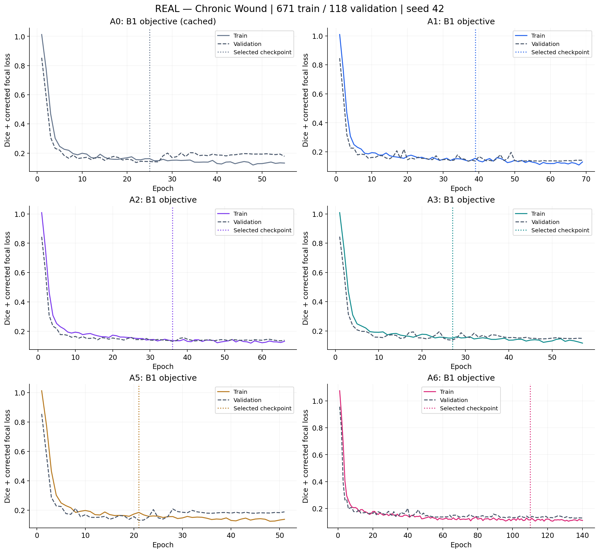
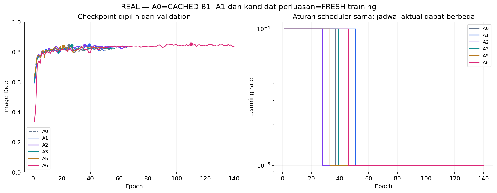
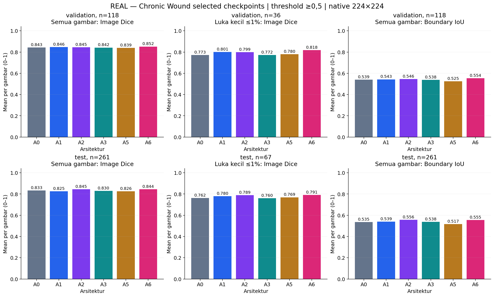
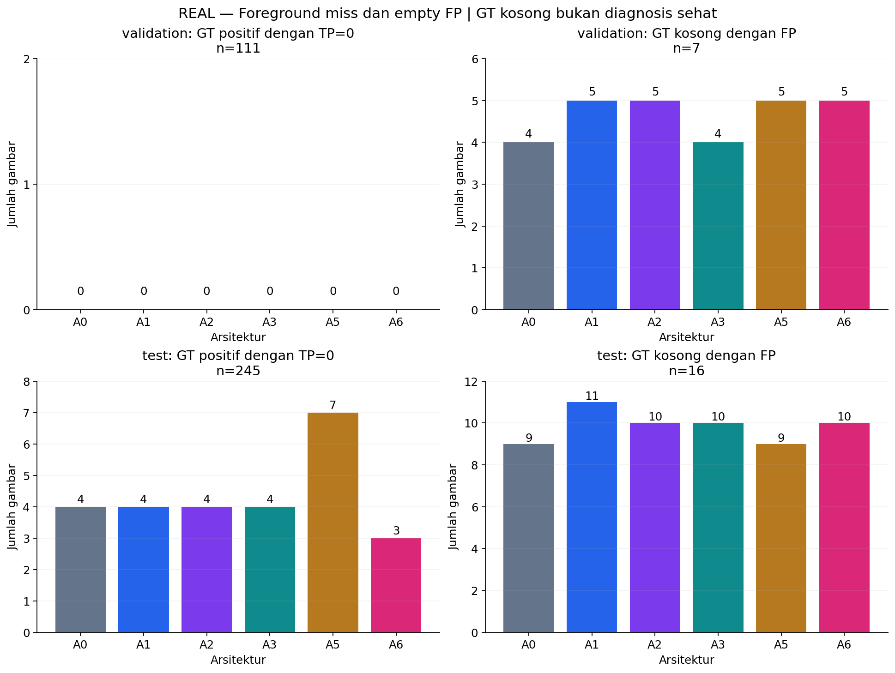
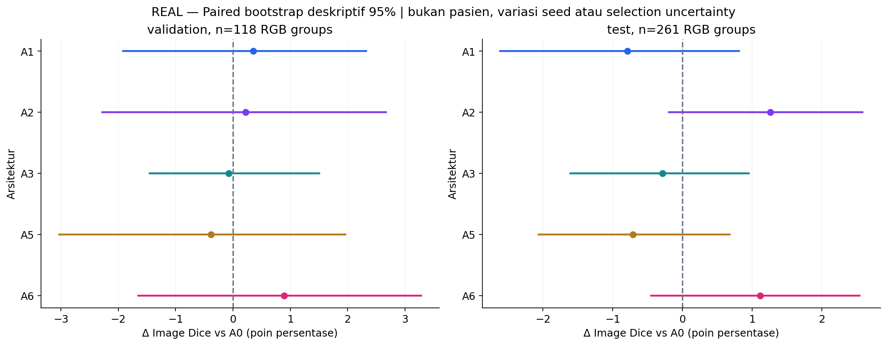
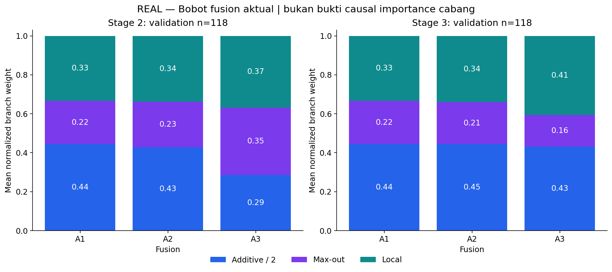
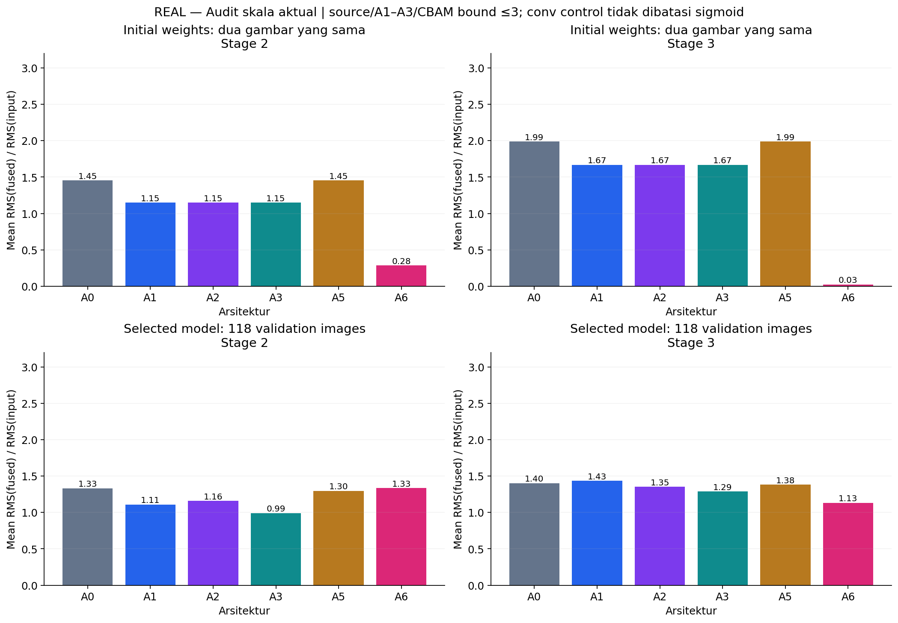
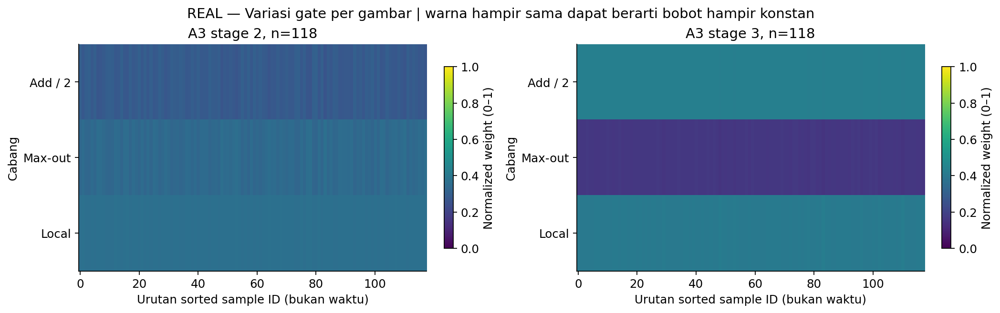
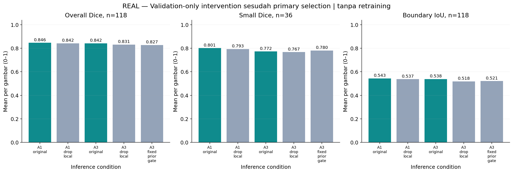

# CP2 Fase A — attention screening

**COMPLETED — model yang dilaporkan benar-benar dilatih/evaluasi, seed 42.** A0 adalah B1 cached; tidak mengulang B0/B1. L3 tetap tersimpan untuk kombinasi mendatang.

Run `outputs/cp2/phase_a/20261108T185142Z`. Preregistration commit `d8242d79b3fd04052ac5e26ef8677c327b4c01cc`. Manifest tetap **671/118/261**, duplicate-RGB-group split, **bukan patient-level**. Tidak ada external data atau perubahan precision/environment.

[Protokol dan hipotesis](../docs/cp2-phase-a.md) · [Config](../configs/cp2/phase_a.json) · [Results JSON](cp2-phase-a-results.json) · [Gate/RMS/intervention JSON](cp2-phase-a-analysis.json)

## Alur dan keputusan bertahap

A1 diselesaikan dan dianalisis pada validation sebelum keputusan perluasan. Gate kelayakan tidak sama dengan guard menerima peningkatan. Kriteria/matriks tidak ditentukan dari source-test.

Keputusan perluasan A1: **True**, checks `{'overall_floor': True, 'small_floor': True, 'miss_limit': True, 'empty_fp_limit': True}`. Executed fresh: A1, A2, A3, A5, A6. A4/spatial gate tetap deferred.

Semua model memakai **B1 Dice + corrected-logit focal**; split, source preprocessing/augmentasi, shared initialization, batch 2, Adam, float32/TF32 flags, max 200/early-stop 30, validation-Dice checkpoint dan scheduler tetap. Core step/evaluator P/L digunakan ulang tanpa mengedit historical sources. Modul bersama diverifikasi per tensor, local A1/A2/A3 dipasangkan, initial forward A1/A2/A3 identik. Stage 2–3 saja berubah; final stage 4 tetap.

## Hasil selected checkpoints

| Model | Epoch dipilih / selesai | Val Image Dice | Test Image Dice | Small val / test | Boundary IoU val / test |
|---|---:|---:|---:|---:|---:|
| A0 | 25 / 55 | 0.8428 | 0.8329 | 0.7728 / 0.7622 | 0.5393 / 0.5353 |
| A1 | 39 / 69 | 0.8463 | 0.8250 | 0.8011 / 0.7802 | 0.5431 / 0.5393 |
| A2 | 36 / 66 | 0.8450 | 0.8455 | 0.7992 / 0.7891 | 0.5461 / 0.5564 |
| A3 | 27 / 57 | 0.8421 | 0.8301 | 0.7724 / 0.7602 | 0.5380 / 0.5381 |
| A5 | 21 / 51 | 0.8390 | 0.8258 | 0.7804 / 0.7690 | 0.5255 / 0.5167 |
| A6 | 110 / 140 | 0.8517 | 0.8441 | 0.8177 / 0.7908 | 0.5543 / 0.5547 |

**Dipilih sebelum test baru: A0.** Guard: overall validation Dice naik; small/Boundary IoU tidak turun; total miss/empty FP tidak bertambah; active params ≤1,01×A0. Jika tidak ada eligible, A0 dipertahankan. Semua executed test results tetap dilaporkan. Source-test sudah dipakai CP1/P/L dan hasil berikut bersifat eksploratif, bukan confirmatory.

| Model | Eligible | Validation checks |
|---|---|---|
| A1 | False | `{'higher_overall_dice': True, 'small_not_lower': True, 'boundary_not_lower': True, 'no_extra_total_miss': True, 'no_extra_empty_fp': False, 'capacity_budget': True}` |
| A2 | False | `{'higher_overall_dice': True, 'small_not_lower': True, 'boundary_not_lower': True, 'no_extra_total_miss': True, 'no_extra_empty_fp': False, 'capacity_budget': True}` |
| A3 | False | `{'higher_overall_dice': False, 'small_not_lower': False, 'boundary_not_lower': False, 'no_extra_total_miss': True, 'no_extra_empty_fp': True, 'capacity_budget': True}` |
| A5 | False | `{'higher_overall_dice': False, 'small_not_lower': True, 'boundary_not_lower': False, 'no_extra_total_miss': True, 'no_extra_empty_fp': False, 'capacity_budget': True}` |
| A6 | False | `{'higher_overall_dice': True, 'small_not_lower': True, 'boundary_not_lower': True, 'no_extra_total_miss': True, 'no_extra_empty_fp': False, 'capacity_budget': True}` |

Objective tetap B1, sehingga definisi loss sama. Train memakai augmentasi; garis vertikal mengikuti puncak validation Image Dice, bukan minimum loss. Budget/jadwal aktual berbeda akibat early stopping.

Kriteria checkpoint/scheduler sama, tetapi peak dan waktu penurunan LR dapat berbeda. Ini perbandingan recipe adaptif; bukan fixed-update-budget ablation.

Semua model dibandingkan pada gambar yang sama. Small berarti ≤1% kanvas berpadded, bukan luas fisik. Baca overall bersama GT-positive/empty dan aggregate-pixel metrics.

TP=0 dan empty FP dihitung sebagai jumlah gambar. Nol yang dianotasi benar-benar berarti tidak ada kasus. GT kosong bukan diagnosis sehat; FP pixels dapat berbeda meski jumlah gambar sama.

Unit bootstrap adalah pasangan RGB group/gambar, bukan piksel. Interval tidak mencakup pasien/crop yang tidak diketahui, seed, checkpoint selection atau multiple comparisons; bukan bukti signifikansi klinis.

Bobot aktual mengikuti normalisasi cabang dan gain 3 yang dipraspesifikasikan. Mean serupa tidak membuktikan gate identik; per-image variance/entropy ada pada JSON. Bobot bukan causal importance.

Baris initial memakai dua validation images yang sama, tanpa fitting gain atau update bobot. Baris selected juga mencakup perubahan fitur upstream selama training. Bound/konvensi skala sama tidak menjamin distribusi aktivasi identik; CBAM midpoint berbeda dan conv residual tidak sigmoid-bounded.

Heatmap berisi bobot model A3 dari gambar nyata, urut sample ID, bukan temporal sequence. Warna yang hampir rata harus dibaca bersama nilai std/entropy; tidak boleh dipaksa menjadi bukti adaptivitas.

Hanya inference validation setelah selection; drop-local menormalisasi bobot tersisa, fixed-prior mengganti learned gate. Tidak melatih ulang, tidak menunjukkan missing-branch robustness atau penyebab fisiologis.

## Subgroups dan biaya

| Split | Model | GT-positive Dice | GT-empty Dice | TP=0 / GT-positive n | Empty FP / empty n | Empty FP pixels | Data Dice | Pixel precision / recall | PFOM |
|---|---|---:|---:|---:|---:|---:|---:|---:|---:|
| validation | A0 | 0.8689 | 0.4286 | 0 / 111 | 4 / 7 | 526 | 0.9151 | 0.9199 / 0.9104 | 0.7411 |
| validation | A1 | 0.8817 | 0.2857 | 0 / 111 | 5 / 7 | 777 | 0.9165 | 0.9274 / 0.9058 | 0.7475 |
| validation | A2 | 0.8803 | 0.2857 | 0 / 111 | 5 / 7 | 786 | 0.9217 | 0.9224 / 0.9211 | 0.7478 |
| validation | A3 | 0.8681 | 0.4286 | 0 / 111 | 4 / 7 | 412 | 0.9194 | 0.9158 / 0.9230 | 0.7440 |
| validation | A5 | 0.8739 | 0.2857 | 0 / 111 | 5 / 7 | 519 | 0.9261 | 0.9150 / 0.9375 | 0.7434 |
| validation | A6 | 0.8874 | 0.2857 | 0 / 111 | 5 / 7 | 735 | 0.9256 | 0.9253 / 0.9260 | 0.7585 |
| test | A0 | 0.8587 | 0.4375 | 4 / 245 | 9 / 16 | 1710 | 0.9077 | 0.9423 / 0.8756 | 0.7311 |
| test | A1 | 0.8585 | 0.3125 | 4 / 245 | 11 / 16 | 1727 | 0.9052 | 0.9432 / 0.8701 | 0.7299 |
| test | A2 | 0.8762 | 0.3750 | 4 / 245 | 10 / 16 | 2174 | 0.9231 | 0.9275 / 0.9187 | 0.7544 |
| test | A3 | 0.8598 | 0.3750 | 4 / 245 | 10 / 16 | 2049 | 0.9183 | 0.9293 / 0.9076 | 0.7332 |
| test | A5 | 0.8511 | 0.4375 | 7 / 245 | 9 / 16 | 2065 | 0.9108 | 0.9052 / 0.9164 | 0.7304 |
| test | A6 | 0.8747 | 0.3750 | 3 / 245 | 10 / 16 | 3098 | 0.9204 | 0.9382 / 0.9032 | 0.7518 |

| Model | Registered / active parameters | Conv+Linear MACs/image | Training invocation (min) | Peak training alloc / reserved (GiB) | Batch-1 median / P95 (ms) |
|---|---:|---:|---:|---:|---:|
| A0 | 70,968,939 / 64,898,248 | 6,806,443,200 | 87.91 | 2.22 / 2.33 | 45.25 / 57.29 |
| A1 | 70,972,285 / 64,901,594 | 6,828,018,880 | 125.05 | 2.24 / 2.37 | 46.35 / 57.36 |
| A2 | 70,972,291 / 64,901,600 | 6,828,018,880 | 110.36 | 2.29 / 2.42 | 43.92 / 49.84 |
| A3 | 70,975,327 / 64,904,636 | 6,828,021,897 | 89.42 | 2.29 / 2.42 | 48.03 / 59.16 |
| A5 | 70,975,429 / 64,904,738 | 6,845,329,600 | 82.16 | 2.24 / 2.37 | 47.73 / 60.52 |
| A6 | 70,975,382 / 64,891,593 | 6,803,664,704 | 410.50 | 2.20 / 2.32 | 59.59 / 71.39 |

Active params dihitung dari actual forward calls, tidak memasukkan dormant source modules. A5 added active params dibandingkan A3 berjarak sekitar 1,6%, tetapi operasi dan kapasitas fungsional tidak identik. MACs hanya Conv2d/Linear, bukan seluruh pooling/normalisasi/elementwise. Latency mencakup forward+sigmoid, same-image/warmup 5/30 synchronized steps, tanpa data/GT/loss/export. GPU bersama dapat berubah; A0 training berasal dari waktu P yang berbeda. Waktu/peak invocation pada resume tidak mencakup semua percobaan; log dan status mentah tetap tersedia. [Resource JSON](cp2-phase-a-resources.json) memuat waktu per epoch/step, sampled overall GPU dan shared-memory headroom. Satu job tetap dipertahankan; VRAM kosong bukan alasan menaikkan batch/AMP/concurrency.

## Batas kesimpulan dan artefak

Screening satu seed tidak menetapkan novelty, signifikansi atau manfaat klinis. Tidak mengubah annotation/empty rule berdasarkan model; pasien dan crop grouping belum diketahui. Source-test bukan untouched test. Gate/spatial map bukan causal explanation. L3 combination, A4, all-stage placement, H, multiseed dan external evaluation belum dijalankan.

Artefak lokal: protocol/manifest/initial weights, checkpoints/optimizer/scheduler/RNG, per-image probabilities/GT/masks, logs dan GPU/shared-memory samples. Foto/GT/overlay klinis tetap lokal. Public numeric membership, per-image tables, trained gate/RMS table, aggregate figures dan source disimpan di repository.

[QA](cp2-phase-a-validation.json) · [Review akhir](cp2-phase-a-review.md) · [Review visual/engineering](cp2-phase-a-quality.json). Berkas hanya diterbitkan setelah pemeriksaan aktual selesai.
