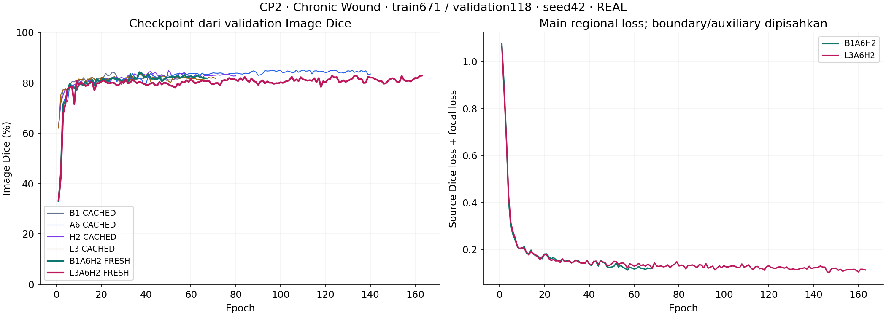
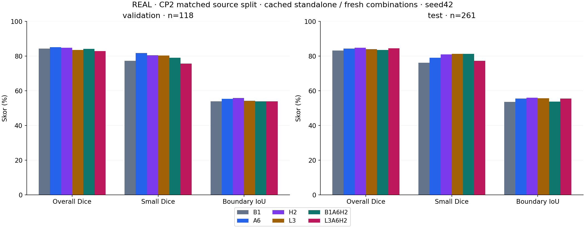

# CP2 Fase C — dua kombinasi CBAM A6 dan H2

**COMPLETED — TWO REAL FULL TRAININGS, seed42.** Run `outputs/cp2/phase_c_combinations/20261119T004726Z`. [Preregistration](../docs/cp2-phase-c-combinations.md) · [Config](../configs/cp2/phase_c_combinations.json).

## Pertanyaan dan kontrol

Apakah kandidat CBAM A6 dan H2 saling melengkapi, dan apakah mengganti main loss B1 menjadi L3 membantu arsitektur gabungan yang sama? B1/A6/H2/L3 cached, tidak dilatih ulang. Historical A1+H2, N1, konfirmasi seed lain dan cascade tetap utuh. Skor terbaik individual tidak menjamin kombinasi terbaik; ketidaklulusan guard historis tidak dihapus.

**B1A6H2:** B1(main mask) +0.1 B1(auxiliary morphological boundary). **L3A6H2:** objective pertama +0.01 mean(sigmoid(main logits) × signed-distance actual augmented GT). L3 sudah mencakup B1; tidak menjumlahkan B1 dua kali. L3 hanya pada main mask, bukan target auxiliary. Signed distance loss dan H2 boundary target mempunyai peran/definisi berbeda dan mungkin redundan.

Kedua run memakai CBAM A6 persis pada decoder stage2–3, termasuk gain3, dan H2 Conv1x1(32,1) dari feature112×112 yang di-upsample ke224. Boundary logits tidak mengarahkan attention; bukan H3. Whole initial model state identik; source tensors, A6 CBAM tensors dan H2 head persis kontrol historis, tanpa warm-start checkpoint terlatih. Main/aux forward awal bit-exact dan actual training input bytes/order dipasangkan pada common epochs.

Split671/118/261 dan seed42 tetap; duplicate-RGB grouping bukan patient-level. Adam1e-4/WD1e-5, batch2/workers4, FP32 tanpaAMP, TF32/augmentation/RNG/evaluator/threshold≥0.5 tetap. Checkpoint earliest strictly best validation Image Dice; Plateau factor0.1/patience10/minLR1e-5, max200epoch, early-stop30. Semua kriteria dipreregister; source-test dan CO2 yang sudah pernah dilihat tidak memilih konfigurasi. Tidak ada inference eksternal baru pada dua run ini.

## Hasil lengkap

| Model | Split | Image Dice | Data Dice | GT+ Dice | Small Dice | Boundary IoU | GT+ recall | Miss | Empty FP images | Empty FP pixels |
| :--- | :--- | ---: | ---: | ---: | ---: | ---: | ---: | ---: | ---: | ---: |
| B1 | validation | 84.28% | 91.51% | 86.89% | 77.28% | 53.93% | 91.04% | 0 | 4/7 | 526 |
| B1 | test | 83.29% | 90.77% | 85.87% | 76.22% | 53.53% | 87.56% | 4 | 9/16 | 1710 |
| A6 | validation | 85.17% | 92.56% | 88.74% | 81.77% | 55.43% | 92.60% | 0 | 5/7 | 735 |
| A6 | test | 84.41% | 92.04% | 87.47% | 79.08% | 55.47% | 90.32% | 3 | 10/16 | 3098 |
| H2 | validation | 84.88% | 92.07% | 88.43% | 80.56% | 55.77% | 91.62% | 0 | 5/7 | 721 |
| H2 | test | 84.77% | 91.50% | 87.86% | 80.92% | 55.96% | 90.12% | 0 | 10/16 | 2085 |
| L3 | validation | 83.60% | 89.40% | 87.07% | 80.40% | 54.25% | 86.57% | 0 | 5/7 | 779 |
| L3 | test | 83.97% | 89.13% | 86.60% | 81.36% | 55.63% | 84.90% | 4 | 9/16 | 1752 |
| B1A6H2 | validation | 84.24% | 92.30% | 87.75% | 79.06% | 53.99% | 93.10% | 1 | 5/7 | 847 |
| B1A6H2 | test | 83.54% | 91.93% | 87.77% | 81.32% | 53.73% | 91.48% | 1 | 13/16 | 2362 |
| L3A6H2 | validation | 82.96% | 90.50% | 85.49% | 75.65% | 53.89% | 87.89% | 1 | 4/7 | 531 |
| L3A6H2 | test | 84.44% | 92.03% | 86.28% | 77.22% | 55.47% | 89.43% | 7 | 7/16 | 1244 |

**Yang terlihat:** validation curves enam kondisi dan regional loss kedua run baru. **Artinya:** checkpoint dipilih dari primary validation, sedangkan main signed-distance dan auxiliary losses dicatat terpisah dalam history JSON. **Perlu diingat:** scheduler sama aturannya, tetapi epoch/update aktual berbeda. Tidak membandingkan total loss dua resep sebagai ukuran kualitas yang sama.

**Yang terlihat:** overall/small/boundary pada populasi yang identik per split. **Artinya:** perubahan dapat diperiksa bersama false-positive dan miss pada tabel, bukan hanya satu skor. **Perlu diingat:** hanya7 validation GT-empty dan satu seed; source-test sudah terekspos.

## Seleksi dan kontras

Dipilih **B1** dari source validation. Guard original terhadap B1: overall meningkat, small/boundary tidak turun, misses/empty-FP images tidak bertambah, active training parameters≤1.01×B1. Kombinasi juga harus melampaui standalone relevan pada overall validation (A6/H2, ditambah L3 untuk resep L3). Ranking hanya eligible; tie memilih loss B1 yang lebih sederhana. Jika semua gagal, baseline tetap B1. Keputusan disimpan sebelum semua test probabilities baru.

Validation Image Dice: B1A6H2−B1 **-0.033pp**; B1A6H2−A6 **-0.925pp**; L3A6H2−B1A6H2 **-1.279pp**. Seluruh perbedaan, subgroup, FP/miss dan descriptive A6×H2 interaction tersedia di JSON.

Ini **bukan full2³ matrix**: L3+A6 dan L3+H2 belum diuji. Selisih dua run baru mengukur perubahan loss pada resep gabungan yang dipasangkan, bukan interaksi tiga-arah yang teridentifikasi atau bukti sinergi kausal. Belum ada konfirmasi multiseed atau validasi pasien independen.

## Biaya dan QA

| Run | Best / completed epoch | Training hours | Peak allocated / reserved GiB | Active training params | Mask-only params |
| :--- | ---: | ---: | ---: | ---: | ---: |
| B1A6H2 | 37 / 67 | 3.93 | 2.21 / 2.32 | 64891626 | 64891593 |
| L3A6H2 | 133 / 163 | 10.49 | 2.21 / 2.32 | 64891626 | 64891593 |

Waktu/VRAM di GPU shared, bukan latency benchmark paper. H2 head33parameter dapat dilepas tanpa perubahan primary mask; MAC Conv/Linear dan parameter terdaftar/aktif tersedia di JSON. Kedua kombinasi berjalan sequential, dengan izin overlap satu training kombinasi dan cascade. Penundaan menunggu cascade dibuka melalui scheduling amendment sebelum training pertama; konfigurasi ilmiah, inisialisasi, loss, data dan seleksi tidak berubah. Runtime/VRAM berasal dari GPU shared dengan concurrent workloads. Tidak mengubah proses orang lain atau shared environment.

**2274 predictions diverifikasi**, termasuk758fresh. Checksums/rawGT/threshold/per-image dan aggregate metrics/CSV diverifikasi, earliest checkpoints dan strict reload main/aux bit-exact. Paired initializer, unique per-loss identities, actual input pairing, chronological selection dan seluruh548protected files lulus. [QA](cp2-phase-c-combinations-validation.json). **Visual review PASSED:** kedua actual PNG telah dibuka; font, sumbu, legend, skala dan kesesuaian isi diperiksa. Canonical QA saat generasi tetap utuh; bukti review dan recovery ditambahkan pada QA publik.

Reproduksi: environment existing, `scripts/run_cp2_combinations.py --root <new append-only run> --stage prepare`, lalu `--stage queue`. Interrupted stages memerlukan inspected `--resume`; code/config/input/environment harus sama, completed stages tidak dilatih ulang. Checkpoints, source media, masks dan probability maps tetap lokal. Semua hasil merupakan eksplorasi satu sumber; tidak menyatakan keunggulan atas paper atau validitas klinis.

## Pemulihan publikasi — 20 November 2026

Training dan inference kedua run selesai pada19November; tahap report sempat berhenti karena source partner dipindah dari `notebook/` ke `notebook/scripts/`. SHA256 source tetap `c476b328f47e241e6114eebb310ddf5ada9f2c714d2fa8fadbc2491b7091c371`. Dispatcher reporting terpisah memverifikasi perpindahan ini serta seluruh isi inventory, tanpa mengedit inventory, source training yang dipreregister, atau direktori partner. File lain yang hilang/berubah tetap menyebabkan audit gagal.

Seluruh2.274 prediksi (758 dari model baru dan1.516 cached controls) dihitung ulang dari NPZ/GT dan dibandingkan dengan CSV/metrik tersimpan. Checkpoint, initial weights, identitas loss, urutan input, pemilihan epoch, dan kronologi validation→test diperiksa. **Tidak ada training atau inference model baru** saat pemulihan laporan; seluruh pemeriksaan dilakukan di CPU2threads. Training Cascade yang masih aktif tidak disentuh.

Original failure log dan `workflow.json` yang failed dipertahankan sebagai bukti historis. Status penyelesaian pelaporan terpisah tercatat dalam `report_publication.json`, serta [manifest publikasi](cp2-phase-c-combinations-publication.json). Laporan/figure P0 terdahulu tetap snapshot saat kombinasi belum final; laporan ini memberikan hasil completed terbaru.

History training: [B1A6H2, 67 epoch](training/cp2-combinations-b1a6h2-history.csv) dan [L3A6H2, 163 epoch](training/cp2-combinations-l3a6h2-history.csv). Nilai validation Image Dice pada CSV adalah fraction, sedangkan grafik/tabel laporan menggunakan persen. CSV per gambar untuk keenam kondisi tersedia sebagai `reports/tables/cp2-combinations-<model>-<split>.csv`; model weights dan probability caches tetap lokal.

Kode pemulihan: [`scripts/publish_cp2_combinations.py`](../scripts/publish_cp2_combinations.py). Dispatcher membutuhkan inference completed dan baseline inventory publikasi sebelum eksekusi. Jika `final_validation.json` sudah tersedia, ia berhenti untuk mempertahankan QA tersebut; jangan menjalankan ulang worker training untuk membuat laporan. Future training/reproduction memakai runner dan konfigurasi asli pada direktori baru, bukan mengganti file hasil run completed ini.
