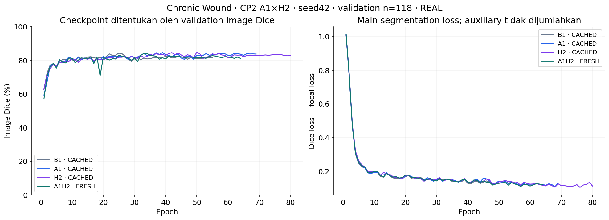
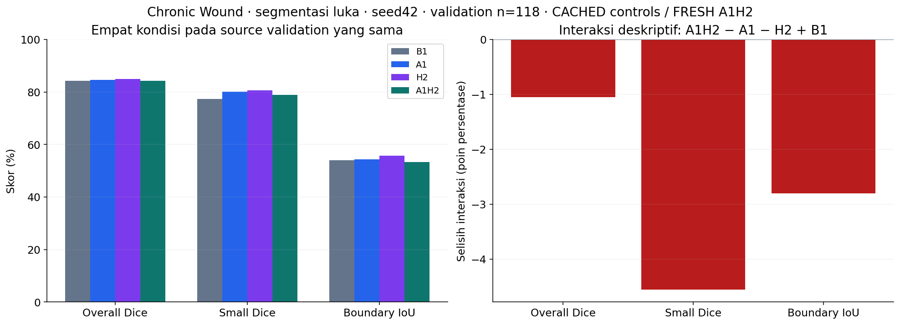

# CP2 Fase C — interaksi local attention A1 dan boundary supervision H2

**COMPLETED — satu full training A1H2 seed42. B1/A1/H2 cached; tidak dilatih ulang.**

Run: `outputs/cp2/phase_c/20261118T140338Z`. [Preregistration](../docs/cp2-phase-c.md) · [Config](../configs/cp2/phase_c.json) · [JSON](cp2-phase-c-results.json).

## Pertanyaan dan metode

Apakah cabang lokal A1 dan supervisi batas H2 saling melengkapi? Kedua komponen belum lolos seluruh guard individual. Percobaan ini menguji hipotesis interaksi baru; hasil lama tetap berlaku. Tidak mengasumsikan manfaat komponen otomatis dijumlahkan.

A1: DWConv3×3 → PWConv1×1 → sigmoid spatial map, decoder stage2–3, fixed fusion dan gain3 yang sama dengan fase A. H2: auxiliary Conv2d(32,1,1) dari output decoder stage3, upsample logits ke224, target morphological gradient3×3 sesudah augmentasi. Objective = **B1(main,mask) +0,1×B1(aux,boundary)**, menggunakan Dice dan corrected-logit focal yang sama seperti fase H. Boundary logits tidak menjadi input attention; ini **bukan H3**. Auxiliary head dapat dilepas saat mask inference.

Split671/118/261, preprocessing/augmentasi, shared source/local/head initial tensors dan actual input bytes dipasangkan. Seed42, batch2/workers4, Adam1e-4/WD1e-5, FP32/TF32, max200, Plateau validation-Dice/patience10, early stopping30 dan earliest strictly best validation Image Dice sama dengan kontrol. Tidak ada warm-start dari checkpoint terlatih, loss L3, CBAM, presence head atau target tuning.

## Seluruh hasil

| Model | Split | Image Dice | Data Dice | GT+ Dice | Small Dice | Boundary IoU | GT+ pixel recall | Miss | Empty FP images / total | Empty FP pixels |
| :--- | :--- | ---: | ---: | ---: | ---: | ---: | ---: | ---: | ---: | ---: |
| B1 | validation | 84.28% | 91.51% | 86.89% | 77.28% | 53.93% | 91.04% | 0 | 4 / 7 | 526 |
| B1 | test | 83.29% | 90.77% | 85.87% | 76.22% | 53.53% | 87.56% | 4 | 9 / 16 | 1710 |
| A1 | validation | 84.63% | 91.65% | 88.17% | 80.11% | 54.31% | 90.58% | 0 | 5 / 7 | 777 |
| A1 | test | 82.50% | 90.52% | 85.85% | 78.02% | 53.93% | 87.01% | 4 | 11 / 16 | 1727 |
| H2 | validation | 84.88% | 92.07% | 88.43% | 80.56% | 55.77% | 91.62% | 0 | 5 / 7 | 721 |
| H2 | test | 84.77% | 91.50% | 87.86% | 80.92% | 55.96% | 90.12% | 0 | 10 / 16 | 2085 |
| A1H2 | validation | 84.18% | 91.41% | 87.69% | 78.83% | 53.35% | 90.45% | 0 | 5 / 7 | 713 |
| A1H2 | test | 83.98% | 91.35% | 86.61% | 78.63% | 54.59% | 89.03% | 4 | 9 / 16 | 1314 |

**Yang terlihat:** semua kurva kondisi, CACHED/FRESH dinyatakan; main loss dipisahkan dari auxiliary. **Artinya:** checkpoint ditentukan oleh validation Image Dice, bukan perbandingan total loss yang berbeda. **Perlu diingat:** aturan scheduler sama tetapi jumlah epoch/update aktual berbeda, sehingga ini perbandingan recipe, bukan fixed-update-budget experiment.

## Interaksi dan nilai tambahan

Validation Image Dice A1H2−B1 = **-0.093 poin**; A1H2−A1 = **-0.447**; A1H2−H2 = **-0.699**. Interaksi = A1H2−A1−H2+B1 = **-1.053 poin**.

**Yang terlihat:** metrik keempat kondisi dan selisih interaksi numeriknya pada source validation. **Artinya:** interaksi positif berarti gabungan melampaui jumlah efek individual pada skala yang ditulis; belum tentu mengungguli kontrol terbaik atau lolos FP guard. **Perlu diingat:** satu seed, validation reuse, nonlinear metrics dan adaptive training membatasi interpretasi. Ini tidak membuktikan sinergi kausal, signifikansi statistik, generalisasi pasien atau novelty.

Semua delta, termasuk positive-pixel recall, GT-positive Dice, empty-FP images/pixels dan total miss tersedia di JSON. Source-test dilaporkan deskriptif setelah selection tersimpan; tidak digunakan mengubah konfigurasi atau keputusan.

## Seleksi dan biaya

Selected **B1**; eligible **False**. Original CP2 guards: `{'higher_overall_dice': False, 'small_not_lower': True, 'boundary_not_lower': False, 'no_extra_total_miss': True, 'no_extra_empty_fp': False, 'capacity_budget': True}`. Lebih tinggi dari kedua individual pada overall validation: **False**.

Guard historis overall/small/boundary/misses/empty-FP/capacity dipertahankan. Tambahan nilai kombinasi mensyaratkan overall validation Dice melampaui A1 dan H2. Tidak meloloskan ulang individual yang gagal dan tidak memperluas matriks otomatis. Bila eligible, perlu review replikasi sebelum mengklaim peningkatan; jika gagal, B1 tetap baseline.

Epoch selected/completed **34/64**, waktu invocation **4.11 jam**, peak allocated/reserved **2.24/2.37 GiB**. Empat profil parameter/MAC training dan mask-only ada pada JSON. Waktu GPU shared bukan latency benchmark eksklusif. Boundary auxiliary tidak menambah parameter aktif saat mask-only inference.

## QA dan keterbatasan

1516 prediksi total diverifikasi, terdiri dari 379 fresh dan sisanya cached; checksum, raw GT, threshold≥0,5, metrik dan CSV cocok. Source, local tensors dan boundary head diinisialisasi persis kontrol. First actual full-training step memeriksa encoder/kedua local branch/boundary head; seluruh langkah menolak nonfinite. Checkpoint main/aux reload bit-exact dan earliest-best policy diverifikasi. Tidak ada smoke training terpisah. [QA](cp2-phase-c-validation.json).

Seluruh 505 historical/user files dalam inventory tetap utuh. Duplicate-RGB grouping bukan patient split; patient ID tidak tersedia. Tujuh GT-empty validation membatasi kepastian FP. CO2Wounds sudah dilihat dan tidak digunakan memilih konfigurasi C; evaluasi eksternal baru tidak dijalankan. Tidak ada media pasien dalam output publik.

**Visual review: PASSED — kedua PNG diperiksa langsung: label, satuan, legend, skala, keterbacaan dan representasi metrik sesuai. Bukti hash disimpan append-only pada `visual_review.json` run; canonical training metrics dan final_validation.json tidak diubah.**
