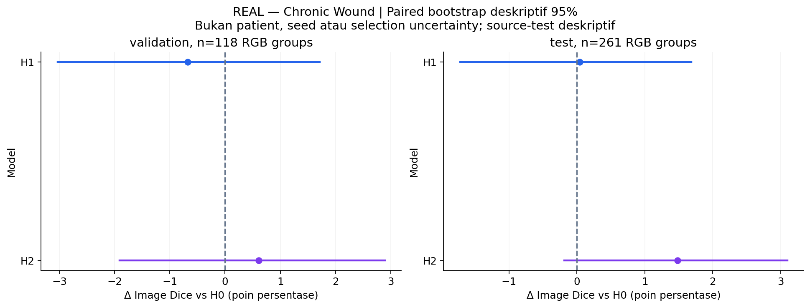

# CP2 Fase H — keputusan dan review auxiliary supervision

**Screening H1/H2 selesai**, satu seed 42, total **135 completed epochs**. **H0 = L0/B1 dipertahankan** oleh aturan validation yang dikunci sebelum training. Tidak mengulang B0/B1, L atau A; tidak memakai L3 atau attention baru.

[Hasil dan enam grafik](cp2-phase-h.md) · [Metrik lengkap](cp2-phase-h-results.json) · [Diagnosis auxiliary](cp2-phase-h-analysis.json) · [Artifact QA](cp2-phase-h-validation.json) · [Visual/engineering QA](cp2-phase-h-quality.json) · [Protokol preregistered](../docs/cp2-phase-h.md)

## Hasil dan keputusan

Semua skor pada tabel berikut adalah **mean Image Dice atau mean Boundary IoU, skala 0–1, dari mask utama**. Small berarti 0 < luas GT ≤1% kanvas berpadded 224×224. Membership tetap **671 train / 118 validation / 261 eligible source-test**; raw source tetap 831/278. Ini duplicate-RGB-group split, **bukan patient-level**.

| Model | Auxiliary target | Epoch dipilih / selesai | Val Dice | Small val | Boundary IoU val | Empty FP val | Source-test Dice |
|---|---|---:|---:|---:|---:|---:|---:|
| H0: B1 cached | Tidak ada | 25 / 55 | 0.8428 | 0.7728 | 0.5393 | 4/7 | 0.8329 |
| H1 | Mask segmentasi | 25 / 55 | 0.8360 | 0.7850 | 0.5342 | 4/7 | 0.8333 |
| H2 | Morphological boundary 3×3 | 50 / 80 | 0.8488 | 0.8056 | 0.5577 | 5/7 | 0.8477 |

**Yang terlihat:** H1 meningkatkan small validation Dice, tetapi overall Dice dan Boundary IoU turun. H2 meningkatkan ketiganya dibanding H0, dengan 0/111 total foreground misses pada validation, tetapi empty-FP images bertambah 4→5 dan empty-FP pixels 526→721.

**Artinya:** H1 gagal guard overall/boundary; H2 gagal guard empty FP. Selection memilih **H0 pada 12 November 2026, 16:56:35 UTC**, sebelum semua ekspor test baru. Hasil source-test yang kemudian lebih tinggi tidak mengubah keputusan ini. Gate H1 pada 13:38:54 UTC hanya memeriksa kelayakan menjalankan H2, bukan menerima H1 sebagai peningkatan.

**Perlu diingat:** hanya tujuh GT-empty validation images. Pada evaluator yang tetap, satu tambahan empty FP mengurangi overall mean **1/118 = 0,847 poin persentase** jika kontribusi lain tetap. H2 memperbaiki kontribusi GT-positive sebesar +1,454 poin, lalu kehilangan 0,847 poin dari kelompok kosong, sehingga net +0,606 poin. Tidak ada pengubahan threshold, empty rule, label atau guard sesudah melihat skor.

## Apa yang dipelajari dari tiap kontras?

Selisih di bawah dalam **poin persentase**. Ini perbandingan recipe dengan scheduler dan early stopping yang sama aturannya; jumlah update aktual tidak disamakan.

| Kontras | Δ overall Dice val / test | Δ small Dice val / test | Δ Boundary IoU val / test |
|---|---:|---:|---:|
| H1 − H0: auxiliary segmentation | −0,674 / +0,040 | +1,214 / +3,000 | −0,506 / +0,625 |
| H2 − H1: target boundary menggantikan mask | +1,280 / +1,444 | +2,059 / +1,694 | +2,345 / +1,798 |
| H2 − H0: boundary supervision vs baseline | +0,606 / +1,484 | +3,273 / +4,694 | +1,839 / +2,423 |

**H1:** deep supervision umum pada penempatan/bobot ini belum memperbaiki hasil menyeluruh. Large-wound validation Dice turun **0,9339→0,8938**. Pixel recall validation turun **0,9104→0,8564**; perbaikan small Dice tidak berarti semua ukuran luka membaik. Data Dice validation juga turun **0,9151→0,8880**. Image Dice memberi bobot sama pada tiap gambar, sedangkan Data Dice menggabungkan hitungan seluruh pixel: keduanya tidak boleh dipertukarkan.

**H2:** hasil mendukung sinyal numerik bahwa target batas lebih berguna dibanding mask auxiliary pada konfigurasi ini. H2−H1 memakai lokasi, jumlah parameter, initial head tensors, loss primitives dan bobot auxiliary yang sama. Namun distribusi target/gradient berbeda, dan H2 mendapat 80 epoch versus H1 55; kontras ini belum mengisolasi mekanisme batas dari seluruh efek optimisasi. Bukan bukti seluruh boundary supervision unggul atau klaim novelty.

Pada source-test yang sudah terekspos, H2 mempunyai **0/245 total misses**, dibanding H0/H1 4/245; empty FP meningkat **9/16→10/16**, pixel FP kosong **1.710→2.085**. Ini menunjukkan tradeoff yang perlu dilaporkan, bukan alasan memilih ulang model dari test. Total miss berarti GT-positive dengan **TP=0**, bukan hanya prediksi mask kosong, dan TP>0 tidak menjamin segmentasi sudah memadai.

## Ketidakpastian dan error per gambar

**Yang terlihat:** H2 lebih baik daripada H0 pada 66/118 validation images, lebih buruk pada 46, dan sama pada 6. Pada source-test: 151 lebih baik, 95 lebih buruk, 15 sama. Bootstrap pasangan RGB group/gambar, 2.000 replikasi, memberi interval deskriptif 95% delta Dice H2 sebesar **[−1,912; +2,892] poin** pada validation dan **[−0,184; +3,098] poin** pada source-test. Interval H1 juga melintasi nol.

**Artinya:** kenaikan rata-rata tidak berarti semua gambar membaik, dan belum memberi bukti peningkatan yang stabil.

**Perlu diingat:** resampling bukan berdasarkan pasien, sebab patient IDs tidak tersedia. Interval tidak menangkap ketergantungan crop/pasien, variasi seed, pemilihan checkpoint, penggunaan validation berulang atau multiple comparisons. Source-test sudah digunakan sejak CP1/P/L/A; bukan independent confirmatory evidence atau manfaat klinis.

## Apakah auxiliary head dan mask utama dibedakan dengan benar?

Head `Conv2d(32,1,1)` mempunyai **33 parameter**, menerima output decoder stage 3 `[B,32,112,112]`, kemudian logits di-upsample menjadi `[B,1,224,224]`. Source forward serta decoder terakhir tetap. Loss training: **B1(main,mask) + 0,1×B1(aux,target)**. Target dibuat setelah augmentasi geometri; tidak ada GT di forward atau inference.

Auxiliary validation H1 memprediksi mask dan mendapat Dice **0,8220**, dengan target foreground 2,899% pixel. H2 memprediksi pita batas dan mendapat Dice **0,5892**, dengan target 0,670% pixel. **Keduanya bukan task yang sama:** skor auxiliary tidak menjadi ranking H1/H2, bukan skor primary segmentation, dan bukan dasar memilih epoch. Subgroup berdasarkan luas target auxiliary H2 juga bukan kelompok ukuran luka asli.

H2 menggunakan morphological gradient dilation−erosion 3×3, exterior zero, mencakup kedua sisi contour. Evaluator Boundary IoU memakai inner band radius 3 pixel; keduanya berbeda. Resolusi head 112 yang di-upsample dan kernel pixel tetap membatasi ketelitian batas. Ini berbeda dari L3, yang menerapkan signed-distance loss pada output mask utama.

Replay **118 validation images × tiga checkpoint = 354 probability maps** bit-identical terhadap cache. Forward dengan/ tanpa head juga identik pada seluruh gambar tersebut. Karena head hanya memberi gradient saat training, head dapat dilepas saat inference tanpa mengubah prediksi utama checkpoint itu; ini bukan jaminan dua checkpoint berbeda menghasilkan mask yang sama.

## Review visual kasus nyata

Enam grafik agregat dan dua gallery lokal telah diperiksa langsung: judul/sumbu/legend, skala, nilai nol, titik checkpoint, LR, tensor diagram, serta alignment foto/GT/prediksi terbaca. Footer diagram yang awalnya overlap diperbaiki pada helper presentasi; kode training tidak berubah. [Provenance numerik kasus](cp2-phase-h-cases.json) publik; foto, GT dan overlay tetap lokal di `outputs/cp2/phase_h/20261112T105427Z/error_analysis/`.

Enam aturan simetris/deterministik dipakai, termasuk random seed 42, median mean Dice semua model, first-ID miss, GT-empty FP, multi-component GT, dan GT-positive terkecil. Aturan dapat memilih gambar sama; tidak memilih contoh kemenangan model.

- Random validation: H0 **0,905**, H1 **0,874**, H2 **0,817**. Contoh median validation juga menunjukkan FP H2 bertambah. Skor rata-rata H2 lebih tinggi tidak menutupi kegagalan ini.
- Tidak ada total miss pada validation; panel “Tidak ada kasus” ditampilkan secara eksplisit.
- GT-positive validation terkecil, 43 pixel: H0 **0,795**, H1 **0,567**, H2 **0,875**.
- GT test terkecil, 20 pixel (`c597b0deca08c4a4ff2679f23fc007ad_0`): H0/H1 **0**, H2 **0,776** dengan TP=19 dan FP=10. Ini juga first-ID miss dan ditampilkan dua kali sesuai aturan, bukan dua observasi independen.
- Contoh GT kosong mempunyai FP pada semua model. Sebagian tampilan foto/GT memerlukan review anotator ahli; observasi ini bukan adjudikasi klinis dan tidak dipakai mengubah label.

Display crop mencakup union konten RGB, GT dan seluruh prediksi agar FP di luar area foto tetap terlihat. Semua input dan metrik dihitung pada grid penuh 224×224, bukan crop display.

## Eksekusi, QA dan batas cakupan

Satu trainer GPU menjalankan H1 lalu H2 berurutan, total invocation **5,85 jam**. H1 153,82 menit, H2 197,14 menit; peak allocated **2,23 GiB**, reserved **2,33 GiB** pada keduanya. Overall GPU sempat sekitar **69,17 GiB**, termasuk pekerjaan pengguna lain. Median epoch H1/H2 **180,38 / 143,08 detik** pada beban shared yang berubah; tidak membuktikan H2 lebih murah secara intrinsik.

Training active parameters **64.898.281**, atau B1+33; registered **70.968.972** mencakup modul source yang tidak aktif pada forward. Setelah head dilepas, active inference sama seperti B1 **64.898.248**. MACs Conv/Linear bertambah 401.408 per gambar saat head aktif, belum mencakup loss, normalisasi, pooling, interpolasi atau operasi elementwise. Mask-only batch-1 median sekitar **49–54 ms**, bukan benchmark hardware eksklusif; arsitektur inference sama sehingga bukan dasar ranking kecepatan metode.

**117 tests lulus**, dua smoke real-data meliputi empty/positive mask, forward/backward/optimizer, finite gradients, validation dan checkpoint reload. Semua **12.200 historical/user files** tetap identik. Shared initial source tensors cocok dengan B1; head H1/H2 identik; actual train order/augmented bytes cocok pada seluruh 55 common epochs. Checkpoint earliest-best main validation Dice, checksum, manifest dan chronology gate/selection lulus. **758 primary baru + 236 auxiliary validation predictions** dihitung ulang dari GT/NPZ dan diverifikasi, termasuk oracle target boundary CV2 independen. Syntax 86 Python files dan kedua dependency checks lulus. Ruff tidak tersedia; tidak dijalankan dan tidak mengubah environment.

Tidak ada kegagalan training H yang tercatat. Dua smoke tests bukan hasil penelitian penuh. Historical notebook tidak diedit atau dieksekusi ulang. Raw media/checkpoints/probabilities tetap lokal, hanya source, konfigurasi, hasil numerik dan grafik agregat dipublikasikan. Rekomendasi concurrency tetap satu job sampai GPU shared dan `/dev/shm` diukur lagi; tidak menaikkan batch, mengaktifkan AMP atau menambah proses untuk memenuhi VRAM.

Hasil ini masih screening **satu seed**, validation reuse, label ambiguity serta crop/wound/patient dependence yang belum diketahui. Zero exact-RGB overlap tidak membuktikan patient independence. **Pertahankan B1 sebagai pembanding**; simpan H2 sebagai kandidat eksploratif yang menunjukkan tradeoff positif-versus-empty. Review anotasi kosong memerlukan prosedur independen dari ranking model, dan konfirmasi berikutnya memerlukan protokol/budget yang dikunci. **H3, kombinasi attention/L3, multiseed, dan external evaluation belum dijalankan** dan tidak dilanjutkan otomatis.
