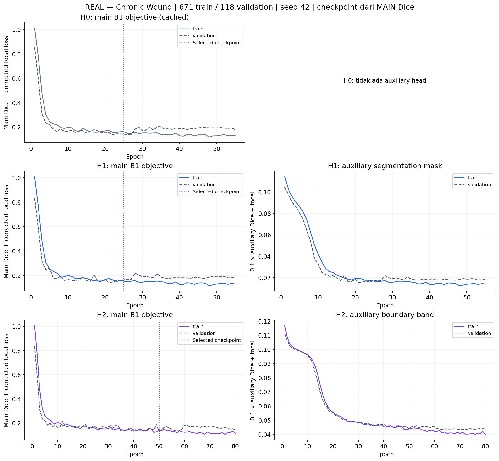
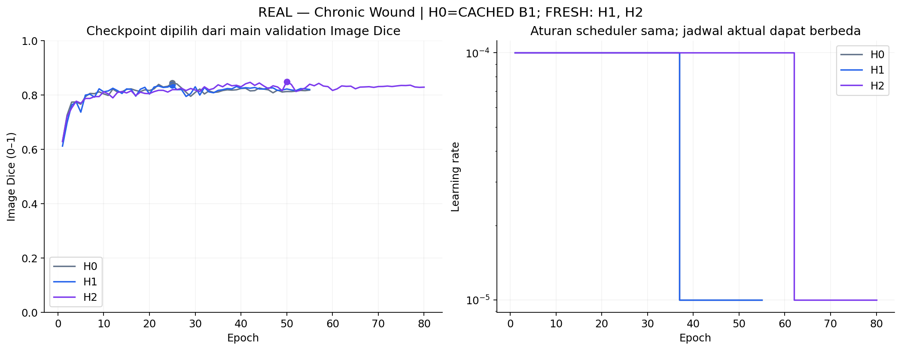
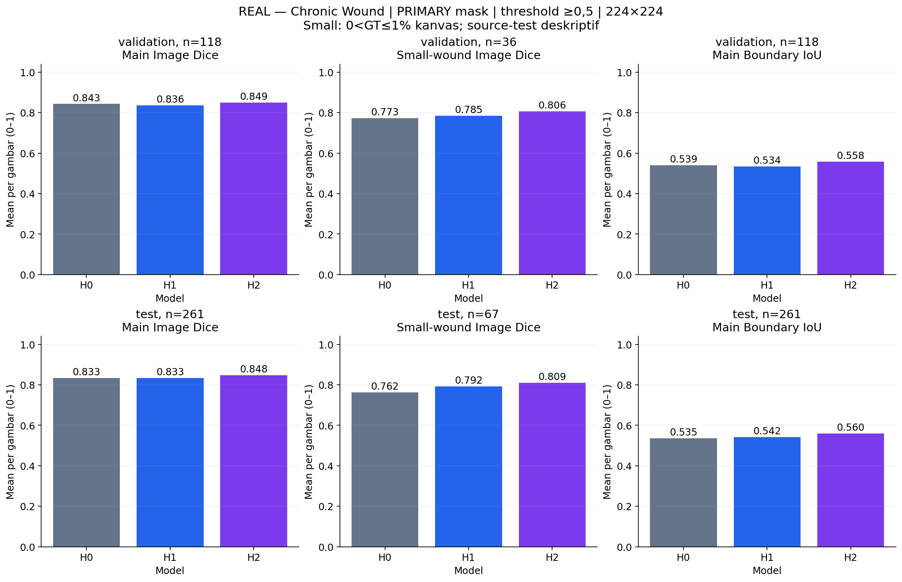
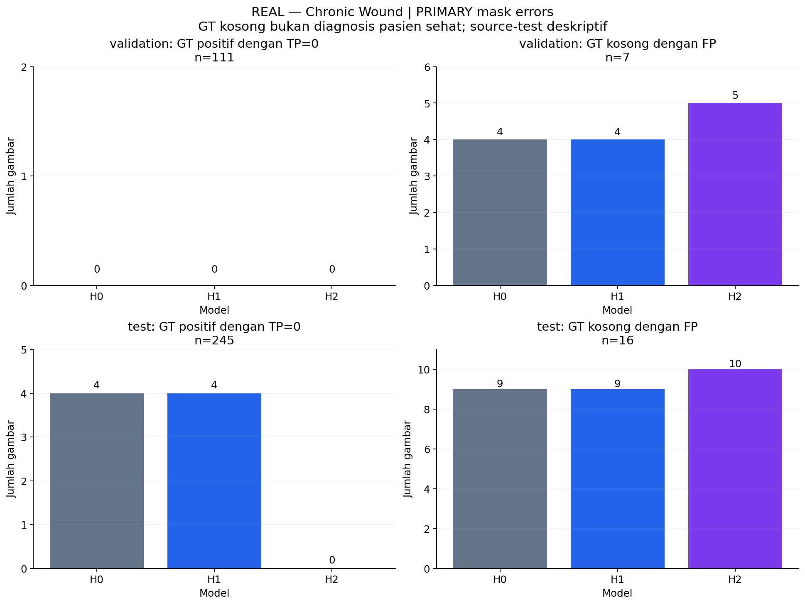
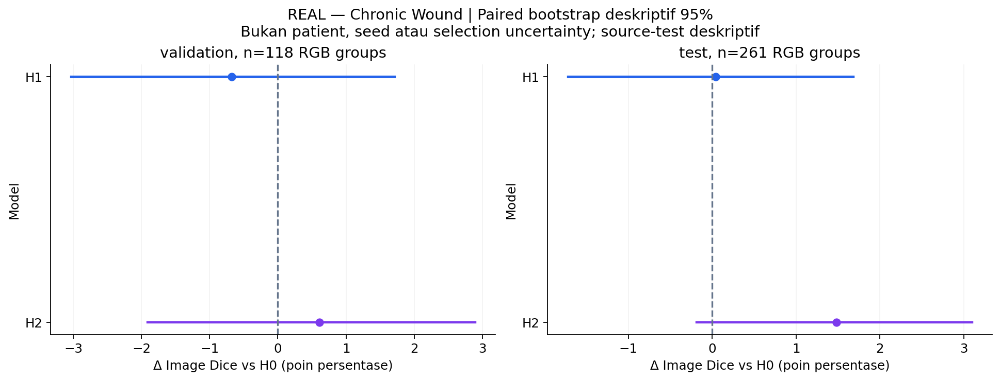
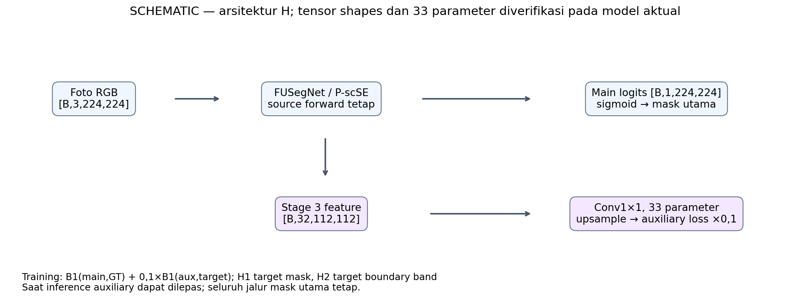

# CP2 Fase H — auxiliary segmentation dan boundary supervision

**COMPLETED — kondisi yang dilaporkan benar-benar dilatih, seed 42.** H0=B1 cached; tidak mengulang baseline atau fase lama.

Run `outputs/cp2/phase_h/20261112T105427Z`. [Preregistered protocol](../docs/cp2-phase-h.md) · [Results JSON](cp2-phase-h-results.json) · [Auxiliary diagnosis](cp2-phase-h-analysis.json).

Manifest tetap **671/118/261**, duplicate-RGB-group split, bukan patient-level. Raw source tetap 831/278. Main B1, source architecture, shared initial tensors, loader/augmentation, float32/TF32, Adam/batch2 dan kebijakan checkpoint tetap.

H1 diagnosis tersimpan sebelum H2; gate perluasan **True**. Executed: H1, H2. H3 dan kombinasi ditunda.

| Model | Selected / completed epoch | Val Image Dice | Small val | Boundary IoU val | Test Image Dice | Empty FP val / test |
|---|---:|---:|---:|---:|---:|---:|
| H0 | 25 / 55 | 0.8428 | 0.7728 | 0.5393 | 0.8329 | 4/7 · 9/16 |
| H1 | 25 / 55 | 0.8360 | 0.7850 | 0.5342 | 0.8333 | 4/7 · 9/16 |
| H2 | 50 / 80 | 0.8488 | 0.8056 | 0.5577 | 0.8477 | 5/7 · 10/16 |

**Validation-only selection: H0.** Semua guard dipertahankan; bukan memilih pemimpin source-test. Checkpoint berdasarkan main Image Dice, bukan auxiliary score atau minimum total loss. Source-test sudah terekspos CP1/P/L/A, bersifat deskriptif.

- H1: eligible **False**, checks `{'higher_overall_dice': False, 'small_not_lower': True, 'boundary_not_lower': False, 'no_extra_total_miss': True, 'no_extra_empty_fp': True, 'capacity_budget': True}`.
- H2: eligible **False**, checks `{'higher_overall_dice': True, 'small_not_lower': True, 'boundary_not_lower': True, 'no_extra_total_miss': True, 'no_extra_empty_fp': False, 'capacity_budget': True}`.

Kolom kiri adalah objective MAIN yang sama; kanan auxiliary berbobot 0,1. Target H1/H2 berbeda. Besar loss bukan norm gradien atau bukti kausal; train memakai augmentasi.

Titik adalah selected main validation Dice, garis LR dari aturan scheduler yang sama. Jumlah update aktual berbeda karena early stopping; bukan fixed-budget ablation.

Seluruh skor berasal dari PRIMARY mask pada gambar sama. Small berdasarkan kanvas berpadded, bukan luas fisik; baca bersama GT-positive/empty dan pixel metrics.

Nol diberi anotasi bila benar-benar tidak ada kasus. Total miss berarti GT positif dengan TP=0; GT kosong bukan diagnosis sehat, dan jumlah FP images tidak menggantikan FP pixels.

Resampling pasangan RGB-group/gambar, tidak mencakup pasien/crop yang tidak diketahui, seed, adaptive checkpoint selection atau multiple comparisons; bukan klaim signifikansi.

Head tambahan hanya memberi gradient saat training dan dapat dilepas. H2 berbeda dari L3: H2 memprediksi target batas pada head terpisah; L3 memberi distance loss pada mask utama.

## Subgroups utama

| Split | Model | GT-positive Dice | GT-empty Dice | Total miss / positive n | Empty FP pixels | Data Dice | Pixel precision / recall | PFOM |
|---|---|---:|---:|---:|---:|---:|---:|---:|
| validation | H0 | 0.8689 | 0.4286 | 0/111 | 526 | 0.9151 | 0.9199 / 0.9104 | 0.7411 |
| validation | H1 | 0.8617 | 0.4286 | 0/111 | 595 | 0.8880 | 0.9220 / 0.8564 | 0.7348 |
| validation | H2 | 0.8843 | 0.2857 | 0/111 | 721 | 0.9207 | 0.9253 / 0.9162 | 0.7528 |
| test | H0 | 0.8587 | 0.4375 | 4/245 | 1710 | 0.9077 | 0.9423 / 0.8756 | 0.7311 |
| test | H1 | 0.8591 | 0.4375 | 4/245 | 1396 | 0.8909 | 0.9488 / 0.8396 | 0.7360 |
| test | H2 | 0.8786 | 0.3750 | 0/245 | 2085 | 0.9150 | 0.9291 / 0.9012 | 0.7539 |

## Auxiliary diagnosis sesudah selection

Tabel ini mengevaluasi task head masing-masing, **bukan kualitas mask utama**. H1 dan H2 mempunyai definisi target berbeda, sehingga angkanya tidak menjadi ranking model atau dasar reselection.

| Head | Target | Target pixel fraction | Aux Image Dice val | Aux pixel precision / recall |
|---|---|---:|---:|---:|
| H1 | segmentation mask | 2.899% | 0.8220 | 0.9249 / 0.8438 |
| H2 | 3×3 boundary band | 0.670% | 0.5892 | 0.5324 / 0.6893 |

## Komputasi dan artefak

| Model | Train registered / active params | Mask-only active params | Last training invocation (min) | Peak train allocated / reserved (GiB) | Mask-only median / P95 (ms) |
|---|---:|---:|---:|---:|---:|
| H0 | 70,968,939 / 64,898,248 | 64,898,248 | 87.91 | 2.22 / 2.33 | 49.17 / 58.81 |
| H1 | 70,968,972 / 64,898,281 | 64,898,248 | 153.82 | 2.23 / 2.33 | 54.14 / 57.74 |
| H2 | 70,968,972 / 64,898,281 | 64,898,248 | 197.14 | 2.23 / 2.33 | 52.62 / 56.96 |

H0 timing training berasal dari P; GPU bersama berubah. H1/H2 inference architecture identik ketika head dilepas, jadi selisih latency tidak menunjukkan metode tertentu intrinsik lebih cepat. MACs dalam JSON hanya Conv/Linear, bukan seluruh operasi. [Resource JSON](cp2-phase-h-resources.json) menyimpan epoch/step time, overall GPU dan shared memory.

Checkpoints/optimizer/scheduler/RNG, probabilities/GT, auxiliary predictions, logs dan clinical galleries tetap lokal. Numeric tables dan aggregate charts publik. Satu seed, label ambigu/crop-patient dependence dan validation reuse membatasi generalisasi. Tidak ada novelty, manfaat klinis, atau generalisasi eksternal yang terbukti.

[Artifact QA](cp2-phase-h-validation.json) · [Review ilmiah](cp2-phase-h-review.md) · [Visual/engineering QA](cp2-phase-h-quality.json). Berkas ini baru diterbitkan setelah pemeriksaan aktual selesai.
