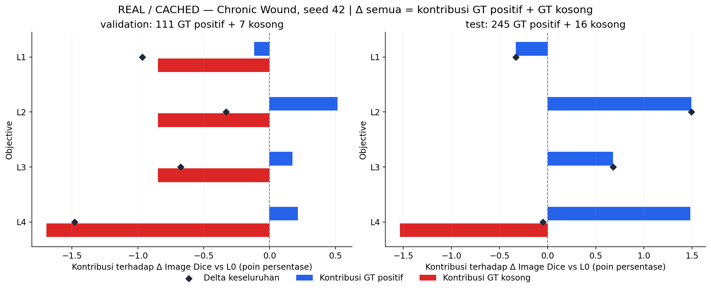

# CP2 Fase L — keputusan dan review hasil

**L.1 selesai:** empat kandidat benar-benar dilatih pada data Chronic Wound, total 270 completed epochs, seed 42. **L0/B1 dipertahankan** berdasarkan aturan validation yang dikunci sebelum training. Tidak ada kandidat yang memenuhi seluruh guard. Ini hasil screening yang informatif, bukan bukti loss baru selalu lebih baik atau lebih buruk.

[Laporan lengkap, kurva dan subgroup](cp2-phase-l.md) · [Metrik kanonis yang dipublikasikan](cp2-phase-l-results.json) · [Analisis deskriptif](cp2-phase-l-analysis.json) · [QA artefak](cp2-phase-l-validation.json) · [Review visual dan engineering](cp2-phase-l-quality.json)

## Hasil yang benar-benar dijalankan

Semua skor berikut **mean Image Dice**, skala 0–1. Small berarti 0 < luas GT ≤1% kanvas 224×224, bukan ukuran fisik luka. Setiap baris menggunakan gambar dan evaluator yang sama. L0 dimuat dari B1 Fase P, tidak dilatih ulang.

| Objective | Epoch dipilih / selesai | Validation, n=118 | Small validation, n=36 | Source-test, n=261 | Small test, n=67 |
|---|---:|---:|---:|---:|---:|
| L0: B1 cached | 25 / 55 | **0.8428** | 0.7728 | 0.8329 | 0.7622 |
| L1: Tversky | 37 / 67 | 0.8331 | 0.7933 | 0.8296 | 0.7786 |
| L2: Focal Tversky | 33 / 63 | 0.8394 | 0.7852 | 0.8478 | 0.7935 |
| L3: B1 + Boundary | 41 / 71 | 0.8360 | **0.8040** | 0.8397 | **0.8136** |
| L4: Focal Tversky + Boundary | 39 / 69 | 0.8280 | 0.7752 | 0.8324 | 0.8057 |

Semua kandidat meningkatkan small validation Dice terhadap L0, tetapi overall validation Dice turun. Seluruh model mempunyai **0/111 GT-positive validation dengan TP=0**. GT-empty validation yang mengandung FP bertambah dari **4/7 pada L0 menjadi 5/7 pada L1–L3 dan 6/7 pada L4**. Karena itu, selain gagal guard overall, semua kandidat gagal guard empty FP.

`selection.json` memilih L0 pada **2026-11-08 16:18:04 UTC**, sebelum ekspor seluruh test probabilities baru. L2 yang kemudian mencatat source-test Dice tertinggi tidak menggantikan keputusan tersebut. Source-test sudah pernah dianalisis pada CP1/P; hasilnya deskriptif, bukan untouched confirmatory test.

## Mengapa hasil luka kecil membaik tetapi ranking keseluruhan turun?

Image Dice merata-ratakan skor setiap gambar. Dengan aturan evaluator yang tetap, GT kosong dan prediksi kosong mendapat 1; GT kosong dengan foreground berapa pun mendapat 0. Pada 118 validation images, satu tambahan gambar kosong dengan FP menurunkan mean keseluruhan **1/118 = 0,847 poin persentase** jika skor gambar lain tetap.

**Yang terlihat:** biru adalah perubahan mean GT-positive yang dibobot jumlah gambar; merah adalah perubahan kelompok GT-empty; berlian adalah jumlah keduanya. Kontribusi ini dihitung tepat dari metrik kanonis, bukan simulasi atau retraining.

**Artinya:** pada L2 validation, perbaikan kelompok positif menyumbang **+0,516 poin**, tetapi kelompok kosong menyumbang **−0,847 poin**, sehingga total **−0,332 poin**. L4 test juga memperbaiki mean kelompok positif, tetapi tambahan empat empty FP membuat overall Dice sedikit di bawah L0. Ini menjelaskan mengapa membaca skor keseluruhan saja tidak cukup.

**Perlu diingat:** hanya ada tujuh GT-empty validation images. Angka ini sensitif terhadap sedikit kasus dan kualitas anotasi. Tidak ada alasan mengganti empty rule atau mengeluarkan kasus setelah melihat hasil. GT kosong juga tidak berarti pasien sehat. Besarnya FP tetap dilaporkan: L2 test mempunyai 3.179 FP pixels pada kelompok kosong, dibanding 1.710 pada L0, meskipun jumlah gambar FP sama-sama 9/16.

## Apa yang dipelajari dari setiap kontras?

Tabel memakai **poin persentase**, yaitu 100 × selisih skor 0–1. Ini kontras recipe dengan scheduler dan early stopping adaptif yang sama aturannya; jumlah update aktual berbeda.

| Kontras | Δ overall Dice val / test | Δ small Dice val / test | Δ Boundary IoU val / test |
|---|---:|---:|---:|
| L1 − L0: objective FN-weighted | −0.965 / −0.330 | +2.048 / +1.642 | −3.014 / −1.599 |
| L2 − L1: eksponen 1 → 0,75 | +0.634 / +1.824 | −0.812 / +1.492 | +1.120 / +2.265 |
| L3 − L0: tambahan boundary pada B1 | −0.674 / +0.679 | +3.112 / +5.139 | +0.326 / +2.096 |
| L4 − L2: tambahan boundary pada Focal Tversky | −1.149 / −1.542 | −0.999 / +1.214 | −0.720 / −0.909 |

**L1:** pixel recall validation naik 0,799 poin, tetapi precision turun 3,725 poin. Penalti FN yang lebih besar menunjukkan trade-off recall–precision pada run ini; tidak menjamin batas atau skor keseluruhan lebih baik.

**L2:** eksponen focal memperbaiki overall validation terhadap L1, tetapi small validation turun. Dibanding L0, validation recall naik 1,826 poin dan precision turun 1,878 poin. Di source-test, mean Dice naik 1,493 poin dan total misses turun 4→2, tetapi hanya 123 gambar membaik, 122 memburuk, dan 16 sama. Interval bootstrap berpasangan RGB-group deskriptif 95% untuk delta test adalah **[−0,012; +3,046] poin**. Ini bukan konfirmasi keunggulan antar-pasien atau antar-seed.

**L3:** small Dice dan mean Boundary IoU lebih tinggi pada validation, tetapi data-based Dice turun **2,114 poin** dan pixel recall turun **4,474 poin**. Di source-test, mean boundary dan small Dice juga membaik, sementara data-based Dice/recall turun. Mean per gambar, agregat pixel, dan batas menekankan aspek berbeda. Menyebut boundary term meningkatkan seluruh kualitas segmentasi akan menyesatkan.

**L4:** tambahan boundary tidak memperbaiki overall validation/test terhadap L2. Di source-test, TP=0 menjadi 3 kasus dan empty FP menjadi 13/16, versus 2 kasus dan 9/16 pada L2. Komposisi ini tidak mendukung menggabungkan dua komponen dengan asumsi manfaatnya otomatis bertambah.

## Review visual kasus nyata

Tujuh grafik agregat dan dua gallery lokal telah diperiksa langsung. Label, legend, colorbar bila relevan, sumbu, skala, checkpoint markers dan anotasi angka terbaca. Panel validation TP=0 menampilkan lima angka nol karena memang tidak ada kasus; itu bukan figure kosong.

Gallery memakai aturan simetris/deterministik yang sama: seed-42 random, median mean Dice lima model, first-ID total miss, first-ID empty FP, first-ID multi-component mask, dan GT positif terkecil. Tidak memilih hanya kemenangan kandidat. Gallery tersimpan lokal di `outputs/cp2/phase_l/20261108T065944Z/error_analysis/`; [provenance numeriknya](cp2-phase-l-cases.json) dipublikasikan. Foto/GT/overlay klinis tidak masuk Git.

- Pada validation, tidak ada total miss pada seluruh model; gallery secara eksplisit menulis “Tidak ada kasus”. Contoh random menunjukkan L0 Dice 0,905 tetapi L2 0,682, sehingga kegagalan relatif kandidat tetap terlihat.
- Pada test, kasus deterministik `baba5451a41a555f6ea4355b4c53db59_1` mempunyai L0 Dice 0,863 dan L3 0. Satu kasus ini menunjukkan failure mode nyata, bukan bukti bahwa boundary loss selalu gagal.
- GT test terkecil hanya 20 pixels dan terlewat oleh semua model. Perbaikan mean small Dice belum mengatasi seluruh lesi sangat kecil.
- Beberapa GT kosong mempunyai area visual yang perlu ditinjau oleh anotator ahli; beberapa mask multi-komponen juga mencakup area terpisah dekat tepi kanvas. Penilaian visual ini bukan diagnosis atau adjudikasi GT. Tidak ada relabeling, penghapusan, atau perubahan split berdasarkan prediksi/test.

Display gallery menggunakan union batas RGB-content, GT dan semua prediksi sehingga FP di luar crop foto tetap tercakup. Zoom hanya tampilan; input model dan seluruh metrik tetap full 224×224.

## Skala boundary dan langkah penelitian berikutnya

Pada L3, komponen boundary validation berbobot berubah dari **+0,12858** pada epoch 1 menjadi **−0,00207** pada selected epoch 41; regional term berubah 0,81973→0,15609. L4 menunjukkan pola serupa. Nilai bertanda negatif valid untuk signed-distance product. Nilai objective bukan ukuran norm gradien, sehingga grafik ini belum membuktikan dominasi atau hilangnya gradien boundary.

**Rekomendasi sebelum pengembangan lebih jauh:** tetap gunakan B1 sebagai baseline; review kualitas anotasi dengan prosedur yang tidak dipandu ranking model, dan konfirmasi kandidat penting pada beberapa seed dengan aturan yang dikunci. Jika melanjutkan L.2, diagnosis validation mengenai GT-empty/aggregation memberi alasan untuk menguji **satu kontras L5 per-image vs batch** terlebih dahulu dengan objective, mask-empty policy dan data sama. Ini hipotesis, bukan janji perbaikan. L6 distance normalization dan L7 warm-up perlu protokol terpisah; fixed-vs-warm-up harus memakai anggaran langkah yang sebanding. Tidak menjalankan L5–L7, attention, boundary head, atau eksternal secara otomatis.

## Eksekusi, kegagalan dan biaya

FUSegNet EfficientNet-B7/P-scSE tetap: **70.968.939 parameter registered, 64.898.248 aktif forward**. Adam, batch 2, empat workers, float32, TF32 flags warisan, tanpa AMP. Tidak ada perubahan package/env. Checksum shared initialization, manifest dan actual augmented inputs/order diperiksa; seed yang sama bukan satu-satunya bukti kontrol.

L1/L2/L3/L4 menuntaskan 67/63/71/69 epoch dan memilih 37/33/41/39. Completed epoch compute time berjumlah sekitar **8,67 jam**; jumlah epoch dengan checkpoint I/O sekitar **8,95 jam**, belum termasuk seluruh setup, partial epoch gagal, jeda dan final export. Angka detail per model tersedia di [resource JSON](cp2-phase-l-resources.json). Semua arsitektur inference identik; variasi latency 68,95–79,35 ms pada GPU bersama tidak menunjukkan loss tertentu membuat model intrinsik lebih cepat.

Peak allocator training tercatat sekitar **2,22–2,23 GiB allocated / 2,33–2,34 GiB reserved**. Pemakaian keseluruhan GPU sempat **79.326 MiB dari 81.920 MiB**, termasuk proses pengguna lain. Durasi L4 yang lebih lama tidak mengisolasi overhead boundary; beban bersama berubah sangat besar. Pertahankan **satu job**. Penilaian concurrency berikutnya harus mencakup beban GPU aktual, CPU/data-loader dan `/dev/shm`, bukan VRAM model saja.

Dua masalah dicatat dengan log yang dipertahankan. Launcher awal salah meresolusikan symlink Python virtualenv dan gagal import cv2 **sebelum training**; path interpreter diperbaiki tanpa mengubah environment. Saat L2, DataLoader mengalami `/dev/shm` ENOSPC sesudah completed epoch 4. Ruang shared memory pulih; checkpoint, optimizer, scheduler dan RNG diverifikasi, lalu resume dari akhir epoch 4. Partial epoch dibuang. Completed L1 tidak diulang, konfigurasi/worker/batch/precision tetap, dan tidak ada file/proses pengguna lain dihapus atau dihentikan. Waktu invocation dan peak allocator L2 yang dipublikasikan hanya mencakup invocation terakhir; failed-session peak tidak tersimpan.

## Bukti dan batas kesimpulan

QA artefak memverifikasi **7.917 file historis dan pekerjaan pengguna tidak berubah**, **1.516 prediksi baru**, GT/source identity, probabilitas float32, threshold ≥0,5, seluruh region/boundary/subgroup metrics, per-image tables dan selected checkpoint metadata/hash. Enam pasangan model mempunyai order/augmented-input hash identik pada seluruh common epochs; kontrol terhadap cached B1 juga lulus. Selected checkpoint replay bit-identik diperiksa pada diagnostic batch setelah perturbasi parameter, bukan klaim retraining bit-identik untuk semua hardware.

Pretraining evidence tetap merekam 80 tests, 40 reference-oracle fixtures dan empat real-data GPU smoke tests sebelum training. Tes posthoc tambahan memeriksa ekspor metrik, deterministic case selection dan dekomposisi skor; jumlah akhir aktual dicatat di quality JSON. Mask sintetis hanya software fixtures, tidak pernah menjadi skor penelitian.

Ini satu seed pada **duplicate-RGB-group split**, tanpa ID pasien. Zero exact RGB overlap bukan bukti pasien/crop independen. Bootstrap RGB-group tidak mencakup korelasi pasien, variasi retraining seed, adaptasi checkpoint atau multiple comparisons. Source-test bukan untouched test. Hasil ini mendukung diagnosis trade-off pada protokol lokal, belum novelty, SOTA, generalisasi eksternal, atau penggunaan klinis.
