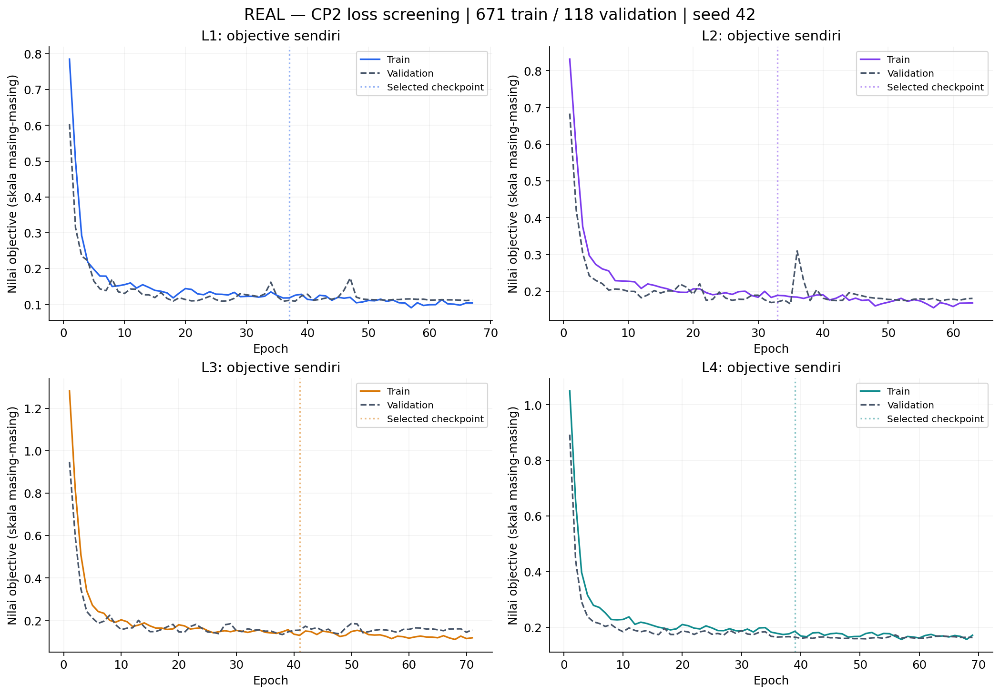
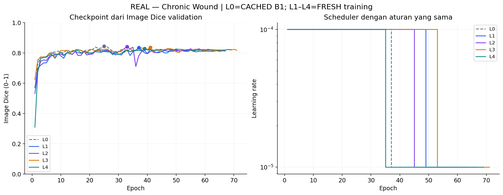
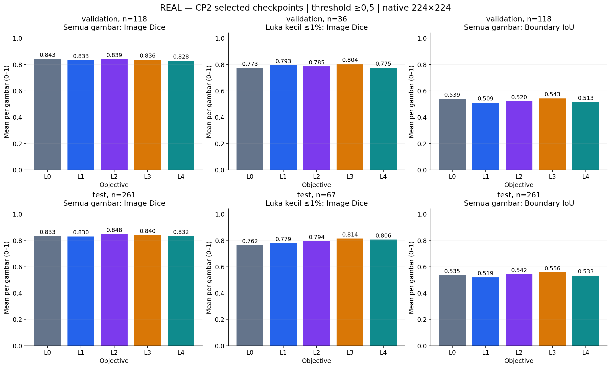
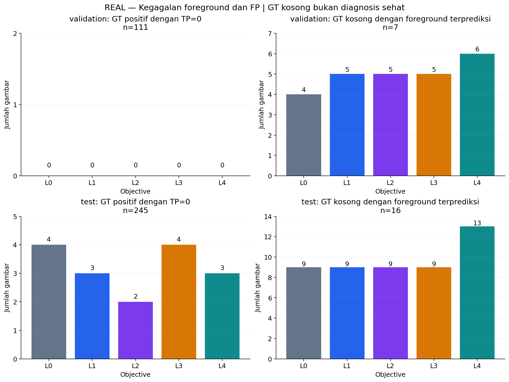
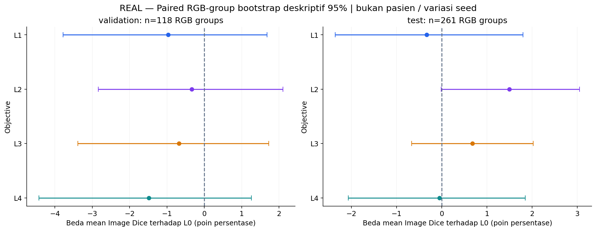
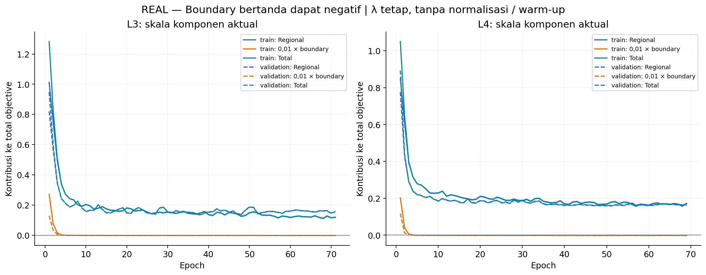

# CP2 Fase L — screening objective regional dan boundary

**COMPLETED — empat model dilatih dan dievaluasi pada data nyata, satu seed 42.** L0 adalah B1 Fase P yang dimuat sebagai acuan historis; tidak dilatih ulang. Tidak ada perubahan attention, boundary head, dataset eksternal, atau konfirmasi multi-seed.

Run: `outputs/cp2/phase_l/20261108T065944Z`. Manifest `fa9f4914a55806248d25c4a4092361db2658bfc63a0031122b63028202ef8ed5` tetap 671 train / 118 validation / 261 source-test. Ini duplicate-group split, bukan patient-level. Seluruh data mentah dan hasil CP1/P dipertahankan.

[Protokol pratraining](../docs/cp2-phase-l.md) · [Config](../configs/cp2/phase_l.json) · [Hasil JSON](cp2-phase-l-results.json)

## Pertanyaan dan kontrol

Apakah penalti FN lebih besar, eksponen Focal Tversky, atau signed-distance Boundary Loss memperbaiki luka kecil/batas tanpa menambah kegagalan foreground dan FP pada GT kosong? Empat kandidat mulai dari state awal identik B0/B1, bukan checkpoint B1 fine-tuned. Model/augmentasi/split/batch/optimizer/precision/evaluator sama. Checkpoint dan scheduler memakai Image Dice validation, early stopping 30/max 200. LR dan jumlah epoch aktual tetap dapat berbeda sebagai akibat validation.

L1=Tversky q=1; L2=Focal Tversky q=0,75; L3=B1+0,01×Boundary; L4=L2+0,01×Boundary. αFP=0,3/βFN=0,7, batch-global, epsilon=1, stabilized power delta=1e-6. Boundary memakai native-pixel signed distance setelah augmentasi, mean p×φ, GT kosong zero map dengan regional penalty tetap aktif. Tidak ada normalization/warm-up. [Definisi dan referensi lengkap](../docs/cp2-phase-l.md#empat-objective-yang-dikunci). Nilai loss lintasobjective tidak dibandingkan sebagai skor kualitas segmentasi.

## Hasil selected checkpoints

| Objective | Epoch dipilih / selesai | Validation Image Dice | Source-test Image Dice | Waktu invocation terakhir (menit) | Peak allocated / reserved (GiB) |
|---|---:|---:|---:|---:|---:|
| L0 (cached) | 25 / 55 | 0.8428 | 0.8329 | 87.91 | 2.22 / 2.33 |
| L1 | 37 / 67 | 0.8331 | 0.8296 | 104.71 | 2.22 / 2.33 |
| L2 | 33 / 63 | 0.8394 | 0.8478 | 111.41 | 2.23 / 2.34 |
| L3 | 41 / 71 | 0.8360 | 0.8397 | 116.29 | 2.22 / 2.33 |
| L4 | 39 / 69 | 0.8280 | 0.8324 | 199.61 | 2.22 / 2.33 |

**Yang terlihat:** train/validation objective ditampilkan pada panel terpisah per loss. Garis vertikal adalah checkpoint dari Image Dice, bukan minimum loss.

**Artinya:** skala objective dan kurva train–validation dapat berubah tanpa perubahan arsitektur. **Perlu diingat:** perbedaan nilai loss antar-panel tidak menunjukkan model mana lebih baik.

**Yang terlihat:** checkpoint mengikuti puncak validation Image Dice; scheduler memakai aturan sama tetapi perubahan LR aktual dapat terjadi pada epoch berbeda. **Artinya:** ini kontras recipe training lengkap dengan monitor tetap. **Perlu diingat:** durasi dan jumlah update aktual berbeda akibat early stopping, sehingga belum merupakan kontrol fixed-step budget.

## Subgroup dan boundary

| Split / kelompok | n | Objective | Image Dice | Data Dice | Data IoU | Data precision | Data recall | Boundary IoU | PFOM |
|---|---:|---|---:|---:|---:|---:|---:|---:|---:|
| validation/all | 118 | L0 | 0.8428 | 0.9151 | 0.8435 | 0.9199 | 0.9104 | 0.5393 | 0.7411 |
| validation/all | 118 | L1 | 0.8331 | 0.9002 | 0.8185 | 0.8826 | 0.9184 | 0.5091 | 0.7380 |
| validation/all | 118 | L2 | 0.8394 | 0.9147 | 0.8428 | 0.9011 | 0.9287 | 0.5203 | 0.7513 |
| validation/all | 118 | L3 | 0.8360 | 0.8940 | 0.8083 | 0.9242 | 0.8657 | 0.5425 | 0.7430 |
| validation/all | 118 | L4 | 0.8280 | 0.9113 | 0.8370 | 0.9014 | 0.9214 | 0.5131 | 0.7383 |
| validation/gt_positive | 111 | L0 | 0.8689 | 0.9165 | 0.8459 | 0.9228 | 0.9104 | 0.5462 | 0.7608 |
| validation/gt_positive | 111 | L1 | 0.8676 | 0.9024 | 0.8221 | 0.8869 | 0.9184 | 0.5232 | 0.7665 |
| validation/gt_positive | 111 | L2 | 0.8744 | 0.9173 | 0.8472 | 0.9061 | 0.9287 | 0.5351 | 0.7807 |
| validation/gt_positive | 111 | L3 | 0.8707 | 0.8961 | 0.8117 | 0.9287 | 0.8657 | 0.5587 | 0.7718 |
| validation/gt_positive | 111 | L4 | 0.8712 | 0.9136 | 0.8410 | 0.9060 | 0.9214 | 0.5365 | 0.7758 |
| validation/gt_empty | 7 | L0 | 0.4286 | 0.0000 | 0.0000 | 0.0000 | 0.0000 | 0.4286 | 0.4286 |
| validation/gt_empty | 7 | L1 | 0.2857 | 0.0000 | 0.0000 | 0.0000 | 0.0000 | 0.2857 | 0.2857 |
| validation/gt_empty | 7 | L2 | 0.2857 | 0.0000 | 0.0000 | 0.0000 | 0.0000 | 0.2857 | 0.2857 |
| validation/gt_empty | 7 | L3 | 0.2857 | 0.0000 | 0.0000 | 0.0000 | 0.0000 | 0.2857 | 0.2857 |
| validation/gt_empty | 7 | L4 | 0.1429 | 0.0000 | 0.0000 | 0.0000 | 0.0000 | 0.1429 | 0.1429 |
| validation/small | 36 | L0 | 0.7728 | 0.7610 | 0.6142 | 0.6995 | 0.8343 | 0.5479 | 0.7386 |
| validation/small | 36 | L1 | 0.7933 | 0.7729 | 0.6298 | 0.6533 | 0.9460 | 0.5287 | 0.7625 |
| validation/small | 36 | L2 | 0.7852 | 0.7768 | 0.6351 | 0.6633 | 0.9374 | 0.5081 | 0.7618 |
| validation/small | 36 | L3 | 0.8040 | 0.7976 | 0.6633 | 0.7204 | 0.8933 | 0.5682 | 0.7693 |
| validation/small | 36 | L4 | 0.7752 | 0.7649 | 0.6192 | 0.6609 | 0.9076 | 0.5100 | 0.7442 |
| test/all | 261 | L0 | 0.8329 | 0.9077 | 0.8310 | 0.9423 | 0.8756 | 0.5353 | 0.7311 |
| test/all | 261 | L1 | 0.8296 | 0.9029 | 0.8231 | 0.8973 | 0.9087 | 0.5194 | 0.7371 |
| test/all | 261 | L2 | 0.8478 | 0.9136 | 0.8410 | 0.9084 | 0.9190 | 0.5420 | 0.7596 |
| test/all | 261 | L3 | 0.8397 | 0.8913 | 0.8040 | 0.9381 | 0.8490 | 0.5563 | 0.7454 |
| test/all | 261 | L4 | 0.8324 | 0.9120 | 0.8382 | 0.9040 | 0.9201 | 0.5329 | 0.7499 |
| test/gt_positive | 245 | L0 | 0.8587 | 0.9099 | 0.8348 | 0.9471 | 0.8756 | 0.5417 | 0.7503 |
| test/gt_positive | 245 | L1 | 0.8552 | 0.9048 | 0.8262 | 0.9010 | 0.9087 | 0.5247 | 0.7566 |
| test/gt_positive | 245 | L2 | 0.8746 | 0.9176 | 0.8478 | 0.9163 | 0.9190 | 0.5488 | 0.7806 |
| test/gt_positive | 245 | L3 | 0.8660 | 0.8936 | 0.8076 | 0.9431 | 0.8490 | 0.5641 | 0.7655 |
| test/gt_positive | 245 | L4 | 0.8745 | 0.9167 | 0.8463 | 0.9134 | 0.9201 | 0.5555 | 0.7866 |
| test/gt_empty | 16 | L0 | 0.4375 | 0.0000 | 0.0000 | 0.0000 | 0.0000 | 0.4375 | 0.4375 |
| test/gt_empty | 16 | L1 | 0.4375 | 0.0000 | 0.0000 | 0.0000 | 0.0000 | 0.4375 | 0.4375 |
| test/gt_empty | 16 | L2 | 0.4375 | 0.0000 | 0.0000 | 0.0000 | 0.0000 | 0.4375 | 0.4375 |
| test/gt_empty | 16 | L3 | 0.4375 | 0.0000 | 0.0000 | 0.0000 | 0.0000 | 0.4375 | 0.4375 |
| test/gt_empty | 16 | L4 | 0.1875 | 0.0000 | 0.0000 | 0.0000 | 0.0000 | 0.1875 | 0.1875 |
| test/small | 67 | L0 | 0.7622 | 0.8320 | 0.7124 | 0.8495 | 0.8153 | 0.5230 | 0.7152 |
| test/small | 67 | L1 | 0.7786 | 0.8150 | 0.6877 | 0.7574 | 0.8819 | 0.5310 | 0.7470 |
| test/small | 67 | L2 | 0.7935 | 0.8251 | 0.7022 | 0.7683 | 0.8909 | 0.5259 | 0.7606 |
| test/small | 67 | L3 | 0.8136 | 0.8615 | 0.7566 | 0.8458 | 0.8777 | 0.5822 | 0.7627 |
| test/small | 67 | L4 | 0.8057 | 0.8385 | 0.7219 | 0.7771 | 0.9105 | 0.5567 | 0.7766 |

**Yang terlihat:** lima objective dibandingkan pada gambar yang sama, keseluruhan dan luka kecil. **Artinya:** mean per gambar dan aggregate-pixel Dice dapat bergerak berbeda. **Perlu diingat:** kecil berarti 0<luas GT≤1% kanvas yang mengandung padding, bukan ukuran fisik luka. Boundary IoU memakai toleransi 3 pixel; PFOM memakai empty-edge rule CP1 dan bukan pengganti region metrics.

**Yang terlihat:** TP=0 pada GT positif dan GT kosong dengan foreground terprediksi dihitung sebagai jumlah gambar. **Artinya:** recall/luka kecil perlu dibaca bersama false positives. **Perlu diingat:** mask kosong bukan diagnosis sehat; kualitas anotasi belum direview ulang oleh ahli. Semua label tetap dibekukan.

## Pemilihan validation-only

Kandidat screening yang dikunci sebelum test baru: **L0**. Guard mensyaratkan overall Dice lebih tinggi, small Dice tidak turun, TP=0 tidak bertambah, dan jumlah GT kosong dengan FP tidak bertambah terhadap L0. Jika tidak ada yang eligible, L0 dipertahankan. Ini heuristik konservatif untuk eksplorasi, bukan ambang klinis.

| Kandidat | Overall Dice naik | Small Dice tidak turun | TP=0 tidak bertambah | Empty FP tidak bertambah | Eligible |
|---|---|---|---|---|---|
| L1 | Tidak | Ya | Ya | Tidak | Tidak |
| L2 | Tidak | Ya | Ya | Tidak | Tidak |
| L3 | Tidak | Ya | Ya | Tidak | Tidak |
| L4 | Tidak | Ya | Ya | Tidak | Tidak |

Selection disimpan pada `selection.json` sebelum test predictions L1–L4. Semua empat test hasil tetap ditampilkan, termasuk kandidat yang tidak lolos. Source-test pernah dianalisis CP1/P dan tidak menjadi bukti konfirmatori atau dasar memilih loss.

## Efek berpasangan dan interpretasi

| Split | Kandidat − L0 | Mean delta Dice (poin persentase) | Bootstrap deskriptif 95% (poin) | Gambar lebih baik / lebih buruk / sama |
|---|---|---:|---:|---:|
| validation | L1 − L0 | -0.965 | [-3.779, +1.682] | 43 / 69 / 6 |
| validation | L2 − L0 | -0.332 | [-2.839, +2.106] | 49 / 63 / 6 |
| validation | L3 − L0 | -0.674 | [-3.383, +1.729] | 63 / 49 / 6 |
| validation | L4 − L0 | -1.481 | [-4.429, +1.265] | 48 / 64 / 6 |
| test | L1 − L0 | -0.330 | [-2.354, +1.796] | 114 / 133 / 14 |
| test | L2 − L0 | +1.493 | [-0.012, +3.046] | 123 / 122 / 16 |
| test | L3 − L0 | +0.679 | [-0.664, +2.023] | 141 / 101 / 19 |
| test | L4 − L0 | -0.049 | [-2.069, +1.846] | 127 / 119 / 15 |

**Yang terlihat:** tiap titik adalah selisih mean pada pasangan gambar yang sama; garis nol berarti rata-rata sama. **Artinya:** arah dan variasi error perlu dibaca bersama subgroup, bukan hanya ranking tunggal. **Perlu diingat:** 2.000 bootstrap unit RGB group/image, bukan pixel; hubungan pasien/crop tidak diketahui. Interval tidak mencakup retraining seed, checkpoint selection atau multiple comparisons, dan bukan klaim signifikansi.

**Yang terlihat:** kontribusi regional, boundary berbobot dan total berasal dari batch training/validation aktual. Boundary bertanda dapat negatif. **Artinya:** grafik membantu diagnosis faktor L6/L7 sebelum pengembangan tambahan. **Perlu diingat:** distance dihitung dalam pixel; λ=0,01 hanya satu titik screening, bukan nilai optimum. Tidak ada perubahan bobot berdasarkan test.

## Biaya, reproducibility dan keterbatasan

Training L1→L2→L3→L4 menggunakan satu proses GPU, batch 2/float32 tanpa AMP. Beban GPU bersama berubah antar-epoch dan antarkandidat, termasuk selama L2; L0 juga berasal dari waktu Fase P yang berbeda. Selisih wall time tidak mengisolasi overhead atau speedup loss. Peak allocated/reserved adalah allocator kita; log GPU keseluruhan termasuk proses lain. Tidak ada perubahan lingkungan atau pekerjaan pengguna lain.

Preflight: 80 tests lulus, empat real-data smoke lulus, 40 fixture oracle signed-distance/product-mean bit-identik dengan fungsi penulis yang dipin. Fixture sintetis hanya engineering tests. Baseline tetap utuh, shared initialization/membership/input hashes dibandingkan pada seluruh common epochs. Checkpoint reload diverifikasi bit-identik setelah perturbasi parameter.

L.2 (L5–L7) **belum dijalankan**: faktor aggregation, normalization dan warm-up bersyarat pada diagnosis source validation dan memerlukan kontras terpisah; tidak digabung otomatis. Pada fixed-vs-warm-up, kontrol langkah/anggaran harus sama. Screening satu seed belum cukup untuk menetapkan loss terbaik secara umum; konfirmasi beberapa seed sebelum klaim metode atau melanjutkan kandidat penting. Tidak ada generalisasi pasien, klinis atau eksternal yang dibuktikan.

Artefak lengkap lokal: `outputs/cp2/phase_l/20261108T065944Z/` (protocol, manifest, shared initial weights, smoke, checkpoints, per-image probabilities/masks/GT, histories, component losses, selection dan logs). Foto klinis/checkpoint besar tidak diunggah. Konfigurasi, per-image metric tables dan source dapat direproduksi mengikuti [panduan](../docs/cp2-phase-l.md).

[QA akhir](cp2-phase-l-validation.json) · [Review visual](cp2-phase-l-quality.json). Berkas QA hanya diterbitkan setelah pemeriksaan aktual selesai.

## Angka error dan kontras objective

### validation

| Objective | Δ Image Dice vs L0 (poin) | Δ small Dice (poin) | Δ Boundary IoU (poin) | GT positif TP=0 | GT kosong dengan FP | FP pixel pada GT kosong |
|---|---:|---:|---:|---:|---:|---:|
| L0 | +0.000 | +0.000 | +0.000 | 0 | 4/7 | 526 |
| L1 | -0.965 | +2.048 | -3.014 | 0 | 5/7 | 847 |
| L2 | -0.332 | +1.236 | -1.894 | 0 | 5/7 | 975 |
| L3 | -0.674 | +3.112 | +0.326 | 0 | 5/7 | 779 |
| L4 | -1.481 | +0.237 | -2.613 | 0 | 6/7 | 895 |

### test

| Objective | Δ Image Dice vs L0 (poin) | Δ small Dice (poin) | Δ Boundary IoU (poin) | GT positif TP=0 | GT kosong dengan FP | FP pixel pada GT kosong |
|---|---:|---:|---:|---:|---:|---:|
| L0 | +0.000 | +0.000 | +0.000 | 4 | 9/16 | 1710 |
| L1 | -0.330 | +1.642 | -1.599 | 3 | 9/16 | 1505 |
| L2 | +1.493 | +3.134 | +0.666 | 2 | 9/16 | 3179 |
| L3 | +0.679 | +5.139 | +2.096 | 4 | 9/16 | 1752 |
| L4 | -0.049 | +4.348 | -0.243 | 3 | 13/16 | 3848 |

Kontras terisolasi dalam screen: L2−L1 mengubah eksponen; L3−L0 menambah boundary pada B1; L4−L2 menambah boundary pada Focal Tversky. Interpretasi mencakup konsekuensi scheduler/early stopping adaptif. Tidak ada atribusi ke loss saja pada fixed update budget yang belum diuji.

## Biaya aktual dan QA akhir

| Objective | Median epoch (s) | Mean training step (s) | Batch-1 median / P95 (ms) | Sampled overall GPU peak (MiB) |
|---|---:|---:|---:|---:|
| L1 | 84.17 | 0.255 | 76.91 / 81.56 | 44056 |
| L2 | 107.48 | 0.302 | 68.95 / 81.77 | 79237 |
| L3 | 94.56 | 0.265 | 78.70 / 81.80 | 39234 |
| L4 | 144.15 | 0.458 | 79.35 / 84.92 | 79326 |

QA memverifikasi **7,917 file historis/pekerjaan pengguna tetap utuh** dan **1,516 prediksi baru** beserta checksum, GT, threshold, per-image CSV, region/boundary/subgroup metrics dan checkpoint metadata. Selection dihitung ulang dari validation dan mendahului seluruh test probabilities baru. Tidak ada RGB-identical group overlap; independensi pasien tidak dapat dibuktikan.

[Resource JSON](cp2-phase-l-resources.json) · [QA JSON](cp2-phase-l-validation.json). Concurrency tetap satu job sampai profiling terkontrol; tidak menaikkan batch size atau mengaktifkan AMP untuk mengisi VRAM.

Satu launcher awal salah meresolusikan symlink interpreter virtualenv sehingga import cv2 gagal sebelum model/training dimulai. Log gagal dipertahankan, path virtualenv diperbaiki, tanpa install/upgrade atau perubahan konfigurasi. Isolated reference oracle awal juga membutuhkan alias typing.Set; perbaikannya tidak mengubah perhitungan loss. Semua smoke/training berikutnya memakai environment yang benar.

Training mengalami interupsi resource: L2 sesudah epoch 4: shared memory DataLoader /dev/shm ENOSPC. Ruang shared memory pulih sebelum resume. Optimizer, scheduler, RNG dan checkpoint identity diverifikasi; partial epoch dibuang lalu dimulai ulang dari akhir epoch lengkap. Worker count, data, loss, batch size, precision dan environment tidak diubah; completed L1 tidak dilatih ulang. Tidak ada shared-memory file milik pengguna lain dihapus atau mount diubah.

Untuk stage yang di-resume, waktu invocation dan peak allocator pada tabel berasal dari invocation terakhir. Resource JSON juga memuat jumlah waktu semua completed epochs; itu belum mencakup waktu partial epoch yang gagal. Interval environment-record sampai selesai mencakup jeda diagnostik. Log GPU keseluruhan tetap append-only untuk seluruh percobaan. Jangan menganggap timing/peak tersebut pengukuran lengkap semua invocation atau benchmark GPU eksklusif.

[Review akhir dan keputusan lanjutan](cp2-phase-l-review.md).
