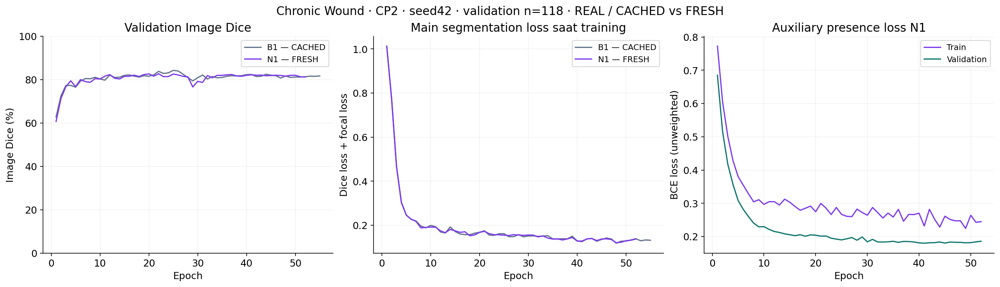
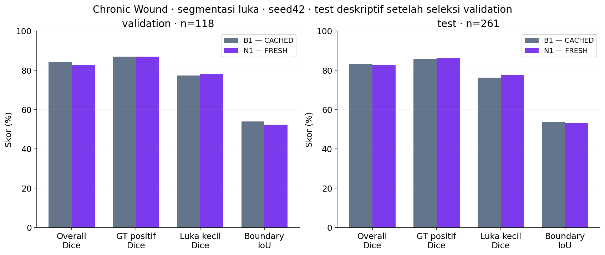

# CP2 Fase N — standalone presence supervision

**COMPLETED — satu full training N1, seed42; B1 cached tidak dilatih ulang. Tidak ada smoke training terpisah.**

Run: `outputs/cp2/phase_n/20261118T054806Z`. [Preregistration](../docs/cp2-phase-n.md) · [Config](../configs/cp2/phase_n.json) · [Metrik JSON](cp2-phase-n-results.json).

## Pertanyaan dan metode

Apakah tugas tambahan mengenali keberadaan foreground membantu segmentasi mengurangi false positive pada anotasi kosong? Presence berarti ada piksel luka pada anotasi, bukan diagnosis pasien sehat/sakit.

Source FUSegNet/P-scSE dan objective utama B1 tetap. Fitur decoder stage3 [B,32,112,112] dirata-ratakan secara spasial menjadi [B,32], lalu Linear(32,1) menghasilkan satu presence logit per gambar. Tambahan 33 parameter. Objective = B1 + 0,1 × BCEWithLogits(mean), tanpa class balancing. Target presence dihitung dari mask sesudah augmentasi, termasuk luka satu piksel. Mask utama tidak dikalikan presence probability; auxiliary head dapat dilepas saat inference.

Split group RGB tetap 671/118/261, tanpa patient ID. Shared initial weights, epoch RNG, actual order/augmented bytes pada common epochs, Adam, LR, batch2, FP32/TF32, scheduler dan early stopping mengikuti B1. Max200, earliest strictly best validation Image Dice, Plateau patience10, early stopping30. Checkpoint aktual: epoch **22**, total **52** epoch. Satu run memerlukan **3.17 jam invocation**, peak CUDA allocated/reserved **2.23/2.33 GiB**. Ini biaya GPU shared, bukan benchmark latency eksklusif.

## Hasil seluruh kondisi

| Model | Split | Image Dice | Data Dice | GT+ Dice | Small Dice | Boundary IoU | Recall pixel GT+ | Miss | GT-empty FP images / total | GT-empty FP pixels |
| :--- | :--- | ---: | ---: | ---: | ---: | ---: | ---: | ---: | ---: | ---: |
| B1 | validation | 84.28% | 91.51% | 86.89% | 77.28% | 53.93% | 91.04% | 0 | 4 / 7 | 526 |
| B1 | test | 83.29% | 90.77% | 85.87% | 76.22% | 53.53% | 87.56% | 4 | 9 / 16 | 1710 |
| N1 | validation | 82.69% | 91.99% | 87.00% | 78.23% | 52.37% | 91.70% | 0 | 6 / 7 | 751 |
| N1 | test | 82.67% | 91.84% | 86.43% | 77.45% | 53.31% | 89.74% | 3 | 12 / 16 | 1351 |

**Yang terlihat:** kurva B1 historis dan N1 baru, main loss terpisah dari auxiliary BCE. **Artinya:** checkpoint dipilih dari Image Dice validation, bukan total loss yang berbeda antar-kondisi. **Perlu diingat:** scheduler dan early stopping menghasilkan jumlah update berbeda; satu seed tidak menggambarkan variasi training.

**Yang terlihat:** overall/GT-positif/luka-kecil Dice dan Boundary IoU pada dua split ditampilkan terpisah. **Artinya:** improvement rata-rata harus diperiksa bersama kegagalan mendeteksi luka dan FP pada GT kosong. **Perlu diingat:** source-test sudah terekspos dan hanya deskriptif. Hanya tujuh GT-empty validation; satu kasus sangat memengaruhi Image Dice.

## Keputusan source validation

Selected: **N0/B1**. N1 eligible: **False**. Rincian guard: `{'higher_overall_dice': False, 'small_not_lower': True, 'boundary_not_lower': False, 'positive_pixel_recall_not_lower': True, 'no_extra_total_miss': True, 'no_extra_empty_fp_images': False, 'no_extra_empty_fp_pixels': False, 'empty_fp_improved': False, 'capacity_budget': True}`.

Semua guard historis dipertahankan; ditambahkan positive pixel recall tidak turun, empty-FP pixels tidak bertambah, dan FP images atau pixels wajib berkurang. Ini seleksi satu-seed eksploratif. Kelolosan menjadi bahan review konfirmasi sebelum kombinasi; tidak ada H2/A/H3/N2 yang dilatih otomatis. Jika gagal, B1 tetap baseline dan hasil negatif dipertahankan.

## QA dan keterbatasan

Unit tests/dependency/inisialisasi/structural forward dijalankan sebelum training; tidak ada run training pendek tambahan sesuai instruksi pengguna. First actual optimizer step memverifikasi gradien finite serta pembaruan encoder dan presence head; seluruh training steps tetap menolak nonfinite. Checkpoint main/presence reload bit-exact. 379 prediksi diverifikasi dengan checksum, raw GT, threshold≥0,5, metrics dan CSV. Split/initial tensors dipasangkan dan selection disimpan sebelum prediksi test baru. [QA lengkap](cp2-phase-n-validation.json).

Presence head probabilities/confusion matrix tersimpan lokal sebagai diagnostik; tidak dipakai sebagai mask gate atau kriteria pemilihan checkpoint. Dataset train didominasi foreground positif; head yang menebak semua positif dapat memiliki accuracy tinggi, sehingga balanced accuracy/positive dan negative recall juga disimpan.

Tidak ada external tuning/training: CO2Wounds sudah diamati sebelumnya dan tidak dipakai memilih konfigurasi N. Pengujian eksternal konfirmatori perlu sumber lain yang belum digunakan untuk pengembangan. Tidak ada klaim patient independence, signifikansi klinis atau novelty global.

**Visual review figure: PASSED — kedua grafik diperiksa langsung setelah training selesai.** Semua grafik berasal dari artefak real-data; tidak ada media pasien dalam output publik. Seluruh 479 file historis/user dalam inventory tetap utuh.

## Interpretasi tambahan setelah review hasil

N1 **tidak memenuhi kriteria penerimaan**, sehingga baseline tetap B1. Pada
validation, Data Dice naik 91,51→91,99%, GT-positive Image Dice 86,89→87,00%,
dan small Image Dice 77,28→78,23%. Namun overall Image Dice turun
84,28→82,69% dan Boundary IoU 53,93→52,37%. GT-empty FP bertambah
4/7→6/7 gambar, dengan FP pixels 526→751. Perubahan positif pada sebagian
metrik tidak menggantikan guard yang ditetapkan sebelum training.

Dua tambahan kesalahan GT-empty menyumbang −2/118 = **−1,695 poin** pada
mean Image Dice validation, karena setiap GT-empty dengan prediksi foreground
mendapat Dice0. Peningkatan kecil pada 111 GT-positive mengimbangi sekitar
+0,105 poin, menghasilkan net −1,590 poin. Ini dekomposisi aritmetis hasil,
bukan bukti sebab fisiologis atau alasan mengubah evaluator.

Presence head pada checkpoint terpilih memprediksi **semua 118 validation dan
261 source-test sebagai positif** pada threshold0,5. Negative recall0%,
positive recall100%, balanced accuracy50%. Jadi auxiliary classification
belum membedakan ada/tidaknya foreground dengan aturan keputusan yang dikunci.
Train berisi 628 positif dan43 kosong sebelum augmentasi; dominasi kelas
positif dapat menjadi salah satu penjelasan, tetapi penyebab tunggal belum
dibuktikan. Target training tetap dihitung sesudah augmentasi. Tidak ada
hard/soft gating mask pada run ini.

Source-test deskriptif: Image Dice B1/N1 **83,29%/82,67%**, Data Dice
**90,77%/91,84%**, GT-empty FP images **9/16 versus12/16**. Walaupun total
FP pixels pada GT-empty berkurang 1710→1351, kesalahan menyebar ke lebih
banyak gambar. Source-test tidak dipakai memilih ulang checkpoint atau kandidat.

Keputusan: **HOLD_AND_DIAGNOSE**. Tidak ada training lanjutan, threshold tuning,
multiseed atau kombinasi yang diluncurkan. Satu seed dan hanya tujuh kasus kosong
validation membatasi generalisasi kesimpulan. Run selesai otomatis pada
18 November2026 **09:14:28 UTC**, sekitar3jam12menit sejak launch; peak PyTorch
allocated/reserved2,23/2,33GiB. Pemakaian proses yang terlihat di nvidia-smi
sekitar4,33GiB juga mencakup memori di luar allocator PyTorch.
