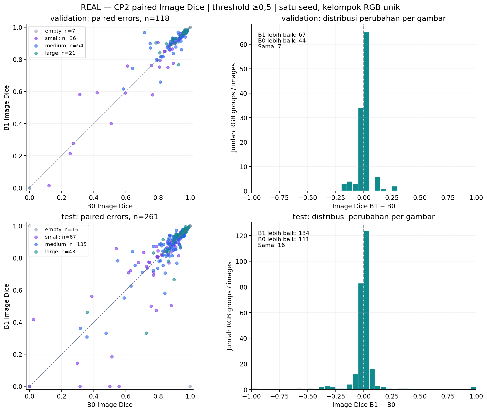

# CP2 FASE P — review akhir dan analisis kesalahan

**COMPLETED — B0 dan B1 dilatih penuh pada data nyata, satu seed 42.** Kedua run mencapai early stopping sesuai protokol, tanpa OOM, fallback konfigurasi, atau pengulangan training. Fase loss lanjutan, attention, boundary head, multi-seed, dan evaluasi eksternal belum dijalankan.

[Laporan utama](cp2-phase-p.md) · [Metrik lengkap](cp2-phase-p-results.json) · [QA](cp2-phase-p-validation.json) · [Visual review dan delivery checks](cp2-phase-p-quality.json) · [Biaya](cp2-phase-p-resources.json)

## Kondisi awal dan pekerjaan yang dipertahankan

| Aspek | Temuan / tindakan |
|---|---|
| Git awal | `main`, commit `a7a7ae0214584631bc4cf91cc52f61a2083e4b2e` |
| Branch CP2 | `feat/cp2-phase-p`; implementasi training dibekukan pada `3f9fe45` |
| Perubahan pengguna | Notebook `01_cp1_analysis.ipynb` sudah dimodifikasi dan roadmap CP2 belum tracked sebelum tugas; keduanya dipertahankan byte-identik dan tidak dimasukkan ke commit CP2 |
| CP1 baseline | Completed 82 epoch, checkpoint 52; SHA256 checkpoint tetap `5d7cf8cd011c1681d853ff1306b293774fa770a217cf7f29f0223e8498d1a999` |
| CP1 lainnya | Additive 68/selected 38, max-out 176/selected 146, serta hasil x-FUSegNet dipertahankan; tidak dilatih ulang |
| Environment | `.venv-training`: Python 3.10.4, torch 1.11.0+cu113, torchvision 0.12.0+cu113; plotting `.venv-analysis`, full tests `.venv-xfuseg`, seluruhnya environment existing |
| Precision | float32, AMP off; TF32 matmul/cuDNN True seperti CP1; tidak ada perubahan dependency |
| GPU awal | A100-SXM4-80GB, total 81.920 MiB, used 21.319 MiB, free 59.834 MiB, utilization 98%; dua proses lain tidak disentuh |
| RAM / disk awal | 2,0 TiB RAM (1,8 TiB available), disk sekitar 4,9 TB available |

Snapshot awal dan hash seluruh **7.001 file CP1/pekerjaan pengguna** ada dalam `initial_audit.json` dan `protected_cp1_sha256.json` di run root. Semua lolos pengecekan preservasi akhir. Tidak ada notebook yang diedit atau dieksekusi ulang dalam FASE P.

## Manifest dan kontrol perbandingan

| Split | RGB unik | GT positif | GT kosong | GT kecil (0 < area ≤1% kanvas) |
|---|---:|---:|---:|---:|
| train | 671 | 628 | 43 | 188 |
| validation | 118 | 111 | 7 | 36 |
| test | 261 | 245 | 16 | 67 |

Dari 1.109 pasangan asli, 57 baris dari 28 kelompok RGB dengan mask berkonflik dikarantina dan dua duplikat identik diringkas. Tidak ada file mentah dihapus. Audit menemukan 17 kelompok RGB lintas source train/test; semua termasuk kelompok konflik yang dikeluarkan. Manifest final tidak mempunyai overlap RGB identik antarpartisi. Tidak tersedia ID pasien: independensi pasien dan hubungan crop tidak dapat dibuktikan.

Fingerprint manifest: `fa9f4914a55806248d25c4a4092361db2658bfc63a0031122b63028202ef8ed5`. SHA256 berkas: `6f52ccdf221f33f28947a37d7c4c16973d9b98153501545d3187f58119e734ac`. SHA256 actual initial tensors/buffers bersama: `904fa7f37e808a84b387d740c7f6883f2dfc51eb257d31d5ef593755c8a63a2c`. Berkas initial ImageNet encoder + decoder baru bukan checkpoint CP1 yang sudah dilatih. Seluruh 47 common epochs mempunyai urutan dan augmented-input hash yang sama.

B0 mempertahankan focal input mismatch sumber; B1 hanya mengganti input focal dari probabilitas menjadi logits. Alpha, gamma, epsilon, reduction, bobot komponen, arsitektur, augmentasi, optimizer, batch size dan precision sama. Checkpoint/scheduler ditetapkan dari Image Dice validation, bukan loss yang berbeda rumus. Jadwal LR dan jumlah epoch yang akhirnya terjadi dapat berbeda sebagai akibat hasil validation.

## Metrik tambahan dan cara membacanya

**Image metrics** merata-ratakan skor setiap gambar sehingga luka kecil tidak tenggelam oleh gambar dengan foreground besar. **Data metrics** menghitung skor dari total TP/FP/FN seluruh piksel. Keduanya bukan besaran yang dapat saling dipertukarkan. Precision/recall pada tabel utama adalah data-based; nilai image-based lengkap tersedia di JSON/CSV.

| Split / subgroup | n | Image IoU B0 / B1 | Data IoU B0 / B1 | Image PFOM B0 / B1 |
|---|---:|---:|---:|---:|
| validation/all | 118 | 0.7614 / 0.7715 | 0.8223 / 0.8435 | 0.7325 / 0.7411 |
| validation/gt_positive | 111 | 0.7824 / 0.7931 | 0.8252 / 0.8459 | 0.7516 / 0.7608 |
| validation/gt_empty | 7 | 0.4286 / 0.4286 | 0.0000 / 0.0000 | 0.4286 / 0.4286 |
| validation/small | 36 | 0.6722 / 0.6737 | 0.6180 / 0.6142 | 0.7446 / 0.7386 |
| test/all | 261 | 0.7637 / 0.7616 | 0.8362 / 0.8310 | 0.7313 / 0.7311 |
| test/gt_positive | 245 | 0.7891 / 0.7828 | 0.8389 / 0.8348 | 0.7546 / 0.7503 |
| test/gt_empty | 16 | 0.3750 / 0.4375 | 0.0000 / 0.0000 | 0.3750 / 0.4375 |
| test/small | 67 | 0.6868 / 0.6662 | 0.7011 / 0.7124 | 0.7387 / 0.7152 |

PFOM mengikuti empty-edge rule CP1; mask konstan nonkosong dapat tidak mempunyai Canny edge. Region metrics dan Boundary IoU memeriksa kosong berdasarkan foreground mask. Karena itu PFOM hanya metrik tambahan, dan tidak menggantikan TP=0, GT kosong dengan FP, atau Boundary IoU. Pada GT kosong, recall data-based bernilai 0 menurut aturan evaluator saat tidak ada TP/FN; ini bukan estimasi sensitivitas klinis.

| Split | B1−B0 Image Dice (poin persentase) | Interval bootstrap deskriptif 95% (poin) | B1 lebih baik / B0 lebih baik / sama |
|---|---:|---:|---:|
| validation | +0.670 | [-0.340, +1.754] | 67 / 44 / 7 |
| test | -0.437 | [-2.101, +1.300] | 134 / 111 / 16 |

Bootstrap memakai 2.000 resampling pasangan gambar/RGB group dengan seed 20261107. Kedua interval mencakup nol. Ini ringkasan deskriptif populasi gambar yang tersedia, bukan interval pasien, ketidakpastian seed training, atau uji signifikansi konfirmatori. Validation juga dipakai memilih checkpoint sehingga interpretasi inferensialnya makin terbatas.

## Distribusi error dan inspeksi visual



**Yang terlihat:** titik di atas diagonal berarti B1 lebih baik pada gambar itu. Sebagian besar selisih dekat nol, dengan beberapa perubahan besar di dua arah. Pada source-test B1 membaik pada 134 gambar namun rata-rata turun 0,44 poin; jumlah kemenangan saja mengabaikan besar penurunan pada gambar lain.

**Artinya:** pada 67 luka kecil source-test, Image Dice turun dari 0,7882 menjadi 0,7622, sementara data Dice naik dari 0,8243 menjadi 0,8320. Agregasi piksel dan per-gambar menimbang kasus secara berbeda. Empat GT positif B1 mempunyai TP=0 dibanding satu pada B0; seluruhnya termasuk kelompok kecil. Boundary IoU keseluruhan sedikit naik tetapi Boundary IoU luka kecil turun, sehingga perbaikan satu metrik tidak cukup untuk mengklaim sasaran luka kecil tercapai.

**Perlu diingat:** GT kosong dengan foreground terprediksi turun dari 10 menjadi 9 gambar pada source-test, tetapi total piksel FP pada kelompok kosong justru naik dari 1.228 menjadi 1.710. Jumlah gambar yang terkena dan luas FP perlu dibaca bersama. Tidak ada threshold tuning dari hasil ini.

Galeri foto/GT/overlay prediksi berada **lokal** di `outputs/cp2/phase_p/20261107T170015Z/error_analysis/{validation,test}_local_gallery.png`. Pemilihan simetris dan deterministik: seed-42 random, median paired Dice pada GT positif, first-ID TP=0 pada salah satu model, first-ID GT kosong dengan FP, first-ID mask multi-komponen, dan GT positif terkecil. Kasus dapat berulang bila memenuhi dua aturan; validation tidak mempunyai kasus TP=0 dan ditampilkan sebagai tidak tersedia. [Daftar ID, aturan, dan skor](cp2-phase-p-error-analysis.json) dapat diperiksa tanpa mengunggah foto klinis baru.

Inspeksi galeri memperlihatkan banyak padding hitam pada kanvas source; luas ≤1% dihitung terhadap kanvas 224×224, bukan ukuran fisik luka maupun proporsi area kulit. Kasus test GT terkecil hanya 20 piksel dan terlewat oleh kedua model. Pada contoh ber-mask kosong terlihat area yang menyerupai lesi: ini alasan untuk review anotasi oleh ahli, bukan dasar mengubah GT atau menyimpulkan diagnosis. Seluruh skor tetap memakai mask asli yang telah dibekukan.

Kurva, subgroup bars, paired scatter/histogram, serta dua galeri lokal telah diperiksa secara visual: label dan legend terbaca, skala dan diagonal konsisten, tidak ada plot kosong atau teks utama bertumpuk. Bar memakai rentang 0–1; learning rate memakai log scale yang ditandai. Galeri mempertahankan grid asli untuk menunjukkan pengaruh padding.

## Biaya komputasi dan cakupan waktu

| Model | Full invocation (menit) | Dari environment-record sampai selesai (menit) | Epoch median (detik) | Langkah mean (detik) |
|---|---:|---:|---:|---:|
| B0 | 75.03 | 74.77 | 93.78 | 0.260 |
| B1 | 87.91 | 87.90 | 94.15 | 0.261 |

Full invocation mencakup setup/checks awal; `training_wall_seconds` pada resources memakai waktu environment snapshot yang ditulis setelah sebagian setup. Selisih sekitar 15 detik pada B0 bukan run berbeda. Peak proses torch allocated 2,22 GiB / reserved 2,33 GiB pada keduanya, sedangkan sampling seluruh GPU mencapai 25.740 MiB dan mencakup proses lain. CUDA context/allocator antarproses tidak sama dengan angka allocated. Inference batch-1 sekitar 39–41 ms median memakai satu validation image yang sama, lima warm-up dan 30 synchronized steps; tidak mencakup decoding/export atau GPU eksklusif.

Rekomendasi berikutnya tetap satu proses training. VRAM yang tersisa tidak menjamin tambahan job akan efisien karena GPU compute telah sibuk oleh proses lain. Pertimbangkan concurrency hanya setelah profiling terkontrol dan koordinasi resource; batch size 2 dan precision baseline tidak diubah demi utilisasi.

## Perubahan kode, pengujian, dan reproduksi

| Berkas CP2 | Tanggung jawab |
|---|---|
| `configs/cp2/phase_p.json` | Protokol B0/B1 yang dikunci |
| `src/foot_ulcer_segmentation/cp2_data.py` | Pair audit, konflik, exact-group manifest dan near-screen |
| `src/foot_ulcer_segmentation/cp2_protocol.py` | Source loss B0/B1, checkpoint policy, region/boundary/subgroup evaluator |
| `src/foot_ulcer_segmentation/cp2_train.py` | Shared initialization, real smoke, train, resume, checkpoint replay dan export |
| `scripts/run_cp2_phase_p.py` | Queue B0→B1, gates dan persistent workflow |
| `src/foot_ulcer_segmentation/cp2_report.py`, `scripts/report_cp2_phase_p.py` | Replay laporan/kurva dari completed artifacts tanpa training |
| `scripts/{cp2_status,finish_cp2_phase_p,benchmark_cp2_inference,validate_cp2_phase_p,cp2_error_analysis}.py` | Monitoring, QA, biaya dan error analysis terpisah dari training |
| `tests/test_cp2_phase_p.py` | Loss/gradient parity, empty/threshold, group leakage, manifest, checkpoint dan export guards |

Full suite **60 passed**, dengan 29 dependency deprecation warnings; dependency check training/analysis lulus. Tidak ada paket diinstal atau diperbarui. Ruff tidak tersedia dalam environment yang diaudit; tidak ada klaim Ruff lulus. Syntax checks dan `git diff --check` dijalankan terpisah. Initial collection membutuhkan matplotlib yang tidak ada di training env; penyelesaiannya memakai existing xfuseg env. Satu asumsi tes sintetis mengenai saturasi gradien B0 diperbaiki berdasarkan source, tanpa mengubah loss; seluruh catatan tersedia di preflight.

QA memeriksa semua 758 prediksi (118 validation + 261 test untuk masing-masing model), checksum checkpoint/NPZ/GT, threshold inklusif, metrik region/boundary/subgroup, per-image CSV, membership dan common-epoch inputs. Identitas checkpoint terpilih sama dengan epoch earliest maximum validation Image Dice. Decoder PIL audit dan OpenCV training setara pada seluruh 1.109 pasangan. Boundary primitive cocok dengan referensi penulis pada 40 fixture sintetis yang hanya dipakai menguji evaluator.

Petunjuk prepare/smoke/train ada pada [protokol](../docs/cp2-phase-p.md). Untuk melihat hasil tanpa training:

```bash
python scripts/cp2_status.py
.venv-analysis/bin/python scripts/report_cp2_phase_p.py \
  --root outputs/cp2/phase_p/20261107T170015Z
# Simpan bukti QA baru; jangan menimpa final_validation.json yang sudah completed.
.venv-training/bin/python scripts/validate_cp2_phase_p.py \
  --root outputs/cp2/phase_p/20261107T170015Z \
  --output outputs/cp2/phase_p/20261107T170015Z/qa-rerun-UNIQUE.json
```

Core training files tidak berubah setelah kedua run dimulai. Perbaikan pascatraining hanya pelaporan, analisis cached predictions, dan QA; checkpoint, canonical metrics, data mentah, serta manifest completed tetap utuh. Laporan replay mempertahankan `report_supplement.md` dan tautan review ini.

## Batas kesimpulan dan langkah berikutnya

Koreksi pasangan focal pada B1 benar secara antarmuka loss, tetapi hasil satu seed ini **belum menunjukkan keunggulan segmentasi yang konsisten**. B1 tetap baseline kerja yang ditetapkan roadmap; jangan menggantinya karena melihat source-test B0 lebih tinggi. Source-test pernah dieksplorasi CP1, karantina mengubah kohort, dan ID pasien tidak ada. Perbandingan dengan skor CP1 lama tidak mengisolasi efek focal karena split/checkpoint policy berbeda.

Berikutnya: tinjau konflik/GT kosong bersama ahli, sepakati sasaran luka kecil/FP dan toleransi perubahan, lalu praregistrasikan konfirmasi beberapa seed sebelum menjalankan Fase L/A/H. Evaluasi eksternal dilakukan pada fase yang memang diotorisasi dengan protokol yang dibekukan sebelumnya. Tidak ada fase tambahan dijalankan dalam tugas ini.
