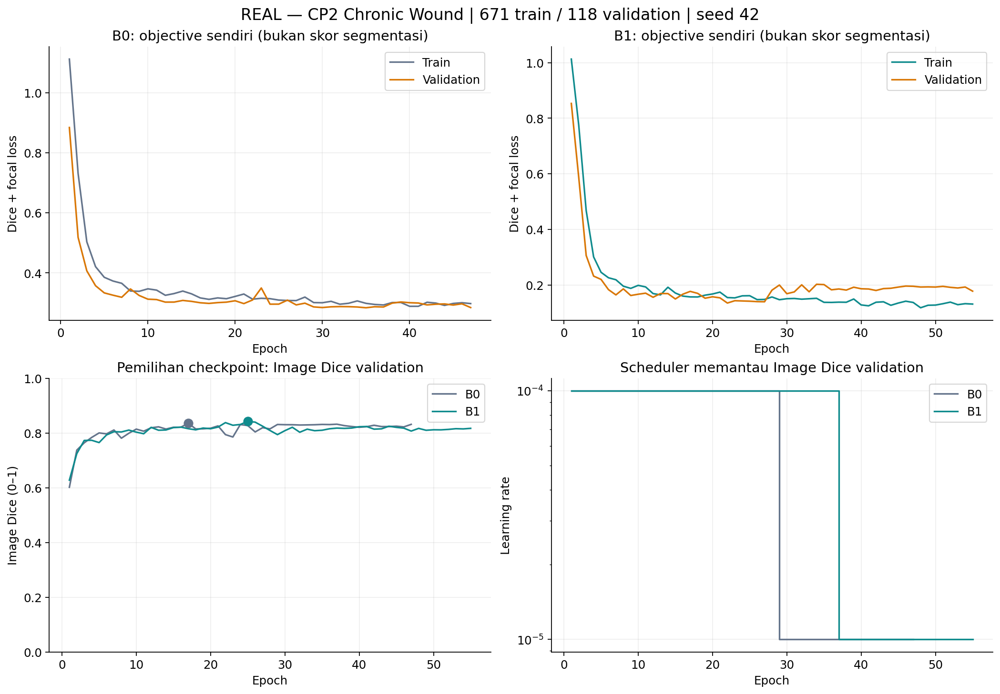
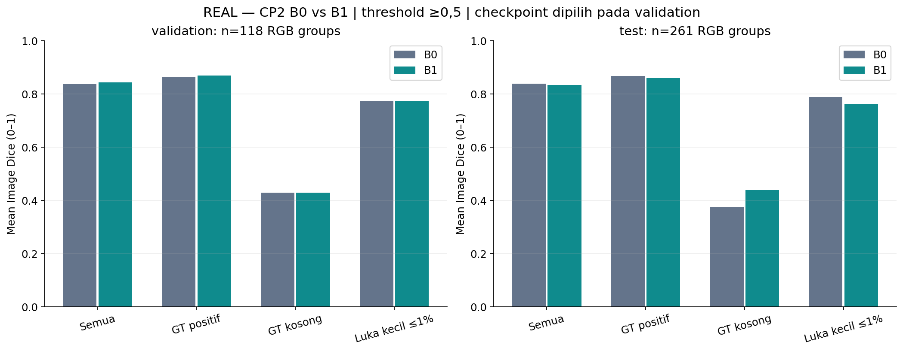

# CP2 — FASE P: audit, smoke test dan baseline B0/B1

**Selesai pada data nyata.** Cakupan berhenti pada dua baseline. Tidak ada fase loss lanjutan, attention, boundary head, atau evaluasi eksternal yang dijalankan.

## Protokol dan data

Manifest `fa9f4914a55806248d25c4a4092361db2658bfc63a0031122b63028202ef8ed5`: **671 train / 118 validation / 261 source-test**. Seluruh 1.109 pasangan foto–mask Chronic Wound diperiksa pada grid 224×224. Ditemukan 30 kelompok RGB duplikat, 28 kelompok berkonflik anotasi, dan 17 kelompok lintas source train–test. Sebanyak 57 baris dalam kelompok berkonflik dikarantina; dua baris duplikat tanpa konflik diringkas menjadi wakil leksikografis. File mentah tetap utuh.

Split seed 42 atas sorted RGB groups, holdout round(15%). Ini **duplicate-group split, bukan patient-level split**. Pemeriksaan near-duplicate memakai RGB-only content crop (menghindari dominasi padding hitam), pHash, MAE dan SSIM; tidak membuktikan tidak adanya crop atau foto pasien berulang. Source-test telah dianalisis dalam CP1 dan tidak dianggap uji konfirmatori yang belum pernah dilihat. Tidak ada dataset eksternal dipakai memilih konfigurasi.

B0 dan B1 memakai FUSegNet–EfficientNet-B7 yang sama, 70.968.939 parameter terdaftar. Keluaran diekspos sebagai logits tanpa mengubah parameter; sigmoid dipakai satu kali untuk probabilitas. **B0** mempertahankan Dice(sigmoid(z)) + focal-with-logits(sigmoid(z)); **B1** memakai Dice(sigmoid(z)) + focal-with-logits(z). Primitive loss berasal dari source terverifikasi: alpha None, gamma 2, Dice epsilon 1, focal epsilon 1e-6, mean reduction, bobot 1+1, agregasi Dice seluruh batch.

Satu berkas bobot awal bersama diverifikasi per tensor, termasuk buffers. Membership, urutan sample dan hash augmented input sama pada seluruh epoch yang sama-sama dijalankan. Adam LR 1e-4/WD 1e-5, batch 2, empat loader workers, augmentasi dan preprocessing source tidak diubah. PyTorch 1.11.0+cu113/torchvision 0.12.0+cu113; float32, tanpa AMP, flag TF32 lama tetap True. Tidak ada upgrade dependency.

Checkpoint = Image Dice validation tertinggi; tie mempertahankan epoch lebih awal. ReduceLROnPlateau memantau Image Dice (max), factor 0,1/patience 10/min LR 1e-5; early stopping 30 epoch tanpa perbaikan, maksimal 200 epoch. Scheduler tidak memantau objective loss yang berbeda antarbaseline. Threshold **>=0,5**, ordinary confusion counts; per-image kedua mask kosong=1, tepat satu kosong=0; aggregate Dice null bila seluruh GT/prediksi kosong. Boundary IoU memakai inner erosion 3×3 dengan zero-padded exterior, radius round(1% diagonal), minimum satu piksel. PFOM menggunakan primitive CP1 dan kebijakan kosong yang sama.

## Hasil terpilih

| Baseline | Epoch dipilih / selesai | Validation Image Dice | Source-test Image Dice | Waktu training (menit) | Peak allocated / reserved (GiB) |
|---|---:|---:|---:|---:|---:|
| B0 | 17 / 47 | 0.8361 | 0.8373 | 75.03 | 2.22 / 2.33 |
| B1 | 25 / 55 | 0.8428 | 0.8329 | 87.91 | 2.22 / 2.33 |

**Yang terlihat:** setiap objective mempunyai kurva train/validation sendiri, sedangkan Dice dan LR dibandingkan pada protokol yang sama. Titik menandai checkpoint yang dipilih.

**Artinya:** koreksi focal dinilai menggunakan prediksi segmentasi, bukan hanya nilai loss yang memang berbeda definisi. Jadwal LR aktual dan penghentian dapat berbeda sebagai konsekuensi kurva validation.

**Perlu diingat:** ini satu seed. Tidak ada pemilihan epoch dari source-test dan tidak ada klaim keunggulan umum dari satu perbandingan.

| Split / subgroup | n | B0 Image Dice | B1 Image Dice | B0 / B1 data Dice | B0 / B1 precision | B0 / B1 recall | B0 / B1 Boundary IoU |
|---|---:|---:|---:|---:|---:|---:|---:|
| validation/all | 118 | 0.8361 | 0.8428 | 0.9025 / 0.9151 | 0.9130 / 0.9199 | 0.8922 / 0.9104 | 0.5224 / 0.5393 |
| validation/gt_positive | 111 | 0.8618 | 0.8689 | 0.9043 / 0.9165 | 0.9166 / 0.9228 | 0.8922 / 0.9104 | 0.5283 / 0.5462 |
| validation/gt_empty | 7 | 0.4286 | 0.4286 | 0.0000 / 0.0000 | 0.0000 / 0.0000 | 0.0000 / 0.0000 | 0.4286 / 0.4286 |
| validation/small | 36 | 0.7714 | 0.7728 | 0.7639 / 0.7610 | 0.6964 / 0.6995 | 0.8458 / 0.8343 | 0.5407 / 0.5479 |
| test/all | 261 | 0.8373 | 0.8329 | 0.9108 / 0.9077 | 0.9410 / 0.9423 | 0.8825 / 0.8756 | 0.5303 / 0.5353 |
| test/gt_positive | 245 | 0.8674 | 0.8587 | 0.9124 / 0.9099 | 0.9444 / 0.9471 | 0.8825 / 0.8756 | 0.5404 / 0.5417 |
| test/gt_empty | 16 | 0.3750 | 0.4375 | 0.0000 / 0.0000 | 0.0000 / 0.0000 | 0.0000 / 0.0000 | 0.3750 / 0.4375 |
| test/small | 67 | 0.7882 | 0.7622 | 0.8243 / 0.8320 | 0.8150 / 0.8495 | 0.8338 / 0.8153 | 0.5514 / 0.5230 |

**Yang terlihat:** semua, GT positif, GT kosong dan luka kecil memakai gambar yang sama untuk B0/B1. Luka kecil berarti luas GT >0 sampai 1% kanvas, bukan ukuran fisik atau kategori C1 penulis.

**Artinya:** perubahan rata-rata perlu dibaca bersama kemampuan menemukan foreground dan false positive pada anotasi kosong. GT kosong bukan diagnosis pasien sehat.

**Perlu diingat:** karantina mengubah populasi. Skor CP1 707/124/278 dan checkpoint policy sumber tidak menjadi pembanding langsung; konfigurasi/evaluator CP2 berbeda.

## Ketahanan kontrol, biaya, dan keterbatasan

Seluruh 47 epoch bersama memiliki hash urutan dan augmented input identik. Checkpoint replay setelah perturbasi parameter menghasilkan prediksi bit-identik pada kedua baseline; split disjoint untuk hash RGB yang diketahui. Normalisasi ImageNet tetap, tidak di-fit dari validation/test. Prediksi satu per gambar diekspor bersama probabilitas float32, mask threshold, GT, per-image confusion counts, subgroup, checksum, dan checkpoint identity.

Training dilakukan **sekuensial dalam satu proses GPU**. GPU bersama masih memuat pekerjaan pengguna lain; waktu/latency bukan benchmark perangkat eksklusif. Peak allocated/reserved adalah allocator proses kita; `train_gpu_samples.jsonl` mencatat pemakaian keseluruhan GPU setiap lima detik (termasuk proses lain). Mulai concurrency berikutnya dengan satu job; lakukan profiling terkontrol sebelum menambah proses. Tidak ada alasan menaikkan batch/AMP hanya untuk mengisi VRAM.

Ketidakpastian bootstrap pada JSON memakai unit RGB-group/image, bukan piksel; tidak mencakup pasien yang tidak diketahui atau variasi retraining antar-seed. Near-duplicate screening tidak menyelesaikan seluruh hubungan crop/pasien. Tidak ada bukti generalisasi eksternal, signifikansi klinis, atau novelty metode dari fase P ini.

Artefak lengkap: `outputs/cp2/phase_p/20261107T170015Z/` (manifest, initial weights, smoke, B0/B1 best/last checkpoints, curves, status, persistent logs, GPU sampling). Bobot CP1 tidak dipakai sebagai inisialisasi train; hanya pretrained ImageNet source yang digunakan. Checkpoints/cache/raw data tetap lokal.

[Hasil machine-readable](cp2-phase-p-results.json) · [Membership](tables/cp2-phase-p-membership.csv) · [Panduan](../docs/cp2-phase-p.md). Fase berikutnya menunggu review B0/B1, lalu konfirmasi beberapa seed sebelum memperluas matriks.

## Interpretasi hasil dan pemeriksaan akhir

**validation:** B1−B0 mean Image Dice = **+0.67 poin persentase**; khusus luka kecil +0.15 poin. GT positif dengan TP=0: B0 0, B1 0. GT kosong dengan prediksi foreground: B0 4/7, B1 4/7.

**test:** B1−B0 mean Image Dice = **-0.44 poin persentase**; khusus luka kecil -2.60 poin. GT positif dengan TP=0: B0 1, B1 4. GT kosong dengan prediksi foreground: B0 10/16, B1 9/16.

Koreksi input focal mempunyai arah/dampak seperti angka di atas pada satu seed dan protokol ini. Hasil tidak menjamin efek yang sama pada seed, split, pasien atau dataset lain. Tidak ada pemilihan threshold maupun checkpoint dari source-test.

| Model | Median epoch (detik) | Mean training step (detik) | Batch-1 inference median / P95 (ms) | Peak pemakaian GPU keseluruhan (MiB) |
|---|---:|---:|---:|---:|
| B0 | 93.78 | 0.260 | 41.19 / 42.87 | 25740 |
| B1 | 94.15 | 0.261 | 39.48 / 41.60 | 25740 |

Validasi akhir memverifikasi **7,001 file CP1/pekerjaan pengguna** tanpa perubahan. Seluruh probabilitas diekspor diperiksa ulang terhadap checksum, GT asli, threshold, confusion counts, region/boundary metrics dan subgroups. Epoch checkpoint sama dengan earliest maximum Image Dice validation. Seluruh common-epoch inputs B0/B1 identik.

Active forward parameters **64.898.248**, registered **70.968.939**; selisih adalah modul source yang tidak dipakai forward. Batch-1 latency memakai satu foto validation yang sama, lima warm-up dan 30 synchronized forward+sigmoid steps, tidak termasuk loading/export. Angka biaya berasal dari GPU bersama dan tidak mengukur kapasitas concurrency eksklusif. Rekomendasi tetap satu job sampai profiling concurrency terkontrol dilakukan.

[QA akhir](cp2-phase-p-validation.json) · [Resources](cp2-phase-p-resources.json). Seluruh kegagalan pemeriksaan awal dan perbaikannya dicatat pada [preflight](cp2-phase-p-preflight.json); tidak ada perubahan objective/config diam-diam selama baseline.

[Review akhir: kondisi awal, metrik tambahan, analisis error dan visual QA](cp2-phase-p-review.md).
