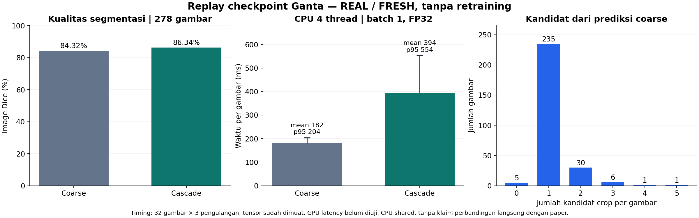

# Replay checkpoint cascade Ganta

Status: **COMPLETED — CHECKPOINT REPLAY AND CPU INFERENCE BENCHMARK**. Tidak ada training, tuning, atau perubahan checkpoint. Run baru: `outputs/partner-cascade/20261117T110234Z`.

## Tujuan dan pelaksanaan

Menguji checkpoint coarse dan refiner milik Ganta pada **seluruh 278 gambar test Chronic Wound** yang digunakan run historis, lalu membandingkan waktu inference dengan pengaturan yang sama. Ini replay protokol historis, bukan eksperimen baru pada split CP2 yang sudah dibersihkan.

Dua model memakai definisi FUSegNet/EfficientNet-B7 dari sumber partner. Hanya kelas, fungsi inference, dan konfigurasi literal yang diaudit dimuat melalui AST. Seluruh perintah training, pengunduhan pretrained weights, pengaturan SSL, dan penulisan folder pada top level sumber dilewati. `pretrained=False` saat konstruksi karena seluruh bobot berasal dari checkpoint; `load_state_dict(strict=True)` lulus untuk kedua model. Model dipindahkan ke `eval()` dan seluruh parameter dibekukan.

- Coarse: **64,898,248 parameter**, checkpoint epoch 41.
- Refiner: **64,898,248 parameter**, checkpoint epoch 27.
- Total cascade: **129,796,496 parameter**.
- Input: RGB 224 × 224, normalisasi ImageNet dari dataset loader partner, batch 1, float32.
- Proposal: probability ≥0,3; komponen 8-connected minimal 4 piksel; maksimal 5 komponen terbesar. Crop diperluas dengan margin 0,5 dan di-resize 224 × 224. Threshold mask akhir ≥0,5.
- Evaluator: confusion counts biasa, mean per gambar dan agregasi seluruh piksel. GT/prediksi sama-sama kosong bernilai 1; GT kosong dengan FP bernilai 0.

## Hasil inference baru

| Model | Image Dice | Data Dice | Image IoU | Data IoU |
| :--- | ---: | ---: | ---: | ---: |
| Coarse | 84.32478% | 92.34748% | 77.65840% | 85.78293% |
| Cascade | 86.33681% | 93.53403% | 80.14522% | 87.85346% |

Tambahan refiner meningkatkan Image Dice **2.01203 percentage points** dan Data Dice **1.18655 points** pada populasi dan checkpoint coarse yang sama. Ini perbandingan inference berpasangan, satu seed historis.

Pada GT positif (n=261), Image Dice coarse 88.2846% → cascade 90.0446%. Pada luka kecil menurut definisi Ganta (**0 < luas mask <1% kanvas**, n=71), Image Dice 82.6107% → 83.6986%. Definisi ini bukan kategori ukuran paper atau kategori CP2.

Pada 17 GT kosong, jumlah gambar dengan false positive coarse 13 → cascade 12. GT positif dengan TP=0: coarse 2 → cascade 2.

## Replay terhadap hasil lama

Hasil historis tersimpan: coarse Image Dice 84,33059% / Data Dice 92,34727%; cascade 86,33924% / 93,53516%. Angka historis dipertahankan; tidak diganti dengan angka replay CPU.

**243/278 mask cascade identik per piksel**. Sisanya berbeda dengan total **44 piksel** dari 13.948.928 piksel evaluasi. Confusion counts coarse cocok pada 231/278 gambar; cascade 243/278. Karena itu replay ini **tidak bitwise-identical**.

Environment replay menggunakan Torch 1.11.0+cu113, NumPy 1.22.4, OpenCV 4.6.0 di CPU. Log asli menggunakan Torch 2.7.1+cu118 di CUDA. Perbedaan environment/perangkat dicatat; penyebab persis setiap piksel berbeda belum diisolasi. Seluruh probability maps finite dan kedua checkpoint dimuat ketat tanpa missing/unexpected weights.

## Kecepatan yang benar-benar diukur

Perangkat: **AMD EPYC 7742 64-Core Processor**, Torch memakai 4 thread, OpenCV 1 thread, batch 1, float32. GPU A100 sedang digunakan pekerjaan lain pada utilisasi 96%, sehingga tidak digunakan untuk eksperimen ini.

32 gambar dipilih dengan indeks berjarak merata dari urutan nama file, sebelum melihat hasil atau waktu. Setiap gambar diukur 3 kali, total 96 pengukuran per metode, setelah 3 warm-up per pipeline. Urutan coarse/cascade diselang-seling. Pengukuran dari tensor ternormalisasi yang sudah dimuat sampai probability map di host; termasuk proposal/crop/refinement/merge pada cascade, tanpa loading gambar, metrik, atau ekspor PNG. Ini shared-CPU timing, bukan pengukuran hardware eksklusif. Pengulangan bukan gambar/subjek independen.

| Model | Mean | Median | p95 | Throughput dari mean |
| :--- | ---: | ---: | ---: | ---: |
| Coarse | 181.68 ms | 179.25 ms | 204.28 ms | 5.50 gambar/s |
| Cascade | 394.35 ms | 361.35 ms | 553.95 ms | 2.54 gambar/s |

Rasio mean cascade/coarse: **2.171×**. Jumlah kandidat pada 278 gambar: {"0": 5, "1": 235, "2": 30, "3": 6, "4": 1, "5": 1}; rata-rata 1.1583 kandidat/gambar. Refiner dipanggil untuk 273 gambar, maksimum 5 kali per gambar. Beban satu gambar sekitar `1 + jumlah kandidat` forward model yang sama besar.

**NOT RUN — GPU BUSY:** latency GPU eksklusif dan peak VRAM inference. Tidak ada perbandingan rasio terhadap paper. Tabel 4 paper melaporkan 33 ms FUSegNet / 175 ms x-FUSegNet pada RTX 2080 Ti; angka CPU dan angka lama evaluasi+ekspor Ganta tidak sebanding langsung dengan pengukuran tersebut.



**Yang terlihat:** pada 278 gambar ini refinement menaikkan skor agregat; pada subset timing yang tetap cascade memerlukan sekitar dua kali waktu CPU coarse. **Artinya:** kemampuan memperbaiki mask disertai tambahan model dan forward per crop. **Perlu diingat:** hasil bukan validasi generalisasi baru, p95 berasal dari 32 gambar berulang pada CPU shared, dan distribusi kandidat memengaruhi latency.

## Integritas dan keterbatasan ilmiah

Checksum SHA256 sebelum/sesudah cocok untuk **839 file**: kode sumber partner, dua checkpoint, dua CSV historis, 278 gambar, 278 mask, serta 278 PNG historis. Tidak ada output ditulis ke folder partner. Artefak CP1/CP2 dan notebook lama tidak dijalankan ulang.

Audit sebelumnya menemukan 12 RGB test identik dengan train dan 5 kelompok RGB melintasi train–validation pada split partner. Checkpoint ini tetap membawa protokol historis tersebut. Validasi refiner historis memakai crop dari bbox GT, berbeda dari proposal prediksi saat test. Hasil test sudah digunakan untuk eksplorasi beberapa metode. Paper menyebut 200 test, sementara source lokal berisi 278. Karena itu skor numerik tinggi belum membuktikan peningkatan terkontrol atas paper atau baseline CP2.

## Reproduksi

Jalankan dari root repository dengan environment training yang sudah ada. Gunakan nama output baru setiap eksekusi; runner menolak menimpa direktori yang sudah ada.

```bash
.venv-training/bin/python -u scripts/test_partner_cascade.py \
  --partner-root ../ganta \
  --output outputs/partner-cascade/NEW_RUN_ID \
  --threads 4 --timing-images 32 --timing-repeats 3 --warmup 3
```

Smoke test: tambahkan `--limit 3 --timing-images 2 --timing-repeats 1 --warmup 1`. Tidak perlu instalasi/upgrade dependency. Bukti mentah: `protocol.json`, `input_inventory.json`, `coarse_per_image.csv`, `cascade_per_image.csv`, `replay_comparison.csv`, `paired_timing.csv`, `result.json`, dan log persisten run.

Hasil ringkas: [JSON](ganta-cascade-replay.json), [tabel metrik](tables/ganta-cascade-replay-metrics.csv). Source runner/helper dan tests disertakan di repository kerja. Checkpoint dan data mentah tetap lokal.

## Pemeriksaan akhir

Seluruh **165 tests lulus** (29 dependency deprecation warnings, tanpa error). Pemeriksaan dependency environment training dan xfuseg tidak menemukan broken requirements. Jumlah prediksi, nama unik, confusion counts, dan metrik CSV/JSON cocok. Hash kode saat pelaksanaan masih cocok dengan kode akhir; 839 input partner kembali diverifikasi tidak berubah. Grafik diperiksa secara visual. Detail: [validation JSON](ganta-cascade-replay-validation.json). GPU inference dan VRAM belum diukur.
